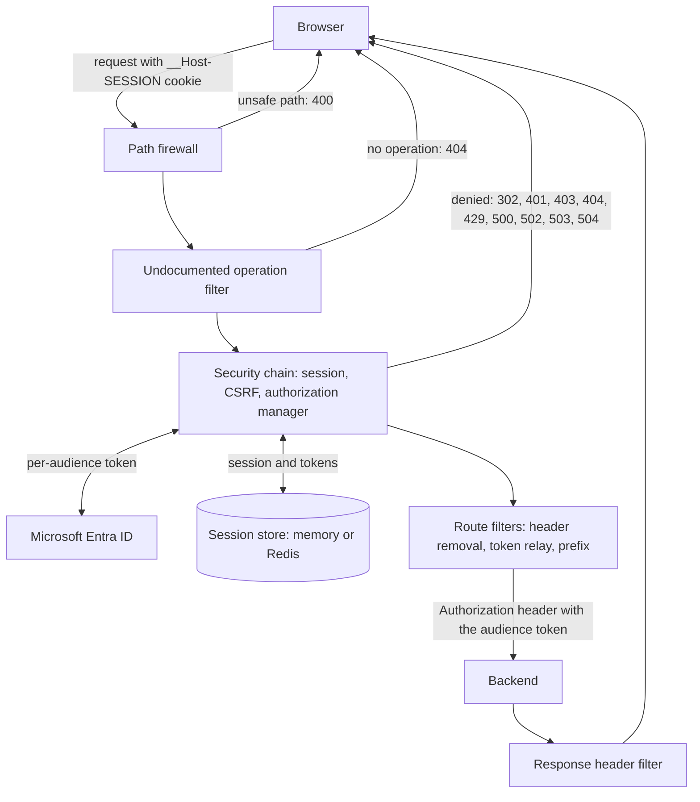
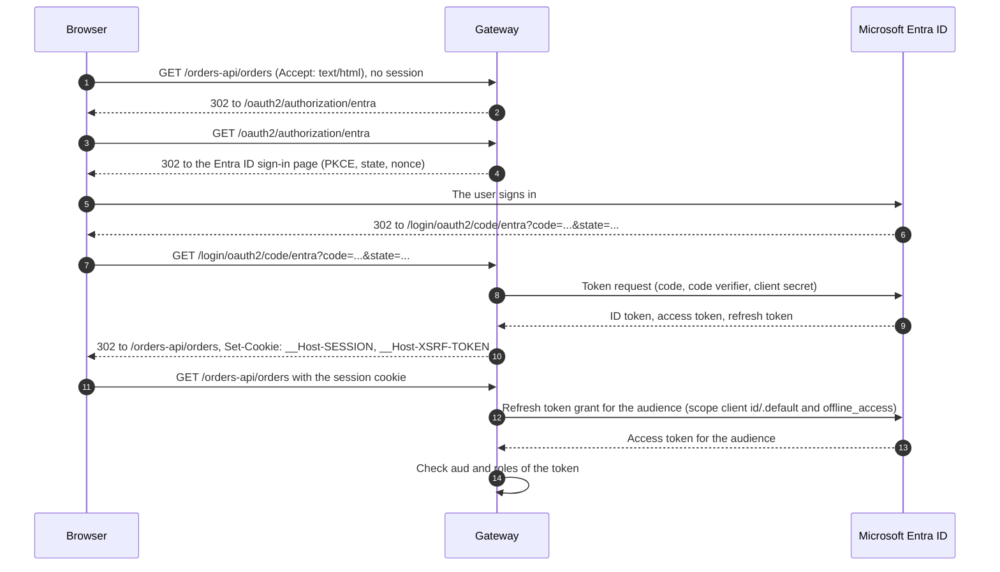

# Concepts

This page explains how oas-spring-boot-gateway works and defines the terms that the other pages use. Read it before you write an OpenAPI Specification (OAS) file or operate the gateway. Each term in the [glossary](#glossary) has one meaning in all pages.

## What the gateway does

oas-spring-boot-gateway is a non-blocking API gateway for browser applications. It is a Spring Boot 4.1.2 application with Spring Cloud Gateway Server WebFlux, and it runs on Java 25.

The gateway does four things:

1. It creates its routes from OAS files. Each route sends requests to one backend.
2. It signs in users with Microsoft Entra ID. The browser gets only a session cookie. The tokens stay in the gateway. This pattern is called Backend for Frontend (BFF).
3. It checks the access rule of each operation before it sends a request to a backend.
4. It sends an access token for the backend (the audience) with each request to a protected operation.

The gateway exposes only the operations of the OAS files. Every other path or method gets `404`, also for a client without a session.

## Modules

The project is a Maven multi-module build.

| Module | Purpose |
|---|---|
| `openapi-gateway-core` | Reads and validates OAS files. Contains the rules, the route model, the access rules, and the path trie. It has no Spring dependency. |
| `openapi-gateway-cli` | The command-line tool (CLI) `oas-gateway-validate`. It validates OAS files in pull requests. See [CLI reference](cli.md). |
| `gateway` | The Spring Cloud Gateway application. It uses `openapi-gateway-core` to create its routes at startup. |

## Request flow

This diagram shows one request from the browser to a backend.

The steps:

1. The path firewall rejects a path that a backend can read in a different way, for example `/a/%2e%2e/b` or `/a;x=1`. The response is `400` without a body.
2. The undocumented operation filter looks for the operation of the method and the path. If no operation matches, the response is `404`. The filter does not read the session.
3. The security chain reads the session and checks the Cross-Site Request Forgery (CSRF) token.
4. The authorization manager applies the access rule of the operation. For a protected operation, it gets the access token of the audience from the session or from Entra ID. It checks the `aud` claim and the `roles` claim of the token.
5. The route filters remove the `Cookie` header, the `Authorization` header of the client, and the identity headers that a client can fake, for example `X-User`. The token relay adds `Authorization: Bearer` with the audience token.
6. The gateway removes the prefix, adds the upstream base path, and sends the request to the backend. The body streams. The gateway does not buffer it.
7. The response header filter removes the cookies and the browser policies of the backend response. Then the gateway sends the response to the browser.

[Security model](security-model.md) explains each step in detail.

## Login flow

A user signs in when the browser navigates to a protected operation without a session.

A request without a session that is not an HTML navigation gets `401`, not a redirect. A single-page application (SPA) then starts the login itself.

## Validation in two places

The CLI and the gateway run the same contract rules on the OAS files.

| Where | Rules | Effect of an error |
|---|---|---|
| CLI in a pull request | Contract rules and best-practice rules | The check of the pull request fails. |
| Gateway at startup | Contract rules only | The gateway does not start. |

An OAS file that passes the CLI therefore does not stop the gateway, with two exceptions. The CLI accepts both cases, but the gateway does not start:

- A `$ref` to another file. See [Use only local references](writing-routes.md#use-only-local-references).
- An `x-gateway.audience` that is the client id of `gateway-bff`. The CLI does not know this client id. The gateway checks it at startup.

See [CLI reference](cli.md) and [CI and change control](ci-change-control.md).

## Glossary

| Term | Definition |
|---|---|
| Access rule | The authorization requirement of one operation: public, or an audience with `all-of` and `any-of` permission lists. The gateway compiles it from the OAS file at startup. |
| App Role | A role that a Microsoft Entra ID app registration defines. Entra ID puts the App Roles of the user in the `roles` claim of the access token. |
| Audience | The backend app that a token is for. Its value is the client id (GUID) of the backend app registration, in `x-gateway.audience`. |
| Audience binding | The pair of `x-gateway.audience` and `x-gateway.upstream` of one OAS file. The gateway sends the token of the audience to that upstream. |
| Backend | The service that receives the requests of a route. Its address is the `upstream` of the OAS file. |
| Backend app registration | The Entra ID app registration of one backend. It defines the App Roles of that backend. |
| Backend for Frontend (BFF) | A pattern in which the server keeps the tokens, and the browser gets only a session cookie. |
| Baseline | A JSON file with known violations of best-practice rules. The CLI does not report them. See [CLI reference](cli.md#accept-known-violations-with-a-baseline). |
| Best-practice rule | A rule about API quality, for example naming or documentation. Only the CLI runs it. You can configure its severity. |
| Contract rule | A rule that protects the gateway, for example a valid `x-gateway` object. It is always an error. You cannot configure or suppress it. The CLI and the gateway run it. |
| Deviation | An `x-deviation` entry on an operation. It accepts a violation of one best-practice rule, with a reason. |
| `gateway-bff` | The Entra ID app registration of the gateway. The gateway signs in users with it and gets tokens with it. |
| OAS file | One OpenAPI Specification document (YAML or JSON) that describes one backend API and its `x-gateway` extensions. |
| Operation | One HTTP method on one path of an OAS file, for example `GET /orders/{id}`. |
| Per-audience token | An access token that the gateway gets from Entra ID for one audience. Its `aud` claim is the client id of the backend app. |
| Permission | The value of one App Role of an audience, for example `Orders.Read`. Access rules list permissions. |
| Prefix | The `x-gateway.prefix` of an OAS file, for example `/orders-api`. The gateway adds it before each path of the file and removes it before it calls the backend. |
| Profile | A set of severities for the best-practice rules: `recommended` (the default) or `strict`. |
| Protected operation | An operation that is not public. It needs a signed-in user and an access rule. |
| Public operation | An operation with `security: []` on the operation. It needs no session and no permission. |
| Public path | The path that a client calls: the prefix and the OAS path, for example `/orders-api/orders/{id}`. |
| Route | The gateway entry that sends matching requests to a backend. The gateway creates one route for each path of an OAS file. If the operations of a path have different response timeouts, it creates one route for each operation. |
| Session | The server-side state of one browser. It holds the security context and the tokens of the user. The `__Host-SESSION` cookie holds its id. |
| Session store | Where the gateway keeps the sessions: the memory of each instance (default), or Redis. |
| Upstream | The `x-gateway.upstream` of an OAS file: the address of the backend, `scheme://host[:port]`. |
| Upstream base path | The `x-gateway.upstream-base-path` of an OAS file, for example `/v1`. The gateway adds it before the OAS path when it calls the backend. |
| Violation | One problem that a rule finds: severity, rule id, file, JSON pointer, and message. |

## Features that are not supported

| Feature | Status | Source |
|---|---|---|
| Route reload without a restart | Not supported. Spec 014 describes it as optional. | [014](../specs/014-route-reload.md) |
| Service-to-service calls with a bearer token | Not supported. Spec 026 is proposed and deferred. | [026](../specs/026-service-to-service-bearer.md) |
| Permission catalog (a list of audiences and App Roles) | Removed on 2026-11-13. | [Removal of the permission catalog](../specs/README.md#removal-of-the-permission-catalog-2026-11-13) |
| Cross-Origin Resource Sharing (CORS) | Not supported. The gateway removes the CORS headers of each backend response. | [025](../specs/025-token-relay-and-header-hygiene.md) |
