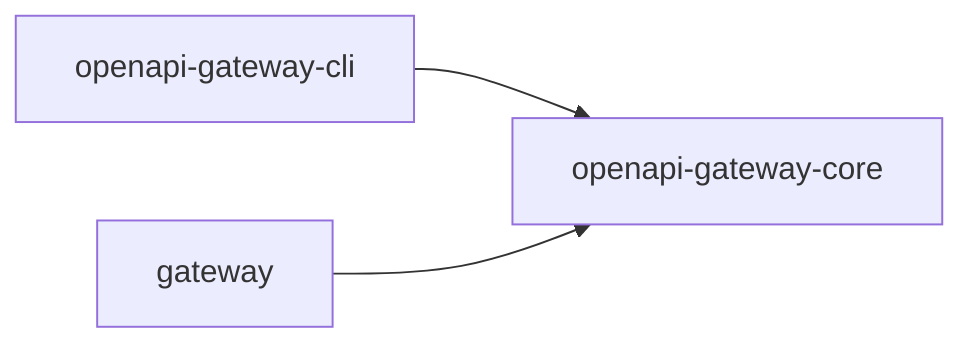

# 001 — Project skeleton

| Field | Value |
|---|---|
| Status | Implemented |
| Phase | 1 — Foundation |
| Depends on | None |
| Modules | parent `pom.xml`, `openapi-gateway-core`, `openapi-gateway-cli`, `gateway` |

## Summary

This spec creates the Maven multi-module project. The project starts from a Spring Initializr project and contains a parent `pom.xml`, three modules, the Maven wrapper, central dependency management, an `.editorconfig` file, and a build workflow. The `gateway` module contains a minimal Spring Boot application and one test. The `openapi-gateway-core` and `openapi-gateway-cli` modules contain only a `package-info.java` file. All other specs add code to this structure. A fixed structure and one place for versions keep the modules consistent and make each later PR small.

## Motivation

Before this spec, the repository contained only `README.md` and `assets/icon.svg`. Each later spec needs a module to put code in and a build that runs its tests. Without central dependency management, each module can choose different library versions. Without a build workflow, a PR can break the build and nobody sees it before the merge.

## Scope

### In scope

- Bootstrap of the project with the Spring Initializr (`start.spring.io`).
- Parent `pom.xml` with the module list, Java version, encoding, dependency management, and plugin management.
- Module `openapi-gateway-core` (library jar with only `package-info.java`).
- Module `openapi-gateway-cli` (jar with only `package-info.java`; depends on `openapi-gateway-core`).
- Module `gateway` (executable jar; depends on `openapi-gateway-core` and `spring-cloud-starter-gateway-server-webflux`). It contains the generated `GatewayApplication` class and the `contextLoads` test.
- Maven wrapper (`mvnw`, `mvnw.cmd`, `.mvn/wrapper/maven-wrapper.properties`).
- `.editorconfig`, `.gitattributes`, and `.gitignore`.
- Build workflow `.github/workflows/build.yml` that runs `./mvnw -B verify` on every PR and on each push to `main`.

### Out of scope

- The actuator, the native transport, the test route, and the classpath tests of the gateway. See [002](002-gateway-bootstrap.md).
- Library dependencies of the core, for example swagger-parser. See [004](004-oas-loading.md).
- The picocli command and the shaded jar. See [008](008-cli-basic.md).
- The OAS validation workflow `.github/workflows/openapi.yml`. See [011](011-pr-validation-pipeline.md).

## Design

### Bootstrap with the Spring Initializr

The project starts from a Maven project that the Spring Initializr API generates. This command reproduces the generated project:

```bash
curl https://start.spring.io/starter.zip \
  -d type=maven-project \
  -d language=java \
  -d bootVersion=4.1.2 \
  -d javaVersion=25 \
  -d groupId=com.johnowl.gateway \
  -d artifactId=gateway \
  -d name=gateway \
  -d "description=Non-blocking API gateway driven by OpenAPI files" \
  -d packageName=com.johnowl.gateway \
  -d packaging=jar \
  -d dependencies=cloud-gateway-reactive \
  -o gateway.zip
```

The project uses these parts of the generated project:

| Generated part | Use in the project |
|---|---|
| `mvnw`, `mvnw.cmd`, `.mvn/wrapper/maven-wrapper.properties` | Repository root, without changes. |
| `.gitattributes` | Repository root, without changes. |
| `.gitignore` | Repository root, without the `HELP.md` line. |
| `GatewayApplication.java` | Module `gateway`, package `com.johnowl.gateway`. |
| `GatewayApplicationTests.java` (`contextLoads` test) | Module `gateway`, package `com.johnowl.gateway`. |
| `application.properties` (`spring.application.name=gateway`) | Module `gateway`, converted to `application.yaml` with the same property, because the other specs use YAML. |
| `HELP.md` | Not used. |
| `pom.xml` | Not used. The parent and module `pom.xml` files replace it. See [Parent POM](#parent-pom). |

The generated Java and XML files use tabs. The project converts the tabs to 4 spaces to match `.editorconfig`.

### Repository layout

```text
oas-spring-boot-gateway/
├── .editorconfig
├── .gitattributes
├── .gitignore
├── .github/workflows/build.yml
├── .mvn/wrapper/maven-wrapper.properties
├── mvnw
├── mvnw.cmd
├── pom.xml                       parent, packaging pom
├── openapi-gateway-core/
│   ├── pom.xml
│   └── src/main/java/com/johnowl/gateway/core/package-info.java
├── openapi-gateway-cli/
│   ├── pom.xml
│   └── src/main/java/com/johnowl/gateway/cli/package-info.java
└── gateway/
    ├── pom.xml
    └── src/
        ├── main/java/com/johnowl/gateway/GatewayApplication.java
        ├── main/resources/application.yaml
        └── test/java/com/johnowl/gateway/GatewayApplicationTests.java
```

The `package-info.java` files fix the base packages `com.johnowl.gateway.core` and `com.johnowl.gateway.cli`. They also make sure that the jars of the two modules are not empty.

### Module dependencies



| Module | Packaging | Purpose | Dependency rule |
|---|---|---|---|
| `openapi-gateway-core` | `jar` | OAS parsing, validation engine, rules, route model, access rules, path trie. | MUST NOT depend on Spring Cloud Gateway, Spring WebFlux, or Spring Boot. |
| `openapi-gateway-cli` | `jar` | Command-line validator `oas-gateway-validate.jar`. | MUST NOT be a Spring application. |
| `gateway` | `jar` (executable) | Spring Cloud Gateway Server WebFlux application. | MUST NOT depend on `spring-boot-starter-web`. |

The `gateway` module has these dependencies:

| Dependency | Scope |
|---|---|
| `com.johnowl.gateway:openapi-gateway-core` | compile |
| `org.springframework.cloud:spring-cloud-starter-gateway-server-webflux` | compile |
| `org.springframework.boot:spring-boot-starter-test` | test |
| `io.projectreactor:reactor-test` | test |

The `gateway` dependency tree contains `tomcat-embed-el`. The gateway starter brings it through `spring-boot-starter-validation`. This artifact is the Expression Language implementation for Bean Validation. It is not a servlet container, and it is expected.

### Parent POM

The parent `pom.xml` contains:

- `groupId`: `com.johnowl.gateway`. This value is also the base Java package of all modules.
- `artifactId`: `oas-spring-boot-gateway-parent`. Packaging: `pom`.
- `<modules>` in this order: `openapi-gateway-core`, `openapi-gateway-cli`, `gateway`.
- Properties: `java.version`, `maven.compiler.release`, `project.build.sourceEncoding=UTF-8`, `project.reporting.outputEncoding=UTF-8`, `spring-boot.version`, `spring-cloud.version`, and one version property for each managed plugin.
- `<dependencyManagement>` that imports two bills of materials (BOMs): `org.springframework.boot:spring-boot-dependencies` and `org.springframework.cloud:spring-cloud-dependencies`.
- A managed version for `openapi-gateway-core` (`${project.version}`), so that other modules do not repeat the version.
- `<pluginManagement>` with fixed plugin versions. See [Plugin versions](#plugin-versions).

The parent imports the Spring Boot BOM. It does not use `spring-boot-starter-parent` as its parent. Reason: the core and the CLI are not Spring Boot applications, and an imported BOM only manages versions.

Example of the dependency management section:

```xml
<dependencyManagement>
    <dependencies>
        <dependency>
            <groupId>org.springframework.boot</groupId>
            <artifactId>spring-boot-dependencies</artifactId>
            <version>${spring-boot.version}</version>
            <type>pom</type>
            <scope>import</scope>
        </dependency>
        <dependency>
            <groupId>org.springframework.cloud</groupId>
            <artifactId>spring-cloud-dependencies</artifactId>
            <version>${spring-cloud.version}</version>
            <type>pom</type>
            <scope>import</scope>
        </dependency>
    </dependencies>
</dependencyManagement>
```

### Plugin versions

An imported BOM manages dependency versions only. It does not bring `<pluginManagement>`. For this reason, the parent repeats the plugin versions of `spring-boot-dependencies` 4.1.2:

| Plugin | Version |
|---|---|
| `maven-clean-plugin` | 3.5.0 |
| `maven-compiler-plugin` | 3.15.0 |
| `maven-deploy-plugin` | 3.1.4 |
| `maven-failsafe-plugin` | 3.5.6 |
| `maven-install-plugin` | 3.1.4 |
| `maven-jar-plugin` | 3.5.1 |
| `maven-resources-plugin` | 3.5.0 |
| `maven-surefire-plugin` | 3.5.6 |
| `spring-boot-maven-plugin` | `${spring-boot.version}` |

The project also reproduces two settings of `spring-boot-starter-parent`:

| Setting | Location | Reason |
|---|---|---|
| `maven-compiler-plugin` with `<parameters>true</parameters>` | Parent `pom.xml`, `<pluginManagement>` | Keeps method parameter names for Spring. |
| `spring-boot-maven-plugin` with the `repackage` execution | `gateway/pom.xml` | Builds the executable jar. |

When the Spring Boot version changes, the plugin versions MUST be updated from the `spring-boot-dependencies` pom of the new Spring Boot version.

### Versions

Decision (2026-11-10): the project uses these versions. The Spring Initializr chose Spring Cloud 2025.1.4 for Spring Boot 4.1.2.

| Item | Version | Notes |
|---|---|---|
| Java | 25 | The current Java Long-Term Support (LTS) release. |
| Spring Boot | 4.1.2 | Spring Boot 4 uses Spring Framework 7 and Spring Security 7. |
| Spring Cloud | 2025.1.4 "Oakwood" | 2025.1.2 is the first Oakwood release that supports Spring Boot 4.1. |
| Spring Cloud Gateway (`spring-cloud-starter-gateway-server-webflux`) | 5.0.4 | Managed by the Spring Cloud BOM. |
| Spring Framework (`spring-webflux`) | 7.0.10 | Managed by the Spring Boot BOM. |
| Reactor Netty (`reactor-netty-http`) | 1.3.8 | Managed by the Spring Boot BOM. |
| Maven | 3.10.0 | Maven wrapper 3.3.4, `distributionType=only-script`. |

The parent `pom.xml` MUST set `java.version` to `25`. It MUST set `spring-boot.version` to 4.1.2 or a later 4.1.x release. It MUST set `spring-cloud.version` to 2025.1.4 or a later 2025.1.x release.

The upgrade to Spring Cloud 2026.0 "Paddington" with Spring Boot 4.2 is out of scope until that release train is generally available.

### `.editorconfig`

The `[*.cmd]` section matches the `*.cmd text eol=crlf` rule in `.gitattributes`.

```ini
root = true

[*]
charset = utf-8
end_of_line = lf
insert_final_newline = true
trim_trailing_whitespace = true
indent_style = space
indent_size = 4

[*.{yml,yaml,json}]
indent_size = 2

[*.md]
trim_trailing_whitespace = false

[*.cmd]
end_of_line = crlf
```

### Build workflow

`.github/workflows/build.yml` runs on each pull request and on each push to `main`. The push trigger verifies `main` after each merge. The workflow uses the latest major versions of the actions on 2026-11-11 and the Eclipse Temurin JDK.

```yaml
name: build

on:
  pull_request:
  push:
    branches: [main]

jobs:
  verify:
    runs-on: ubuntu-latest
    steps:
      - uses: actions/checkout@v7
      - uses: actions/setup-java@v6
        with:
          distribution: temurin
          java-version: 25
          cache: maven
      - run: ./mvnw -B verify
```

## Acceptance criteria

- [x] `./mvnw -B verify` succeeds on a clean clone.
- [x] `./mvnw -B verify` runs the test `GatewayApplicationTests.contextLoads`, and the test passes.
- [x] The parent `pom.xml` lists exactly the modules `openapi-gateway-core`, `openapi-gateway-cli`, and `gateway`.
- [x] No module `pom.xml` declares a version for a dependency that a BOM manages.
- [x] `./mvnw -B -pl openapi-gateway-core dependency:tree` lists no artifact with group id `org.springframework.cloud` and no `spring-webflux` artifact.
- [x] `./mvnw -B -pl gateway dependency:tree` lists no `spring-boot-starter-web` artifact and no `tomcat-embed-core` artifact.
- [x] `.github/workflows/build.yml` runs `./mvnw -B verify` on a pull request and on a push to `main`.
- [ ] The `verify` job of `.github/workflows/build.yml` fails when the build fails.
- [x] `.editorconfig` exists at the repository root with the content in this spec.
- [x] The parent `pom.xml` sets `java.version` to `25`.
- [x] The parent `pom.xml` sets `spring-boot.version` to 4.1.2 or a later 4.1.x release and `spring-cloud.version` to 2025.1.4 or a later 2025.1.x release.
- [x] `.github/workflows/build.yml` uses `distribution: temurin` and `java-version: 25`.
- [x] The `groupId` of the parent `pom.xml` is `com.johnowl.gateway`.

## Test plan

- Build test: run `./mvnw -B verify` locally and in the build workflow. The build runs the `contextLoads` test of the `gateway` module.
- Dependency check: run `dependency:tree` for `openapi-gateway-core` and `gateway` and check the excluded artifacts. The `tomcat-embed-el` artifact in the `gateway` tree is expected.
- Workflow test: this test runs in the PR of this spec, because the workflow runs only on GitHub. Push a commit with a failing test to the PR and check that the `verify` job fails. Remove the failing test before the merge.

## Delivery

One PR. Main files: `pom.xml`, three module `pom.xml` files, `GatewayApplication.java`, `GatewayApplicationTests.java`, `application.yaml`, two `package-info.java` files, Maven wrapper files, `.editorconfig`, `.gitattributes`, `.gitignore`, and `.github/workflows/build.yml`. Estimate: fewer than 250 changed lines without the generated wrapper files.

## Open questions

None.

## References

- [Specs index](README.md)
- [002 — Gateway bootstrap](002-gateway-bootstrap.md)
- [004 — OAS loading](004-oas-loading.md)
- Spring Initializr: https://start.spring.io
- Spring Cloud release train and Spring Boot compatibility: https://spring.io/projects/spring-cloud
- Spring Cloud 2025.1.2 (Oakwood) release announcement: https://spring.io/blog/2026/06/11/spring-cloud-2025-1-2-aka-oakwood-has-been-released/
- Spring Cloud supported versions: https://github.com/spring-cloud/spring-cloud-release/wiki/Supported-Versions
- EditorConfig: https://editorconfig.org
