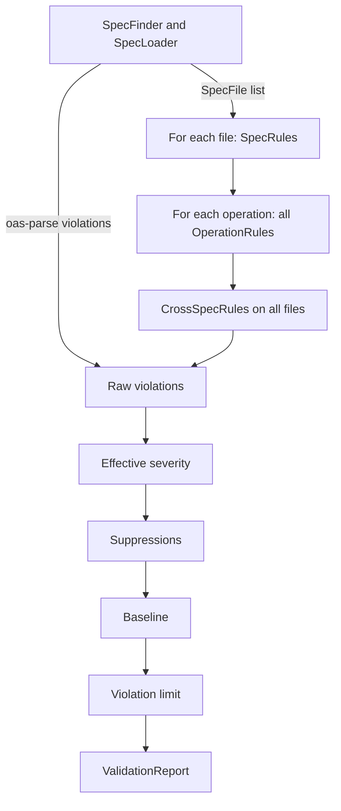

# 005 — Validation engine

| Field | Value |
|---|---|
| Status | Implemented |
| Phase | 2 — OAS core |
| Depends on | [004](004-oas-loading.md) |
| Modules | `openapi-gateway-core` |

## Summary

This spec adds the validation engine to `openapi-gateway-core`, and a fixture test harness for rules. The engine loads OAS files, traverses each file once, calls each rule, and collects violations in a `ValidationReport`. Rules only report problems. The engine decides the final severity and applies suppressions and the baseline. The caller selects the rule set. The gateway runs only the `CONTRACT` rules at startup. The CLI runs the `CONTRACT` rules and the best-practice rules in pull requests. A file that passes the CLI therefore cannot break the gateway.

## Motivation

Many later specs add rules: [006](006-x-gateway-extension.md), [007](007-route-model.md), [018](018-authorization-extension.md), and [029](029-naming-rules.md) to [031](031-documentation-rules.md). Without a common engine, each rule would traverse the files, handle severity, and handle suppressions in its own way. The result would be slow, inconsistent, and hard to test. A common fixture harness gives each rule the same kind of tests with little code.

## Scope

### In scope

- Types: `Severity`, `Category`, `RuleMeta`, `Rule`, `SpecRule`, `OperationRule`, `CrossSpecRule`, the rule contexts, `Violation`, `ValidationReport`.
- `ValidationEngine` with one traversal for each OAS file.
- Extension points for configured severity, suppressions, and baseline, with default implementations that change nothing.
- The `oas-parse` rule metadata, so that parse violations from [004](004-oas-loading.md) appear in the report.
- The rule sets `BuiltInRules.all()` (CLI) and `BuiltInRules.contract()` (gateway).
- The fixture test harness and the meta-test.

### Out of scope

- The configuration file `.oas-gateway.yaml` and profiles. See [027](027-rule-configuration.md).
- `x-deviation` and the baseline file. See [028](028-suppressions-and-baseline.md).
- Concrete rules other than `oas-parse`. See the specs listed in "Motivation".
- Route building. The `routes` field of `ValidationReport` is filled in [007](007-route-model.md).
- Rules from other teams with `ServiceLoader<Rule>`. This is a possible future extension.

## Design

Package: `com.johnowl.gateway.core.validation`.

### Core types

```java
public enum Severity { INFO, WARN, ERROR }      // ordered from low to high

public enum Category { CONTRACT, NAMING, DOCUMENTATION, ERRORS, SECURITY, DESIGN }

public record RuleMeta(
        String id,                 // kebab-case, unique, for example "x-gateway-schema"
        Category category,
        Severity defaultSeverity,
        boolean configurable,      // always false for CONTRACT
        String description,
        String rationale) { }

public record Violation(Severity severity, String ruleId, String file, String pointer, String message) { }
```

`RuleMeta` MUST reject an instance with category `CONTRACT` and `configurable=true`. It MUST also reject an instance with category `CONTRACT` and a default severity other than `ERROR`.

A rule of another category MAY set `configurable=false`. The engine then ignores the policy results for that rule, as for a `CONTRACT` rule, but the rule is not in `BuiltInRules.contract()`. Example: `deviation-schema` ([028](028-suppressions-and-baseline.md)).

### Rule interfaces

```java
public sealed interface Rule permits SpecRule, OperationRule, CrossSpecRule {
    RuleMeta meta();
}

public non-sealed interface SpecRule extends Rule {
    void check(SpecContext context, Reporter reporter);
}

public non-sealed interface OperationRule extends Rule {
    void check(OperationContext context, Reporter reporter);
}

public non-sealed interface CrossSpecRule extends Rule {
    void check(List<SpecContext> specs, Reporter.ForFile reporter);
}

public interface Reporter {
    void report(String pointer, String message);

    interface ForFile {                                  // for CrossSpecRule
        void report(String file, String pointer, String message);
    }
}
```

A `CrossSpecRule` finds problems in several files, so its reporter takes the file of each problem. The file is usually the `file()` of one of the `SpecContext` values. Since [019](019-permission-catalog.md), it can also be a file that is not an OAS file. Then the suppression policy does not apply. The permission catalog was the only such file. It is removed (decision of 2026-11-13), so no built-in rule reports on a file that is not an OAS file.

| Type | Exposes |
|---|---|
| `SpecContext` | `SpecFile spec()`, `String file()`. The pointer of the document root is the empty string. |
| `OperationContext` | `SpecContext spec()`, `String path()` (for example `/users/{id}`), `PathItem.HttpMethod method()`, `Operation operation()`, `PathItem pathItem()`, `String pointer()`. |
| `JsonPointers` | `escape(String token)`: escapes one RFC 6901 reference token. |

The operation pointer follows RFC 6901. The character `/` becomes `~1` and the character `~` becomes `~0`. Example: `GET /users/{id}` has the pointer `/paths/~1users~1{id}/get`.

A rule reports a pointer and a message. A rule MUST NOT choose the severity. The engine adds the rule id, the file, and the severity.

### Engine flow



1. Load all files with [004](004-oas-loading.md). Files with an `oas-parse` violation do not go to the rules.
2. For each `SpecFile`, call each `SpecRule` once.
3. For each operation of the file, call each `OperationRule` once. The engine builds each `OperationContext` once. The engine reads the operations from the model (`PathItem.readOperationsMap()`), and many rules read the raw tree. Both must have the same operations. swagger-parser can drop operations of a path item with `$ref`, so the engine would visit none of them. The loader therefore rejects every path item `$ref` with `oas-parse`, and also rejects a path whose HTTP methods differ between the raw tree and the model ([004](004-oas-loading.md), "Path item references" and "Operations of the model", findings SEC-66-1 and SEC-67-1). `GatewayRouteBuilder` and `AccessRuleCompiler` throw `IllegalStateException` for a path item that is still a `$ref` in the model, so that the gateway does not start even if a caller skips the loader check.
4. Call each `CrossSpecRule` once with all files.
5. Apply the steps 5a–5c to the raw violations, in this order:
   a. `SeverityPolicy` sets the effective severity. The default returns `RuleMeta.defaultSeverity()`. A policy can turn a configurable rule off for a file. A rule that is off does not run for that file.
   b. `SuppressionPolicy` removes suppressed violations. The default suppresses nothing.
   c. `BaselinePolicy` removes known violations. The default removes nothing.
6. Sort the violations by file, pointer, rule id, and message.
7. Apply the violation limit (see "Violation limit"), and return a `ValidationReport`.

```java
public interface SeverityPolicy {
    Optional<Severity> severity(RuleMeta rule, String file);   // empty: the rule is off for this file
    default List<Rule> configure(List<Rule> rules);           // rules with options (027); default: unchanged
    static SeverityPolicy defaults();
}

public interface SuppressionPolicy {
    boolean isSuppressed(Violation violation, SpecFile spec);  // spec: to read x-deviation (028)
    static SuppressionPolicy none();
}

public interface BaselinePolicy {
    boolean isKnown(Violation violation);
    static BaselinePolicy empty();
}
```

The engine calls `SeverityPolicy.configure` once, in its constructor, and runs the rules that it returns. The rule configuration of [027](027-rule-configuration.md) uses it to give rule options to the rules. `configure` gets all rules, but it MUST return each rule with `configurable=false` unchanged (finding QA-65-3 of [030](030-design-rules.md)).

The policies take the file because [027](027-rule-configuration.md) can exclude files from a rule, and [028](028-suppressions-and-baseline.md) reads `x-deviation` from the document.

The engine MUST NOT call any of the three policies for a rule with `configurable=false`. This includes each `CONTRACT` rule. A `CONTRACT` violation therefore always stays `ERROR` and always stays in the report. This matches [028](028-suppressions-and-baseline.md): no deviation and no baseline entry can cover a CONTRACT violation.

`oas-parse` violations from the loader also skip the policies.

A rule that throws an exception MUST NOT stop the engine. The engine reports an `ERROR` violation with the rule id of the failing rule and the message `Rule failed: <exception message>`. If the exception has no message, the engine uses the simple class name, for example `Rule failed: NullPointerException`. The engine catches every `Exception`, and also `StackOverflowError` (for example on a deep schema), `LinkageError`, and `AssertionError`. This violation skips the policies, because it shows a bug in the rule. The pointer is the operation pointer for an `OperationRule`, and empty for the other kinds. The file is empty for a `CrossSpecRule`. Violations that the rule reported before the exception stay in the report.

### Violation limit

One value in a file can produce many violations. For example, a shared response with a long media type name gives one violation for each operation that uses the response. The report therefore shows at most 100 violations of each rule in each file (`ValidationEngine.VIOLATION_LIMIT`). These are the first 100 in the sort order of step 6.

If a rule has more violations in a file, the engine adds one more violation of the same rule in the same file:

- Pointer: empty (the document root). The violation therefore comes first among the violations of the file.
- Severity: the highest severity of the violations that the report does not show. An `ERROR` therefore still stops the routes, and the exit code of the CLI does not change.
- Message: `<N> more violations of this rule in this file are not reported. The report shows at most 100 violations of each rule in each file.` For `N` = 1, the message starts with `1 more violation of this rule in this file is not reported.`

The limit applies to every violation, also to `CONTRACT` and `oas-parse` violations and to rule failures. It applies after the three policies. So suppressions and the baseline see every violation, a suppressed or a known violation does not count, and `deviation-unused` ([028](028-suppressions-and-baseline.md)) stays correct. The added violation skips the policies.

A baseline MUST contain every violation, so `baseline create` ([028](028-suppressions-and-baseline.md)) runs the engine with `ValidationEngine.NO_LIMIT`. Then the engine adds no violation. Without `NO_LIMIT`, the added violation would be a baseline entry at the document root, and that entry would hide a real violation of the rule at the document root.

### `ValidationEngine` and `ValidationReport`

```java
public final class ValidationEngine {
    public ValidationEngine(List<Rule> rules, SeverityPolicy severity,
                            SuppressionPolicy suppression, BaselinePolicy baseline);  // limit 100
    public ValidationEngine(List<Rule> rules, SeverityPolicy severity,
                            SuppressionPolicy suppression, BaselinePolicy baseline,
                            int violationLimit);                  // NO_LIMIT for baseline create
    public ValidationEngine(List<Rule> rules);                     // default policies (gateway), limit 100
    public ValidationReport validate(List<SpecSource> sources);
    public ValidationReport validateLoaded(List<SpecLoadResult> loaded);
}

public record ValidationReport(List<Violation> violations, List<GatewayRoute> routes) {
    public boolean hasAtLeast(Severity severity);
    public Map<Severity, Long> summary();     // count for each severity
}
```

The `routes` field arrives with [007](007-route-model.md). Before [007](007-route-model.md), `ValidationReport` has only the `violations` field.

`validate` loads each `SpecSource` with `SpecLoader.load(SpecSource)`. A `SpecSource` has no directory, so the loader allows only local `$ref` values. The CLI loads files with `SpecLoader.load(Path)` and calls `validateLoaded` instead ([004](004-oas-loading.md)). `summary()` contains each severity, also with the count zero.

The engine checks at construction that all rule ids are unique. A duplicate id throws `IllegalArgumentException`. A `violationLimit` below 1 also throws `IllegalArgumentException`. `validateLoaded` also throws `IllegalArgumentException` when two loaded files have the same path, because one file would hide the other.

### Rule sets

Package: `com.johnowl.gateway.core.rules`. `BuiltInRules` and each concrete rule are in this package.

The caller of the engine selects the rule set. Decision (2026-11-10): the gateway runs only the `CONTRACT` rules.

| Method | Content | Used by |
|---|---|---|
| `BuiltInRules.all()` | All built-in rules: `CONTRACT` rules and best-practice rules. | CLI, meta-test |
| `BuiltInRules.contract()` | Only the rules with category `CONTRACT`, including `oas-parse`. | Gateway at startup ([013](013-oas-route-locator.md)) |

- `BuiltInRules.contract()` MUST be a subset of `BuiltInRules.all()`. The CLI therefore runs each rule that the gateway runs.
- The gateway uses the default policies. It never reads `.oas-gateway.yaml` ([027](027-rule-configuration.md)), `x-deviation`, or the baseline ([028](028-suppressions-and-baseline.md)). These features are CLI-only.
- A best-practice rule with severity `ERROR` therefore cannot stop the gateway.

### The `oas-parse` rule

| Id | Category | Severity | Checks |
|---|---|---|---|
| `oas-parse` | CONTRACT | ERROR | The file is valid YAML or JSON with one document, is OAS 3.0 or 3.1, and swagger-parser parses it without messages. See [004](004-oas-loading.md). |

`oas-parse` is a `SpecRule` (`OasParseRule`) that only carries metadata. Its `check` method does nothing. The loader creates its violations. The rule is in `BuiltInRules.all()` so that the meta-test, `rules`, and `explain` ([032](032-cli-rules-and-explain.md)) know it.

### Fixture test harness

Each rule has a fixture directory in `openapi-gateway-core/src/test/resources/rules/<rule-id>/`:

| File | Content |
|---|---|
| `valid.yaml` | An OAS file that produces no violation of this rule. |
| `invalid.yaml` | An OAS file that produces at least one violation of this rule. |
| `expected.txt` | The expected JSON pointers of the violations in `invalid.yaml`, one on each line. |

Example `rules/x-gateway-response-timeout/expected.txt`:

```text
/paths/~1reports/get/x-gateway-response-timeout
/paths/~1orders~1{id}/delete/x-gateway-response-timeout
```

`RuleFixtureTest` is a parameterized JUnit 5 test with one case for each rule in `BuiltInRules.all()`:

1. Run the engine with only this rule on `valid.yaml`. Expect no violation.
2. Run the engine with only this rule on `invalid.yaml`. Expect at least one violation, only violations of this rule, no `Rule failed:` violation, and expect the set of pointers to be equal to the lines of `expected.txt`. The order does not matter. Blank lines in `expected.txt` are ignored.

The harness always loads the fixture with the full loader (`SpecLoader.load(Path)`). A fixture that does not parse therefore gives `oas-parse` violations, and the test fails. For `oas-parse` itself, the loader creates the expected violations.

A `CrossSpecRule` needs several files. Its fixture directory then has the directories `valid/` and `invalid/` instead of the files `valid.yaml` and `invalid.yaml`. The harness loads all OAS files of the directory, recursively. Each line of `expected.txt` then has the format `<path relative to invalid/>#<pointer>`, for example `team-a/orders.yaml#/paths/~1orders~1{id}/get`. There is one line for each violation. The harness compares the lines and the violations as lists, so two files with the same name are two lines. Added with [007](007-route-model.md).

The test helper `RuleFixtures.problems(rules, root)` returns one message for each problem below. `RuleCatalogMetaTest` asserts that the list is empty for `BuiltInRules.all()`, and uses fake rules and a temporary directory to prove each check. It fails in these cases:

- A rule in `BuiltInRules.all()` has no fixture directory, or the directory does not contain the three files.
- The `expected.txt` of a rule has no pointer (it is empty or has only blank lines).
- Two rules have the same id.
- A fixture directory exists for an id that no rule has.
- A rule id is not kebab-case (`^[a-z0-9]+(-[a-z0-9]+)*$`).

## Acceptance criteria

- [x] `Severity.ERROR` is higher than `WARN`, and `WARN` is higher than `INFO`. `hasAtLeast(WARN)` is `true` for a report with one `ERROR`.
- [x] Creating a `RuleMeta` with category `CONTRACT` and `configurable=true` throws `IllegalArgumentException`.
- [x] The engine calls each `SpecRule` once for each file, each `OperationRule` once for each operation, and each `CrossSpecRule` once for each run.
- [x] The `OperationContext` of `GET /users/{id}` has the pointer `/paths/~1users~1{id}/get`.
- [x] A violation has the rule id, file, pointer, message, and effective severity.
- [x] A `SeverityPolicy` that returns `WARN` for a `CONTRACT` rule has no effect. The violation stays `ERROR`.
- [x] A `SuppressionPolicy` that suppresses a `CONTRACT` violation has no effect.
- [x] A rule that throws an exception produces one `ERROR` violation, and the other rules still run.
- [x] A rule that throws `StackOverflowError`, `LinkageError`, or `AssertionError` produces one `ERROR` violation. An exception without a message gives `Rule failed: <class name>`.
- [x] A failing `OperationRule` reports at the operation pointer. A failing `CrossSpecRule` reports with an empty file. Violations that a rule reported before it failed stay in the report.
- [x] The engine does not call the three policies for a rule with `configurable=false`.
- [x] `validateLoaded` throws `IllegalArgumentException` when two loaded files have the same path.
- [x] A file with an `oas-parse` violation produces no violation from other rules.
- [x] The engine throws `IllegalArgumentException` when two rules have the same id.
- [x] `RuleFixtureTest` runs for `oas-parse` and passes.
- [x] `RuleCatalogMetaTest` fails when a fixture directory is missing. A test proves this with a fake rule.
- [x] The report lists violations sorted by file, pointer, and rule id.
- [x] `BuiltInRules.contract()` contains `oas-parse` and contains only rules with category `CONTRACT`.
- [x] Each rule in `BuiltInRules.contract()` is also in `BuiltInRules.all()`.
- [x] Each rule in `BuiltInRules.all()` with category `CONTRACT` is also in `BuiltInRules.contract()`.
- [x] A `SeverityPolicy` that returns `WARN` for a non-`CONTRACT` rule with `configurable=false` has no effect.
- [x] A rule with 150 violations in a file gives 100 violations and one more violation with the message `50 more violations of this rule in this file are not reported. ...` at the document root. A rule with 100 violations gives no extra violation.
- [x] Suppressed and known violations do not count for the limit. The suppression policy sees every violation.
- [x] The extra violation of a `CONTRACT` rule is `ERROR`, and the report has no routes.
- [x] `NO_LIMIT` reports every violation. `baseline create` writes an entry for each violation, also above the limit.

## Test plan

- Unit tests `ValidationEngineTest` with fake rules: call counts, pointers, severity policy, suppression policy, baseline policy, `CONTRACT` protection, failing rule, duplicate ids, sort order, violation limit.
- CLI test `BaselineCommandTest`: `validate` shows 100 violations and the extra violation, `baseline create` writes all entries.
- Unit tests `RuleMetaTest` and `ValidationReportTest` (`hasAtLeast`, `summary`).
- Unit test `BuiltInRulesTest`: `contract()` is the set of `CONTRACT` rules in `all()`.
- Fixture test `RuleFixtureTest` (parameterized) and `RuleCatalogMetaTest`.
- Fixtures for `oas-parse` in `src/test/resources/rules/oas-parse/`.

## Delivery

Two PRs:

1. Types, rule interfaces, contexts, `ValidationEngine`, policies with default implementations, `ValidationReport`, and unit tests. Estimate: 350 changed lines. `Severity` and `Violation` already exist from [004](004-oas-loading.md).
2. `BuiltInRules` with `all()` and `contract()`, the `oas-parse` rule metadata, `RuleFixtureTest`, `RuleCatalogMetaTest`, and the `oas-parse` fixtures. Estimate: 200 changed lines without fixtures.

Decision: `oas-parse` is a `SpecRule` that never reports. A fourth rule kind is not necessary.

## Review findings

- SEC-67-1 (HIGH): step 3 now says that the loader rejects every path item `$ref` and compares the HTTP methods of the raw tree and of the model ([004](004-oas-loading.md)).
- SEC-66-2 ([031](031-documentation-rules.md)): "Violation limit": at most 100 violations of each rule in each file, and one extra violation with the number of the others. `baseline create` has no limit.

## Open questions

## References

- [004 — OAS loading](004-oas-loading.md)
- [006 — x-gateway extension](006-x-gateway-extension.md)
- [007 — Route model](007-route-model.md)
- [027 — Rule configuration](027-rule-configuration.md)
- [028 — Suppressions and baseline](028-suppressions-and-baseline.md)
- [032 — CLI rules and explain](032-cli-rules-and-explain.md)
- RFC 6901, JSON Pointer: https://www.rfc-editor.org/rfc/rfc6901
