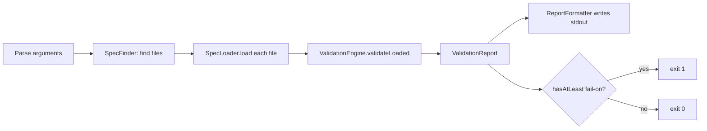

# 008 — CLI basic

| Field | Value |
|---|---|
| Status | Implemented |
| Phase | 3 — CLI and pipeline |
| Depends on | [004](004-oas-loading.md), [005](005-validation-engine.md) |
| Modules | `openapi-gateway-cli` |

## Summary

This spec adds the first version of the in-house validation command-line interface (CLI), `oas-gateway-validate`. The CLI finds OpenAPI Specification (OAS) files, runs the validation engine from `openapi-gateway-core`, prints the violations as text, and returns a defined exit code. The build packages the CLI as one executable shaded jar, `oas-gateway-validate.jar`. Pipelines use this jar to reject invalid OAS files in pull requests (PRs). The CLI runs all built-in rules: the CONTRACT rules that the gateway runs at startup, and the best-practice rules.

## Motivation

The gateway fails at startup when an OAS file has an ERROR violation. Without a CLI, a team finds the problem only when the gateway starts in an environment. The CLI moves the same check to the PR, before the merge. The CLI runs a superset of the gateway rules: the same CONTRACT rules from the same core code, plus the best-practice rules. A spec that passes the CLI therefore cannot break the gateway.

## Scope

### In scope

- A picocli root command `oas-gateway-validate` that validates files and directories.
- The options `--format text` and `--fail-on info|warn|error`.
- The standard options `--help` and `--version`.
- The text output format.
- Exit codes 0, 1, and 2.
- A shaded executable jar with a `Main-Class` entry in the manifest.

### Out of scope

- The `github` and `json` formats: [009](009-cli-github-and-json-output.md).
- The `sarif` format: [010](010-cli-sarif-output.md).
- The workflow that runs the CLI: [011](011-pr-validation-pipeline.md).
- Versioning and publication of the jar: [012](012-cli-distribution.md).
- The options `--catalog` and `--entra` and the subcommand `catalog export` of [019](019-permission-catalog.md) and [035](035-entra-permission-validation.md). The permission catalog is removed (decision of 2026-11-13). See [Removal of the permission catalog (2026-11-13)](README.md#removal-of-the-permission-catalog-2026-11-13).
- The `--config` option: [027](027-rule-configuration.md).
- The `--baseline` option and the `baseline create` subcommand: [028](028-suppressions-and-baseline.md).
- The `rules` and `explain` subcommands: [032](032-cli-rules-and-explain.md).
- The `diff` subcommand: [034](034-access-change-review.md).
- GraalVM native-image.

## Design

### Command line

```text
oas-gateway-validate [--format text] [--fail-on info|warn|error] <files-or-dirs>...
oas-gateway-validate --help
oas-gateway-validate --version
```

| Option or parameter | Type | Default | Meaning |
|---|---|---|---|
| `<files-or-dirs>...` | one or more paths | none (required) | OAS files or directories. The CLI searches directories recursively for `*.yaml`, `*.yml`, and `*.json`. |
| `--format` | enum | `text` | Output format. This spec supports only `text`. Later specs add values. |
| `--fail-on` | enum `info`, `warn`, `error` | `error` | Lowest severity that makes the CLI return exit code 1. |
| `--help` | flag | | Prints the usage and returns exit code 0. |
| `--version` | flag | | Prints the CLI version and returns exit code 0. |

The CLI is a plain Java program. It MUST NOT start a Spring application context.

### Classes

Base package: `com.johnowl.gateway.cli`.

| Class | Responsibility |
|---|---|
| `Main` | Entry point. Creates `CommandLine`, runs it, and calls `System.exit` with the returned code. |
| `ValidateCommand` | picocli root command, `Callable<Integer>`. Parses options, calls the core, selects the formatter, computes the exit code. |
| `OutputFormat` | Enum of the formats. This spec adds `TEXT`. |
| `ReportFormatter` | Interface: `void write(ValidationReport report, int fileCount, PrintWriter out)`. The summary line needs the number of checked files. |
| `TextReportFormatter` | Writes the text format. |
| `ManifestVersionProvider` | picocli `IVersionProvider`. Reads `Implementation-Version` from the jar manifest. |
| `FailOn` | Enum `INFO`, `WARN`, `ERROR`, mapped to `Severity`. |
| `ExitCodes` | The constants 0, 1, and 2. |
| `LowercaseValues` | Lists enum values in lowercase in the help. picocli accepts the values in any case. |

`ValidateCommand` uses `SpecFinder` from [004](004-oas-loading.md) to expand the paths. It loads each file with `SpecLoader.load(Path)`, so that relative external `$ref` values resolve from the file directory. It then calls `ValidationEngine.validateLoaded(...)` from [005](005-validation-engine.md) with `BuiltInRules.all()`. This rule set contains each rule of `BuiltInRules.contract()`, which the gateway uses. The CLI MUST NOT contain validation rules. All rules live in `openapi-gateway-core`.

A package-private constructor `ValidateCommand(List<Rule>)` lets tests run other rules, for example a fake WARN rule. The CLI itself always uses `BuiltInRules.all()`.

### Flow



### Text format

The formatter sorts violations by file, then by JSON pointer, then by rule id. The order is deterministic, so two runs on the same input give the same output.

Each violation uses two lines. The first line has the severity, the rule id, and the location (`<file>#<pointer>`). The second line has the message, indented by two spaces. A summary line follows the violations.

```text
ERROR route-collision gateway/src/main/resources/openapi/orders.yaml#/paths/~1orders~1{id}/get
  GET /orders-api/orders/{} is also declared in payments.yaml at /paths/~1orders~1{orderId}/get.
WARN  operation-summary-required gateway/src/main/resources/openapi/orders.yaml#/paths/~1orders/post
  Operation has no summary.

2 files checked: 1 error, 1 warning, 0 info.
```

The nouns of the summary are singular for the count 1, for example `1 file checked: 0 errors, 1 warning, 0 info.` Without violations, the output is only the summary line.

File paths in the output are relative to the current working directory when possible. Otherwise they are absolute.

File names, pointers, and messages come from the reviewed files. The CLI escapes control characters, Unicode line separators, and bidirectional controls in them, on stdout and on stderr: a line feed becomes `\n`, other characters become `\uXXXX`. One violation therefore never prints an extra line, for example a GitHub workflow command such as `::error ...`, and never shows its text in another order than the order of its characters. The set of characters is `UnsafeCharacters` in `openapi-gateway-core` ([031](031-documentation-rules.md), "Implementation"). The rule messages and the denial log of the gateway use the same set (finding SEC-66-4).

### Shaded jar

The `openapi-gateway-cli` module uses `maven-shade-plugin` in the `package` phase:

- Final name: `oas-gateway-validate` (output `openapi-gateway-cli/target/oas-gateway-validate.jar`).
- `ManifestResourceTransformer` with `Main-Class: com.johnowl.gateway.cli.Main` and `Implementation-Version: ${project.version}`.
- `ServicesResourceTransformer` to merge `META-INF/services` files.
- A filter that removes signature files (`META-INF/*.SF`, `META-INF/*.DSA`, `META-INF/*.RSA`), the manifests of the dependencies, and `module-info.class` files.
- `createDependencyReducedPom` is `false`. The shaded jar is not published as a Maven artifact ([012](012-cli-distribution.md)).
- `slf4j-nop` (runtime scope) silences the SLF4J logging of swagger-parser. The CLI prints only its own output.

The shaded jar of version 0.0.1-SNAPSHOT is 6.1 MB. One run on two small files takes about 0.3 seconds on an Apple M-series laptop with Java 25.

## Behavior and errors

| Condition | Output | Exit code |
|---|---|---|
| No violation at or above `--fail-on` | Violations below the threshold and the summary on stdout | 0 |
| At least one violation at or above `--fail-on` | Violations and the summary on stdout | 1 |
| A file has invalid YAML or JSON | Violation with rule id `oas-parse` (see [004](004-oas-loading.md)) | 1 when `--fail-on` is `error` or lower |
| Unknown option, invalid enum value, or no path argument | picocli usage message on stderr | 2 |
| A path argument does not exist or cannot be read (`SpecFinder.find` throws `IOException`) | Error message on stderr | 2 |
| The paths contain no `*.yaml`, `*.yml`, or `*.json` file | Error message on stderr | 2 |
| Unexpected exception | `Error: <message>` on stderr. Without a message: `Error: <exception class>`, for example `Error: java.lang.NullPointerException` | 2 |
| Unexpected JVM error, for example `OutOfMemoryError` | `Error: <message>` on stderr | 2 |
| A rule throws an exception | `ERROR` violation `Rule failed: <message>` ([005](005-validation-engine.md)) | 1 |

picocli returns `CommandLine.ExitCode.USAGE` (2) for usage errors. `Main` installs an `IParameterExceptionHandler` that prints the picocli message with `ConsoleText.untrusted`, then the usage. The message can contain an argument of the user, so it gets the escapes of "Text format", and no line of stderr starts with `::` (finding SEC-71-3). `Main` also turns off the picocli `@file` expansion (`setExpandAtFiles(false)`): an argument such as `@args.txt` is a path, not a file with more arguments. By default, picocli returns 1 for an exception in the command. `Main` MUST install an `IExecutionExceptionHandler` that returns 2, because exit code 1 means "violations found". `Main` also catches an `Error` from the command and returns 2. Without this, the JVM exits with 1.

## Acceptance criteria

- [x] `./mvnw -B -pl openapi-gateway-cli -am package` produces `openapi-gateway-cli/target/oas-gateway-validate.jar`.
- [x] `java -jar oas-gateway-validate.jar --version` prints the project version and returns 0.
- [x] `java -jar oas-gateway-validate.jar --help` prints the usage and returns 0.
- [x] A directory with only valid OAS files returns 0 and prints a summary with 0 errors.
- [x] A directory with one ERROR violation returns 1 and prints the rule id, the file, and the JSON pointer.
- [x] A file with only WARN violations returns 0 with `--fail-on error` and returns 1 with `--fail-on warn`.
- [x] A file with only INFO violations returns 1 with `--fail-on info`.
- [x] A file with invalid YAML returns 1 and prints a violation with rule id `oas-parse`.
- [x] An unknown option returns 2.
- [x] `--fail-on fatal` returns 2.
- [x] A path that does not exist returns 2.
- [x] A directory without OAS files returns 2.
- [x] The CLI finds `*.yaml`, `*.yml`, and `*.json` files in nested directories and ignores other files.
- [x] Two runs on the same input produce identical output, also when the arguments are in a different order.
- [x] An exception or an `Error` in the command returns 2 and prints a message on stderr.
- [x] Control characters in file names and messages are escaped on stdout and stderr.
- [x] A usage error escapes the argument of the user, and no line of stderr starts with `::`. `@<file>` is a path, not an argument file (finding SEC-71-3).
- [x] Each subcommand (`rules`, `explain`, `baseline`, `baseline create`) prints the CLI version with `--version` (finding QA-71-5).
- [x] The CLI jar does not contain Spring Cloud Gateway or WebFlux classes.
- [x] The CLI jar contains no `reactor/` classes and no `com/azure/` classes. `CliJarIT` fails if the jar contains them. (Code PR 1 of the removal of the permission catalog.)
- [x] `--catalog` and `--entra` are unknown options and return 2. `catalog export` is not a subcommand. (Code PR 1 of the removal of the permission catalog.)
- [x] A file with a protected operation and no other violation returns 0. The CLI prints no message about a catalog. (Code PR 1 of the removal of the permission catalog, finding QA-48-4.)

## Test plan

- Unit tests for `TextReportFormatter`: sort order, two-line layout, summary counts, zero violations.
- Unit tests for the exit code computation for each `--fail-on` value.
- Command tests that call `new CommandLine(new ValidateCommand()).execute(args)` with captured stdout and stderr. Fixtures in `openapi-gateway-cli/src/test/resources/cli/` (valid, error, warn-only, info-only, invalid YAML, nested directories, no OAS files).
- One integration test `CliJarIT` that runs the shaded jar with `ProcessBuilder` and checks `--version` and one exit code. It also checks that the jar contains no `org/springframework/` classes, no Reactor classes (`reactor/`), and no Netty (`io/netty/`) classes. [035](035-entra-permission-validation.md) allowed `reactor-core`, because the `TokenCredential` interface of `azure-core` uses it. The removal of the permission catalog (2026-11-13) removes `azure-identity`, so the check bans all of `reactor/` again. Failsafe runs it in the `integration-test` phase, after `package`.

## Delivery

One PR. Main files:

- `openapi-gateway-cli/pom.xml` (picocli dependency, shade plugin).
- `Main.java`, `ValidateCommand.java`, `OutputFormat.java`, `ReportFormatter.java`, `TextReportFormatter.java`, `ManifestVersionProvider.java`.
- Tests and fixtures.

Estimate: 300–400 changed lines without fixtures.

## Open questions

- Is `error` the right default for `--fail-on`? The brief says the pipeline fails on ERROR, but it does not define the default.
- Does the CLI need a `--verbose` option that prints stack traces for exit code 2?
- The root command takes positional paths and later gets subcommands (`rules`, `explain`, `baseline`, `diff`). A directory named `rules` is then ambiguous. Should validation move to a `validate` subcommand? Until then, `rules`, `explain` and `diff` return 2 when a file or directory with their name exists in the working directory ([032](032-cli-rules-and-explain.md), finding SEC-71-1; [034](034-access-change-review.md)).

## References

- [004 — OAS loading](004-oas-loading.md)
- [005 — Validation engine](005-validation-engine.md)
- [009 — CLI GitHub and JSON output](009-cli-github-and-json-output.md)
- [012 — CLI distribution](012-cli-distribution.md)
- picocli documentation: <https://picocli.info/>
- Apache Maven Shade Plugin: <https://maven.apache.org/plugins/maven-shade-plugin/>
