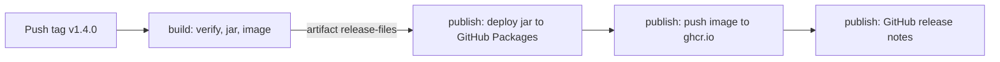

# 012 — CLI distribution

| Field | Value |
|---|---|
| Status | Draft |
| Phase | 3 — CLI and pipeline |
| Depends on | [008](008-cli-basic.md) |
| Modules | `openapi-gateway-cli`, `.github/workflows` |

## Summary

This spec defines how the team versions, builds, and publishes the command-line interface (CLI) `oas-gateway-validate`. A Git tag starts a release workflow. The workflow publishes the shaded jar to GitHub Packages and a container image to the GitHub Container Registry (`ghcr.io`). Pipelines in other repositories pin an exact version, so a new release never changes their result without a PR. This spec also defines the rule rollout policy: a new rule starts as WARN and becomes ERROR only in a later, announced version.

## Motivation

Other repositories also validate OpenAPI Specification (OAS) files that the gateway loads. They need the same CLI version as the gateway, and they need a predictable upgrade path. Without versions, a new rule could fail all pipelines on the same day. Without a container image, each pipeline must install a Java runtime first.

## Scope

### In scope

- Semantic versioning of the CLI.
- The release workflow `.github/workflows/release.yml`, triggered by a tag.
- Publication of the shaded jar to the GitHub Packages Maven registry.
- The container image `ghcr.io/<owner>/oas-gateway-validate` and its `Dockerfile`.
- The rule rollout policy.
- Usage examples for pipelines in other repositories.

### Out of scope

- The PR workflow of this repository, which builds the CLI from source: [011](011-pr-validation-pipeline.md).
- Release of the gateway application.
- GraalVM native-image. It is optional and not part of this spec.
- Publication of `openapi-gateway-core` as a separate library.

## Design

### Versioning

The CLI uses semantic versioning (`MAJOR.MINOR.PATCH`):

| Change | Version part |
|---|---|
| Bug fix, no new violation on a previously valid spec | PATCH |
| New rule at WARN or INFO, new option, new output format | MINOR |
| A rule changes from WARN to ERROR, a new CONTRACT rule, a removed option, a changed exit code, a breaking change to the JSON or SARIF output layout | MAJOR |

The release version comes from the tag: tag `v1.4.0` releases version `1.4.0`. `--version` prints the same value ([008](008-cli-basic.md)).

### Release flow



1. A maintainer pushes a tag `vX.Y.Z` on a commit of `main`.
2. The job `build` sets the Maven project version from the tag, runs `./mvnw -B verify`, and builds the image from `openapi-gateway-cli/Dockerfile`.
3. The job `publish` deploys the parent POM and the CLI jar to the GitHub Packages repository.
4. The job `publish` pushes the image with the tag `X.Y.Z`.
5. The job `publish` creates a GitHub release with the release notes, including the rule changes. The GitHub release is the proposed announcement channel (see open questions).

### Maven artifact

- Coordinates: `com.johnowl.gateway:openapi-gateway-cli:X.Y.Z` (group id from [001](001-project-skeleton.md)).
- The deployed main artifact is the shaded jar. The shade plugin creates a dependency-reduced POM, so consumers do not need `openapi-gateway-core` in the registry.
- Repository URL: `https://maven.pkg.github.com/johnowl/oas-spring-boot-gateway`. The parent `pom.xml` declares it in `distributionManagement` with the server id `github`.

Implementation details:

- The CLI module sets the build `finalName` to `oas-gateway-validate`. The shade plugin then replaces the main jar with the shaded jar, so `install` and `deploy` publish the shaded jar. The file `target/oas-gateway-validate.jar` of [008](008-cli-basic.md) does not change. The jar without dependencies stays as `target/original-oas-gateway-validate.jar`.
- The jar plugin uses `forceCreation=true`. Without it, an incremental build keeps the old shaded jar under the same name, and shade shades it again.
- The dependency-reduced POM stays at its default location, `openapi-gateway-cli/dependency-reduced-pom.xml`, and `.gitignore` excludes it. Shade makes this file the POM of the project, and `basedir` follows the file. In `target/`, the working directory of the Failsafe tests would also move to `target/`.
- The dependency-reduced POM still names the parent `oas-spring-boot-gateway-parent`. A consumer must resolve it, so the release also publishes the parent POM.
- `openapi-gateway-core` and `gateway` set `maven.deploy.skip=true`.
- A deploy to a local file repository (`-DaltDeploymentRepository=local::file:///tmp/deploytest`) publishes exactly two files: the parent POM and the 6.1 MB shaded CLI jar.

### Container image

```dockerfile
FROM eclipse-temurin:25-jre-alpine@sha256:e1898fd6a11fc965a994d8ace186fd3585aeb636cf8f05f47a723fcfee0b0918
COPY target/oas-gateway-validate.jar /opt/oas-gateway-validate/oas-gateway-validate.jar
WORKDIR /work
USER 65532:65532
ENTRYPOINT ["java", "-jar", "/opt/oas-gateway-validate/oas-gateway-validate.jar"]
```

Decision (2026-11-12): the base image is `eclipse-temurin:25-jre-alpine`, pinned by digest. The image of the CLI is about 231 MB. The image `eclipse-temurin:25-jre` (Ubuntu) is about 357 MB. The team updates the digest by hand (see "Decisions").

The build context is `openapi-gateway-cli/`. The file `.dockerignore` sends only `target/oas-gateway-validate.jar` to the build.

The image runs as a non-root user. A local test of the image showed `uid=65532`, the exit codes 0, 1, and 2 on the fixtures of [008](008-cli-basic.md), and annotation paths relative to the mounted directory. The image tag is the exact version (`1.4.0`). The workflow MUST NOT move an existing version tag.

Example usage in another repository:

```bash
docker run --rm -v "$PWD:/work" ghcr.io/<owner>/oas-gateway-validate:1.4.0 \
  --format github --fail-on error openapi/
```

```yaml
- name: Validate OAS files
  run: >
    docker run --rm -v "$PWD:/work"
    ghcr.io/<owner>/oas-gateway-validate:1.4.0
    --format github --fail-on error openapi/
```

The container working directory is `/work`, so the paths in annotations are relative to the repository root.

### Release workflow

```yaml
name: Release CLI

on:
  push:
    tags: ['v*.*.*']

permissions:
  contents: write     # create the GitHub release
  packages: write     # GitHub Packages and ghcr.io

jobs:
  release:
    runs-on: ubuntu-latest
    steps:
      - uses: actions/checkout@v4
      - uses: actions/setup-java@v4
        with:
          distribution: temurin
          java-version: '25'
          cache: maven
          server-id: github
      - name: Set version
        run: ./mvnw -B versions:set -DnewVersion="${GITHUB_REF_NAME#v}" -DgenerateBackupPoms=false
      - name: Verify
        run: ./mvnw -B verify
      - name: Deploy jar
        run: ./mvnw -B -pl openapi-gateway-cli -am deploy -DskipTests
        env:
          GITHUB_TOKEN: ${{ secrets.GITHUB_TOKEN }}
      # Steps: log in to ghcr.io, build and push the image, create the release.
```

The example above shows the structure only. The implementation differs in three points:

- The implementation MUST pin each action to a commit SHA.
- The `-am deploy` command also deploys the parent and core artifacts unless the build skips them. The modules that are not published MUST set `maven.deploy.skip`.
- The implementation MUST NOT give write permissions or registry credentials to a job that runs project code. The build runs all tests, Maven plugins, and test dependencies. A compromised dependency could otherwise read the token and push any image tag. So the implementation splits the work into two jobs.

The file `.github/workflows/release.yml` has these jobs and steps, in this order.

Job `build` (`contents: read`, checkout with `persist-credentials: false`, no registry login):

1. Check that the tag matches `^v[0-9]+\.[0-9]+\.[0-9]+$` and that the tagged commit is on `main`.
2. Set the version with `org.codehaus.mojo:versions-maven-plugin:2.21.0:set -DprocessAllModules=true`. The project uses `versions:set`, not a CI-friendly `${revision}` property.
3. Run `./mvnw -B verify`. Nothing is published before this step passes.
4. Build the image and check that `--version` prints `oas-gateway-validate X.Y.Z` and that the user is not root.
5. Upload the artifact `release-files`: the versioned parent POM, the dependency-reduced POM of the CLI, the shaded jar, and the image (`docker save`).

Job `publish` (`needs: build`, `contents: write`, `packages: write`). It has no checkout and runs no code of the repository:

1. Download `release-files`.
2. Log in to `ghcr.io`. Fail if the image tag `X.Y.Z` exists. A release never moves a version tag. Only the registry answer "manifest unknown" (or "name unknown", "not found") means that the tag is new. Any other error, for example 401, 403, a rate limit, or a network error, stops the release.
3. Load the image.
4. Deploy the parent POM and the CLI jar with `maven-deploy-plugin:3.1.4:deploy-file` and the Maven of the runner. `deploy-file` reads only the POM files and builds nothing.
5. Push the image.
6. Create the GitHub release with `gh release create --verify-tag --generate-notes` and attach the jar.
7. Log out of `ghcr.io`.

The jar in GitHub Packages, the jar of the GitHub release, and the jar in the image are the same file, because the publish job does not build again.

The release workflow does not use the Maven cache of `setup-java`. Other workflows write that cache, so a poisoned entry could reach the published jar. The Maven wrapper checks the SHA-256 of the Maven distribution (`distributionSha256Sum` in `.mvn/wrapper/maven-wrapper.properties`).

The workflow uses `docker login` with `GITHUB_TOKEN` instead of a login action. `actionlint` reports no problems. A local test of the version step with the version `9.9.9` gave `--version` output `oas-gateway-validate 9.9.9`. A local test of the two `deploy-file` commands with a file repository published the parent POM and the shaded CLI jar, version `9.9.9`.

### Rule rollout policy

The document [`docs/cli-release-policy.md`](../docs/cli-release-policy.md) contains the policy for maintainers and consuming teams.

1. A new configurable rule starts with default severity WARN (or INFO) in a MINOR version.
2. The release notes announce the new rule and the version in which it becomes ERROR, if it does.
3. The severity change to ERROR happens in a later version, as the table in "Versioning" defines.
4. Teams fix the violations or configure the rule ([027](027-rule-configuration.md)) before they upgrade.

Pipelines pin the version. An upgrade is a PR in the consuming repository, so the team sees new violations before the merge.

## Acceptance criteria

- [ ] Pushing tag `v0.1.0` runs `release.yml` and publishes `openapi-gateway-cli` version `0.1.0` to GitHub Packages.
- [ ] The published jar runs with `java -jar` and `--version` prints `0.1.0`.
- [ ] The image `ghcr.io/<owner>/oas-gateway-validate:0.1.0` exists, and `docker run ... --version` prints `0.1.0`.
- [ ] The container process does not run as root.
- [ ] `docker run` with `-v "$PWD:/work"` validates a relative path and prints annotations with paths relative to the mounted directory.
- [ ] A tag that does not match `v*.*.*` does not start the release workflow. (The workflow also checks the exact format `vX.Y.Z`.)
- [ ] The release workflow fails, and publishes nothing, when `./mvnw -B verify` fails.
- [ ] The GitHub release for the tag contains release notes.
- [ ] The rule rollout policy is documented in the repository, and the release notes of each version list new rules and severity changes.

## Test plan

- Dry run: run the workflow in a test repository with a test tag, so that the real registries do not get test versions.
- Container test: build the image locally and run it against the CLI fixtures from [008](008-cli-basic.md). Check the exit codes 0, 1, and 2.
- Check that the workflow publishes nothing when a test fails.

## Delivery

Two PRs:

1. `openapi-gateway-cli/Dockerfile`, Maven `distributionManagement`, and deploy skip configuration (about 80 lines). Done.
2. `.github/workflows/release.yml` and the rule rollout policy text (about 150 lines). Done.

The acceptance criteria need a real tag. They stay open until the first release (`v0.1.0`). The test plan proposes a dry run in a test repository.

## Decisions (2026-11-12)

- No tag ruleset and no approval step for releases for now. Any person with write access can push a `v*` tag. This closes the review finding SEC-19-3 for now.
- No Dependabot or Renovate configuration for now. The pinned action SHAs and the base image digest are updated by hand (review finding SEC-18-1).
- The rule rollout policy starts with the first release (`v0.1.0`). The rules of the first release keep the severity of their spec. Example: `operation-id-required` is ERROR ([029](029-naming-rules.md)).

## Open questions

- Proposal implemented, to confirm: a change from WARN to ERROR and a new CONTRACT rule are MAJOR changes, because they can fail pipelines that passed before. Rule changes are announced in a section "Rule changes" of the GitHub release.
- Should the image have floating tags (`1`, `1.4`)? Floating tags break the "pin the version" rule.
- Consumers of GitHub Packages need a token with `read:packages`, also for public packages in the Maven registry. Verify this and document it for consuming teams.
- Should the image be signed, or should the release include a software bill of materials (SBOM)?

## References

- [008 — CLI basic](008-cli-basic.md)
- [011 — PR validation pipeline](011-pr-validation-pipeline.md)
- [027 — Rule configuration](027-rule-configuration.md)
- Semantic Versioning 2.0.0: <https://semver.org/>
- GitHub Packages, Apache Maven registry: <https://docs.github.com/en/packages/working-with-a-github-packages-registry/working-with-the-apache-maven-registry>
- GitHub Container registry: <https://docs.github.com/en/packages/working-with-a-github-packages-registry/working-with-the-container-registry>
