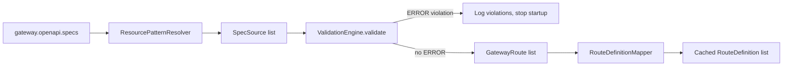

# 013 — OAS route locator

| Field | Value |
|---|---|
| Status | Implemented |
| Phase | 4 — Routing in the gateway |
| Depends on | [002](002-gateway-bootstrap.md), [003](003-upstream-http-client.md), [007](007-route-model.md) |
| Modules | `gateway` |

## Summary

This spec adds `OpenApiRouteDefinitionLocator`, the component that creates all gateway routes from OpenAPI Specification (OAS) files. At startup, the locator loads the OAS files, runs the CONTRACT rules that the command-line interface (CLI) also runs, and stops the application on any ERROR violation. It converts each `GatewayRoute` from core into a Spring Cloud Gateway `RouteDefinition`. Only documented operations get a route, so any other request returns 404. This is the central feature of the project: routes are never written by hand.

## Motivation

Hand-written routes drift from the API documentation. A route can expose an operation that the OAS file does not document, or it can miss a documented operation. When the routes come from the OAS files, the OAS file is the contract and the gateway enforces it. The fail-fast validation also guarantees that the gateway never starts with an OAS file that violates a CONTRACT rule. The CLI runs the same CONTRACT rules, so an OAS file that passes the CLI also passes the gateway startup.

## Scope

### In scope

- `OpenApiRouteDefinitionLocator` (a `RouteDefinitionLocator`).
- `GatewayOpenApiProperties` with the property `gateway.openapi.specs`.
- Loading of the OAS files from Spring resource locations (`classpath:` and `file:`).
- Startup validation with `ValidationEngine` and `BuiltInRules.contract()` ([005](005-validation-engine.md)).
- `RouteDefinitionMapper`: conversion of `GatewayRoute` to `RouteDefinition`.
- Integration tests with `WebTestClient`.

### Out of scope

- The route model and the route rules (`path-pattern-supported`, `route-collision`, `route-id-unique`): [007](007-route-model.md).
- The HTTP client and the `response-timeout` behavior: [003](003-upstream-http-client.md).
- Reload of the OAS files at runtime: [014](014-route-reload.md).
- Indexed route lookup: [017](017-indexed-route-lookup.md).
- Token relay (`AudienceTokenRelay`) and header removal filters: [025](025-token-relay-and-header-hygiene.md).
- Authorization. The security index uses the same OAS files: [024](024-authorization-manager.md).
- Best-practice rules, `.oas-gateway.yaml`, `x-deviation`, and the baseline. They are CLI-only, and the gateway never reads them: [005](005-validation-engine.md), [027](027-rule-configuration.md), [028](028-suppressions-and-baseline.md).

## Design

### Flow at startup



1. The locator logs the value of `gateway.openapi.specs` at log level INFO, for example `gateway.openapi.specs: [classpath:openapi/*.yaml, classpath:openapi/*.yml, classpath:openapi/*.json]`. Then it resolves the patterns with Spring `ResourcePatternResolver`, and checks the location of each file (see "OAS file location").
2. It reads each resource as UTF-8 into a `SpecSource(path, content)` ([004](004-oas-loading.md)). The path is the URI of the resource, for example `file:/app/BOOT-INF/classes/openapi/orders.yaml` or `jar:file:/app.jar!/BOOT-INF/classes!/openapi/orders.yaml`. The URI is unique, so the locator also uses it to remove duplicates when two patterns match the same file. The sources are sorted by URI. A pattern whose directory does not exist matches nothing.
3. It calls `ValidationEngine.validate(sources)` with the rule set `BuiltInRules.contract()` and the default policies ([005](005-validation-engine.md)). The locator keeps only the CONTRACT rules of the list that it gets, so a best-practice rule never runs in the gateway, whatever its severity.
4. If `report.hasAtLeast(ERROR)` is true, it logs each violation and throws `OpenApiValidationException`. The application context does not start.
5. It logs WARN violations at log level WARN and INFO violations at log level DEBUG. CONTRACT rules always have severity ERROR, so the report normally has no WARN or INFO violation.

### OAS file location

A pattern that starts with `file:` reads a path of the file system. Each other pattern reads the classpath, for example `classpath:openapi/*.yaml` or `classpath*:openapi/*.yaml`. Each file that a classpath pattern matches MUST be in the classes of the gateway application. Otherwise the application does not start (finding SEC-75-1).

The classes of the gateway application are the classpath root of the gateway classes. The locator finds it from the URL of its own class file:

| Run | Classpath root |
|---|---|
| The jar of the gateway | `BOOT-INF/classes/` in the jar, for example `jar:nested:/app/gateway.jar/!BOOT-INF/classes/!/` |
| A Maven build of the module `gateway` | `gateway/target/classes/`. `gateway/target/test-classes/` also counts, so that the tests can use the default location. |

Reason: the classpath also has the resources of the other modules and of the dependency jars. `classpath:openapi/` reads the first classpath entry that has the folder `openapi/`, and `classpath*:openapi/` reads all of them. The checks of the pull requests ([033](033-breaking-change-detection.md), [034](034-access-change-review.md)) compare only `gateway/src/main/resources/openapi`. So an OAS file in `openapi-gateway-core/src/main/resources/openapi/` would reach the gateway without a check. A `file:` pattern names its path, so this rule does not apply to it. A change of `gateway.openapi.specs` fails the location check of [033](033-breaking-change-detection.md).

The file name, the pointer, and the message of a violation come from the OAS files. The locator writes each violation as one line (`OpenApiValidationException.line`), in the log and in the exception message. The line shows each unsafe character as a Java escape (`PrintableText.escape`, [004](004-oas-loading.md), "Text in messages"), so that a value in a file cannot start a new log line (finding SEC-67-3).
6. It maps `report.routes()` to `RouteDefinition` objects and keeps the list in a final field.

The work happens once, when Spring creates the bean. `getRouteDefinitions()` returns `Flux.fromIterable(cachedList)`. It does no parsing and no validation, because Spring Cloud Gateway can call it on each route refresh.

### Mapping from `GatewayRoute` to `RouteDefinition`

| `GatewayRoute` field ([007](007-route-model.md)) | `RouteDefinition` element |
|---|---|
| id | `id` |
| upstream URI | `uri` (`scheme://host[:port]`, no path) |
| public path pattern (prefix + OAS path) | predicate `Path=<pattern>` |
| HTTP methods | predicate `Method=GET,POST,...` |
| number of prefix segments to strip | filter `StripPrefix=<n>`, only when the spec has a `prefix` |
| base path to add | filter `PrefixPath=<upstream-base-path>`, only when set |
| response timeout | metadata `response-timeout` (milliseconds), only when set |
| prefix (the first `<n>` segments of the public path pattern) | metadata `public-prefix`, only when the spec has a `prefix`. [025](025-token-relay-and-header-hygiene.md) uses it for a backend `Location`. |
| upstream base path | metadata `upstream-base-path`, only when set. [025](025-token-relay-and-header-hygiene.md) uses it for a backend `Location`. |
| order | `order` (0 for literal paths, 100 for paths with variables) |

The audience is not mapped in this spec. [024](024-authorization-manager.md) and [025](025-token-relay-and-header-hygiene.md) use it.

Example. This OAS file:

```yaml
x-gateway:
  upstream: http://orders-service:8080
  prefix: /orders-api
  upstream-base-path: /v1
paths:
  /orders/{id}:
    get:
      x-gateway-response-timeout: 2000
    delete:
      x-gateway-response-timeout: 2000
  /orders/export:
    get: {}
```

produces two routes, shown here in the Spring Cloud Gateway YAML notation:

```yaml
- id: <id from 007>
  uri: http://orders-service:8080
  order: 0
  predicates:
    - Path=/orders-api/orders/export
    - Method=GET
  filters:
    - StripPrefix=1
    - PrefixPath=/v1
- id: <id from 007>
  uri: http://orders-service:8080
  order: 100
  predicates:
    - Path=/orders-api/orders/{id}
    - Method=GET,DELETE
  filters:
    - StripPrefix=1
    - PrefixPath=/v1
  metadata:
    response-timeout: 2000
    public-prefix: /orders-api
    upstream-base-path: /v1
```

A request `GET /orders-api/orders/42` reaches `http://orders-service:8080/v1/orders/42`.

### Classes

| Class | Responsibility |
|---|---|
| `GatewayOpenApiProperties` | `@ConfigurationProperties("gateway.openapi")` |
| `OpenApiRouteDefinitionLocator` | Loads, validates, maps, and caches the routes |
| `RouteDefinitionMapper` | Pure function `RouteDefinition map(GatewayRoute route)` |
| `RequestPathFirewall` | `WebFilter` that rejects ambiguous request paths before the route lookup |
| `OpenApiValidationException` | Startup failure with the list of ERROR violations |
| `OpenApiRoutingConfiguration` | `@Configuration` that creates the beans |

The classes are in the package `com.johnowl.gateway.routing`. `GatewayOpenApiProperties` is a record with the default value `classpath:openapi/*.yaml`, `classpath:openapi/*.yml`, `classpath:openapi/*.json`. `RouteDefinitionMapper` uses `RouteMetadataUtils.RESPONSE_TIMEOUT_ATTR` (`response-timeout`) as the metadata key. The methods in the `Method` predicate are sorted.

`RouteDefinitionMapper` creates the `Path` predicate and the `StripPrefix` and `PrefixPath` filters with explicit arguments (`patterns`, `parts`, `prefix`), not with the shortcut text form of the YAML example above. The shortcut form `Path=/a,b` splits the value on commas into two patterns, `/a` and `b`. An OAS path with a comma would then get a route for an undocumented path, outside the prefix of its file. [007](007-route-model.md) also rejects commas in OAS paths. The `Method` predicate uses the shortcut form, because HTTP method names have no commas.

No property of Spring Cloud Gateway 5.0.4 starts with `gateway.`, so `gateway.openapi.specs` has no conflict.

### Request path firewall

A route with a variable, for example `/orders/{id}`, matches any single segment, and the gateway forwards the raw path. A backend or proxy that removes dot segments or decodes `%2F` can then serve a path that no OAS file documents. For example, `GET /orders-api/orders/..%2F..%2Fadmin` matches `/orders/{id}`, and the backend can read it as `/admin`.

`RequestPathFirewall` is a `WebFilter` with the highest precedence. It runs before the route lookup and before every other filter. It returns 400 with an empty body when the raw request path contains:

- `%2F` or `%5C`, in upper case or lower case (an encoded `/` or `\`);
- a `;` (matrix parameters), for example `/users/me;x=1`, also percent-encoded as `%3B` in upper case or lower case, for example `/users/me%3Bx=1`;
- a percent-encoded unreserved character of RFC 3986 (`ALPHA`, `DIGIT`, `-`, `.`, `_`, `~`), in upper case or lower case, for example `/users/m%65`;
- a backslash `\`;
- a `.` or `..` segment after percent-decoding, for example `/a/../b`, `/a/%2e%2e/b`, or `/a/..;x/b` (the part before `;` is checked);
- an invalid percent-encoding, for example `%zz`.

The filter reads only the request path. It does not read or buffer the body, and it does not block. A dot inside a segment is allowed, for example `/files/report.v2` or `/a/.well-known`.

The route lookup and the security index of [024](024-authorization-manager.md) remove matrix parameters and decode the path. A backend may not do this. Then `/users/me;x=1` and `/users/m%65` match the operation `/users/me` in the gateway, and the backend can read them as `/users/{id}` (finding SEC-59-1). A client never needs to encode an unreserved character, and an OAS literal segment never contains `;` ([007](007-route-model.md)). A backend that decodes the path before it removes matrix parameters reads `%3B` as `;`, so the filter also rejects `%3B`. Other percent-encodings stay allowed, for example `%20` or `%C3%A9`.

## Behavior and errors

| Condition | Result |
|---|---|
| Request matches a documented path and method | The gateway forwards the request to the upstream. |
| Request to the actuator health endpoint | The actuator runs on the separate management port ([002](002-gateway-bootstrap.md)). It is not a gateway route, so an OAS path such as `/actuator/health` does not collide with it. |
| Request path is not documented | 404 with a generic `application/problem+json` body. `UndocumentedOperationWebFilter` ([024](024-authorization-manager.md)) returns it before the security chain and before routing. Before [024](024-authorization-manager.md), routing finds no route and returns 404. |
| Request path is documented, but the method is not | 404, not 405, in the same way. Before [024](024-authorization-manager.md), the `Method` predicate does not match, so no route matches. |
| `GET /orders-api/orders/export` with routes for `/orders/export` and `/orders/{id}` | The literal route (order 0) handles the request. |
| Request path contains `%2F`, `%5C`, `%3B`, `\`, `;`, a percent-encoded unreserved character, a `.` or `..` segment (also percent-encoded), or an invalid percent-encoding | 400 with an empty body. `RequestPathFirewall` rejects the request before the route lookup, and the backend receives nothing. |
| An OAS file has an ERROR violation | The application does not start. The log contains each violation with rule id, file, and JSON pointer. |
| A classpath pattern of `gateway.openapi.specs` matches a file outside the classes of the gateway application, for example in another module or in a dependency jar | The application does not start. The message names the patterns, the classpath roots of the gateway, and each file outside them. |
| No resource matches `gateway.openapi.specs` | The application does not start. The message is `No OAS file matches gateway.openapi.specs [<patterns>]. The gateway needs at least one.` |
| An OAS file has only best-practice violations (for example a naming violation) | The application starts. The gateway does not run best-practice rules. |
| An OAS file has a protected operation, and the application context has no bean of type `AudienceAuthorizationActive` | The application does not start. This is the temporary startup stop of [024](024-authorization-manager.md) ("Startup stop until the authorization manager is active"). The locator checks it after the CONTRACT rules. The message is `<METHOD> <public path pattern> is a protected operation, but the authorization manager (spec 024) is not active.` |

## Configuration

| Property | Type | Default | Meaning |
|---|---|---|---|
| `gateway.openapi.specs` | list of Spring resource patterns | `classpath:openapi/*.yaml`, `classpath:openapi/*.yml`, `classpath:openapi/*.json` | Locations of the OAS files. The default reads the same file extensions as the CLI ([008](008-cli-basic.md), [011](011-pr-validation-pipeline.md)). |

```yaml
gateway:
  openapi:
    specs:
      - classpath:openapi/*.yaml
      - file:/etc/gateway/openapi/*.yaml
```

## Acceptance criteria

- [x] With the default property, the gateway loads all `*.yaml`, `*.yml`, and `*.json` files from `classpath:openapi/` (tested with `gateway/src/test/resources/openapi/` and with a test class loader).
- [x] A documented `GET` request reaches the mock backend with the expected method and path.
- [x] A request to an undocumented path returns 404, and the mock backend receives no request.
- [x] A request with an undocumented method on a documented path returns 404.
- [x] With routes `/users/me` and `/users/{id}`, `GET /users/me` reaches the `/users/me` operation of the backend.
- [x] With `prefix: /orders-api` and `upstream-base-path: /v1`, `GET /orders-api/orders/42` reaches the backend path `/v1/orders/42`.
- [x] Without `prefix` and `upstream-base-path`, the backend receives the request path unchanged.
- [x] An operation with `x-gateway-response-timeout: 500` and a backend delay of 1 second returns the timeout status from [003](003-upstream-http-client.md).
- [x] A test OAS file with an ERROR violation of a CONTRACT rule stops the application context, and the exception message contains the rule id.
- [x] A line feed in a path key and a `U+2028` in a `$ref` are Java escapes in the exception message (SEC-67-3).
- [x] A test OAS file with only best-practice violations (for example `operation-summary-required`) starts the application context. (The test uses a file without summaries and with a verb in the path. A locator test also gives the locator a non-CONTRACT test rule with severity ERROR; the locator starts.)
- [x] The locator passes `BuiltInRules.contract()` to the engine and does not read `.oas-gateway.yaml`.
- [x] A request path with `%2F`, `%5C`, `\`, or a `.` or `..` segment (also percent-encoded) returns 400, and the mock backend receives no request.
- [x] A pattern that matches no resource stops the application context.
- [x] A file of `classpath:openapi/` in another classpath root (another module first on the classpath) stops the application context (SEC-75-1).
- [x] A file of `classpath*:openapi/*.yaml` in a dependency jar on the classpath stops the application context (SEC-75-1).
- [x] In a jar, the class and the OAS files of the gateway have the same classpath root, and the gateway loads the files.
- [x] A `file:` pattern outside the classes loads its files. The log shows the value of `gateway.openapi.specs` at log level INFO (SEC-75-2).
- [x] `getRouteDefinitions()` does not call `ValidationEngine` after startup.
- [x] The route definitions do not contain `ModifyRequestBody`, `ModifyResponseBody`, or `CacheRequestBody` filters.

## Test plan

- Unit tests `RouteDefinitionMapperTest`: each row of the mapping table, with and without prefix, base path, and timeout.
- Integration tests `OpenApiRoutingIT` (`@SpringBootTest(webEnvironment = RANDOM_PORT)`, `WebTestClient`). The mock backend is the Reactor Netty `HttpServer` from [002](002-gateway-bootstrap.md). It records the received method and path. Test OAS files are in `gateway/src/test/resources/openapi-test/`. The test sets `gateway.openapi.specs` to that folder and sets each `upstream` to the mock backend port.
- Startup failure tests with `ApplicationContextRunner` or `SpringApplication` and an invalid OAS fixture: invalid file, empty pattern result.
- Startup success test with an OAS fixture that has only best-practice violations.
- Remove the test route from [002](002-gateway-bootstrap.md) if it conflicts with the OAS test routes. It does not conflict, so it stays.

Implementation notes:

- `OpenApiRoutingIT` writes its OAS files to a temporary directory with the port of the mock backend, and sets `gateway.openapi.specs` to `file:<directory>/*.yaml`. This answers the test part of the first open question. The production part stays open.
- `OpenApiRoutingStartupTest` uses `ApplicationContextRunner` with `OpenApiRoutingConfiguration` only.
- The gateway does not start without an OAS file. `src/main/resources/openapi/` has no OAS file yet, because the project has no real backend yet. The tests use `gateway/src/test/resources/openapi/sample.yaml` for the default location. The PR that adds the first real OAS file also removes the temporary check in `.github/workflows/openapi.yml` ([011](011-pr-validation-pipeline.md)).

## Delivery

Two PRs:

1. `GatewayOpenApiProperties`, `RouteDefinitionMapper`, and unit tests (about 200 lines).
2. `OpenApiRouteDefinitionLocator`, `OpenApiValidationException`, `OpenApiRoutingConfiguration`, integration tests, and fixtures (about 300 lines without fixtures).

## Decisions (2026-11-12)

- There is one environment: production. The gateway always receives the production OAS files, and their `upstream` and `audience` values are the correct values. No per-environment override is necessary. This answers the open question about environments.
- The target is about 10,000 routes. A measurement on 2026-11-12 (Apple M-series laptop, Java 25) gave these startup times: 10,000 routes in 4.4 s (resident memory 0.9 GB), 50,000 in 10.6 s, 100,000 in 17.7 s, 200,000 in 30 s.

## Review findings

- SEC-67-3 (info): the locator wrote the file name, the pointer, and the message of a violation to the log as they were. Fix: the locator escapes unsafe characters in each violation line, in the log and in `OpenApiValidationException`.
- SEC-75-1 (high, review of PR #75 of [034](034-access-change-review.md)): an OAS file in the folder `src/main/resources/openapi/` of another module reached the gateway through `classpath:openapi/`, and the checks of the pull requests did not see it. Fix: a classpath pattern matches only files in the classes of the gateway application (see "OAS file location"). The location check of [033](033-breaking-change-detection.md) also fails on such a folder.
- SEC-75-2 (medium, the same review): the gateway logs the value of `gateway.openapi.specs` at startup, so that the log of each instance shows the locations of its OAS files.

## Open questions

- Must the gateway reject routes that are defined in properties (`spring.cloud.gateway.server.webflux.routes`) or by other `RouteDefinitionLocator` beans? The brief says routes are not written by hand.

## References

- [003 — Upstream HTTP client](003-upstream-http-client.md)
- [004 — OAS loading](004-oas-loading.md)
- [005 — Validation engine](005-validation-engine.md)
- [007 — Route model](007-route-model.md)
- [024 — Authorization manager](024-authorization-manager.md)
- [027 — Rule configuration](027-rule-configuration.md)
- [028 — Suppressions and baseline](028-suppressions-and-baseline.md)
- [014 — Route reload](014-route-reload.md)
- [016 — Routing benchmark](016-routing-benchmark.md)
- Spring Cloud Gateway Server WebFlux reference: <https://docs.spring.io/spring-cloud-gateway/reference/spring-cloud-gateway-server-webflux.html>
