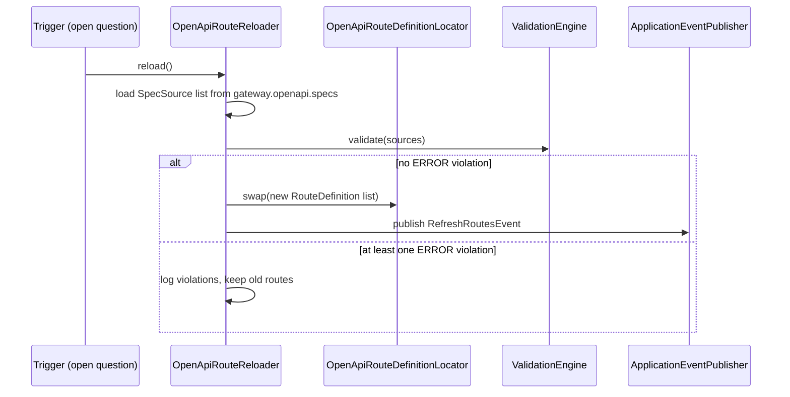

# 014 — Route reload

| Field | Value |
|---|---|
| Status | Optional |
| Phase | 4 — Routing in the gateway |
| Depends on | [013](013-oas-route-locator.md) |
| Modules | `gateway` |

## Summary

This spec adds an optional reload of the OpenAPI Specification (OAS) files while the gateway runs. The OAS files come from an external location. On a reload, the gateway loads and validates the complete new set of files first. Only if the new set has no ERROR violation does the gateway swap the routes and publish a `RefreshRoutesEvent`. If the validation fails, the gateway keeps the old routes and logs the violations. The feature lets a team change routes without a new deployment. The reload runs the same contract rules as the startup validation. The reloaded files do not pass the pull request (PR) check and its review. The feature is not required for the first release.

## Motivation

With [013](013-oas-route-locator.md), a change to an OAS file needs a new build and a restart of the gateway. A restart closes connections and takes time. Some teams need faster route changes. A reload without validation is dangerous, because one invalid file could remove all routes. This spec defines a reload that never replaces valid routes with invalid ones.

## Scope

### In scope

- `OpenApiRouteReloader` with the method `reload()`.
- Validate-then-swap of the routes in `OpenApiRouteDefinitionLocator`.
- Publication of `RefreshRoutesEvent` after a successful swap.
- Logs for a successful and a failed reload.
- The property `gateway.openapi.reload.enabled`.

### Out of scope

- The trigger mechanism (see open questions). This spec defines `reload()` only. A follow-up change adds the trigger after the decision.
- The Spring Cloud Gateway actuator endpoint `POST /actuator/gateway/refresh`. The gateway exposes only the `health` endpoint ([002](002-gateway-bootstrap.md)), so this endpoint is not available.
- Rebuild of the security index ([024](024-authorization-manager.md)) and of the per-audience client registrations ([023](023-per-audience-tokens.md)). See "Consistency with other derived data".
- Rebuild of the indexed route lookup. [017](017-indexed-route-lookup.md) rebuilds its index on `RefreshRoutesResultEvent`, so it needs no change here.

## Design

### Flow



### Validate-then-swap

1. `reload()` resolves `gateway.openapi.specs` again and reads all files into `SpecSource` objects.
2. It validates the complete set with `ValidationEngine.validate(sources)` and `BuiltInRules.contract()`, the same rule set as at startup ([005](005-validation-engine.md)). Cross-spec rules, for example `route-collision`, run on the complete new set. The contract rules check the format of audiences and permissions, not their existence in Entra.
3. If the report has an ERROR violation, `reload()` logs each violation and returns a failed `ReloadResult`. The routes do not change.
4. While the startup stop of [024](024-authorization-manager.md) exists, `reload()` applies the same check as the startup. The check fails if the new set has a protected operation and the application context has no bean of type `AudienceAuthorizationActive`. Then `reload()` logs the message of the stop at `ERROR` level and returns a failed `ReloadResult`. The routes do not change. See "Startup stop".
5. `reload()` also rejects the client id of `gateway-bff` as an audience, the same as the startup ([023](023-per-audience-tokens.md), "Client registrations for each audience"). It logs the message at `ERROR` level and returns a failed `ReloadResult`.
6. Otherwise, `reload()` maps the routes with `RouteDefinitionMapper` ([013](013-oas-route-locator.md)).
7. It replaces the route list in the locator in one atomic step.
8. It publishes `RefreshRoutesEvent`. Spring Cloud Gateway then reads `getRouteDefinitions()` again.

The locator keeps the list in an `AtomicReference<List<RouteDefinition>>` (or a `volatile` field) with an immutable list. A request that is in progress during the swap uses either the complete old list or the complete new list.

`reload()` MUST NOT run on a Netty event loop thread, because it reads files. It runs on a bounded elastic scheduler or on the thread of the trigger. Only one reload runs at a time. A second call during a reload waits or is rejected (see open questions).

```java
public record ReloadResult(boolean applied, int routeCount, List<Violation> violations) { }

public final class OpenApiRouteReloader {
    public ReloadResult reload();
}
```

### Startup stop

Decision (2026-11-13, team default after the review of PR #48, finding QA-48-3). A reload MUST NOT bypass the startup stop of [024](024-authorization-manager.md), "Startup stop until the authorization manager is active". Without step 4, a gateway could start with public operations only, and a reload could then add a protected operation without an access check.

Example: the gateway starts with `health.yaml` (only `security: []`). A reload adds `orders.yaml` with `GET /orders-api/orders/{id}` and `all-of: [Orders.Read]`. Before PR 2 of [024](024-authorization-manager.md), `reload()` keeps the old routes and logs `GET /orders-api/orders/{id} is a protected operation, but the authorization manager (spec 024) is not active.`

### Files outside the PR review

The permission catalog is removed (decision of 2026-11-13, [Removal of the permission catalog (2026-11-13)](README.md#removal-of-the-permission-catalog-2026-11-13)). Earlier, a reload required `gateway.security.catalog`. Now no property is required.

Files from an external location bypass the PR validation pipeline ([011](011-pr-validation-pipeline.md)), `diff` ([034](034-access-change-review.md)), and the PR review. The CONTRACT rules still run on the reload:

- `audience-unique` ([018](018-authorization-extension.md)) rejects a reloaded file that uses the audience of another file in the new set.
- `audience-not-first-party` ([018](018-authorization-extension.md)) rejects a Microsoft first-party app id.

No rule controls a change of `upstream` in the existing file of an audience. Example: a writer of the external folder changes the `upstream` of the `payments-api` file. The gateway then relays `payments-api` tokens to the new upstream ([025](025-token-relay-and-header-hygiene.md)). See "Open questions".

### Consistency with other derived data

Other components also derive data from the OAS files: the security index of [024](024-authorization-manager.md) and the client registrations per audience of [023](023-per-audience-tokens.md). Routes and access rules MUST come from the same validated set of files. Otherwise a new route could be active while the old access rules are still in use.

Note (finding SEC-59-3 of [024](024-authorization-manager.md)): the security index MUST rebuild together with the route index, from the same `ValidationReport`, and the two MUST swap together. Until then, `RouteOperationFilter` of [024](024-authorization-manager.md) ("Only OAS routes") answers `404` for each request whose route is not the route of its access rule. A reload MUST also keep the rule of the startup check of [024](024-authorization-manager.md): only routes from OAS files.

For this reason, a reload MUST NOT be enabled in production before two conditions are true. The components of [023](023-per-audience-tokens.md) and [024](024-authorization-manager.md) can swap their data, and they use the same `ValidationReport` as the routes.

### Partial files

A reload can read a file while another process writes it. The file then has invalid content and causes an `oas-parse` ERROR. The reload keeps the old routes, and the next trigger retries. No partial set is ever applied.

## Behavior and errors

| Condition | Result | Log |
|---|---|---|
| New set is valid | Routes swapped, `RefreshRoutesEvent` published | INFO: number of routes before and after |
| New set has an ERROR violation | Old routes kept | ERROR: each violation with rule id, file, and JSON pointer |
| New set has only WARN violations | Routes swapped | WARN: each warning |
| No file matches the patterns | Old routes kept | ERROR: the property and the patterns |
| New set has a protected operation, and no bean of type `AudienceAuthorizationActive` exists | Old routes kept | ERROR: the message of the startup stop of [024](024-authorization-manager.md) |
| New set uses the client id of `gateway-bff` as an audience | Old routes kept | ERROR: the message of [023](023-per-audience-tokens.md) |
| `gateway.openapi.reload.enabled` is `false` | `OpenApiRouteReloader` bean does not exist | None |
| Reload while a reload runs | See open questions | |

## Configuration

| Property | Type | Default | Meaning |
|---|---|---|---|
| `gateway.openapi.reload.enabled` | boolean | `false` | Creates the `OpenApiRouteReloader` bean. |
| `gateway.openapi.specs` | list of resource patterns | `classpath:openapi/*.yaml` | Defined in [013](013-oas-route-locator.md). A reload is useful only with a `file:` location. |

```yaml
gateway:
  openapi:
    specs:
      - file:/etc/gateway/openapi/*.yaml
    reload:
      enabled: true
```

## Acceptance criteria

- [ ] With `gateway.openapi.reload.enabled=false`, the application context has no `OpenApiRouteReloader` bean.
- [ ] A new permission with an invalid format, for example `orders.read`, makes `reload()` keep the old routes. The log has a `permission-format` violation.
- [ ] The test adds a valid OAS file to the external folder and calls `reload()`. A request to the new operation then reaches the backend.
- [ ] After an operation is removed from an OAS file and `reload()` is called, a request to that operation returns 404.
- [ ] After an invalid OAS file is added and `reload()` is called, `ReloadResult.applied()` is `false`, and all old routes still work.
- [ ] After a change that creates a `route-collision` between two files, `reload()` keeps the old routes.
- [ ] A failed reload logs each ERROR violation with rule id, file, and JSON pointer.
- [ ] A successful reload publishes exactly one `RefreshRoutesEvent`.
- [ ] A failed reload publishes no `RefreshRoutesEvent`.
- [ ] During a reload, requests in a loop never get a 404 for an operation that exists in the old set and in the new set.
- [ ] When spec 014 is implemented: without a bean of type `AudienceAuthorizationActive`, the gateway starts with public operations only. A reload that adds the protected operation `GET /orders` returns `ReloadResult.applied()` `false`, keeps the old routes, and logs `GET /orders is a protected operation, but the authorization manager (spec 024) is not active.` at `ERROR` level. A request to `GET /orders` returns 404. (This criterion was in [024](024-authorization-manager.md), "Startup stop", until 2026-11-14.)
- [ ] With a test bean of type `AudienceAuthorizationActive`, the same reload applies.
- [ ] A reload that adds a second file with the audience of an existing file keeps the old routes. The log has two `audience-unique` violations.
- [ ] A reload that adds a file with the client id of `gateway-bff` as its audience keeps the old routes.

## Test plan

- Unit tests `OpenApiRouteReloaderTest` with a temporary directory (`@TempDir`): valid change, invalid file, collision, empty folder, best-practice violations only (no effect), a protected operation with and without the test bean of `AudienceAuthorizationActive`, a repeated audience, and the client id of `gateway-bff` as an audience. Verify the published events with a mock `ApplicationEventPublisher`.
- Integration tests `RouteReloadIT` (`@SpringBootTest(webEnvironment = RANDOM_PORT)`, `WebTestClient`, mock backend from [002](002-gateway-bootstrap.md)): add a route, remove a route, invalid change keeps old routes.
- Concurrency test: send requests in a loop while the test calls `reload()` several times. No request to a stable operation fails.

## Delivery

One PR: `OpenApiRouteReloader`, `ReloadResult`, the swap in `OpenApiRouteDefinitionLocator`, the property, and tests. Estimate: 250–350 changed lines without fixtures. The trigger mechanism is a separate PR after the decision.

## Open questions

- Which mechanism triggers `reload()`? Options: a file watcher (`java.nio.file.WatchService`), a scheduled poll that compares file hashes, a protected actuator endpoint on the management port (this needs a change to the exposure decision in [002](002-gateway-bootstrap.md)), or a Kubernetes ConfigMap update. The brief leaves this open.
- Does a second `reload()` call during a running reload wait, or is it rejected?
- How does a reload handle a new audience that has no client registration yet ([023](023-per-audience-tokens.md))? Should the reload reject it, or should it also add a client registration?
- How do the security index ([024](024-authorization-manager.md)) and the routes swap at the same time? This needs a shared snapshot design.
- Does the reload need metrics (for example, a counter of failed reloads)? The brief does not mention metrics.
- Where does the external OAS folder come from in production (volume, ConfigMap, object storage), and who can write to it? The PR validation pipeline ([011](011-pr-validation-pipeline.md)) does not check files that bypass the repository. `audience-unique` runs on a reload, but nothing controls a change of `upstream` in the existing file of an audience. Does a reload need its own control, for example an allowlist that binds each audience to its upstream hosts?

## References

- [002 — Gateway bootstrap](002-gateway-bootstrap.md)
- [005 — Validation engine](005-validation-engine.md)
- [013 — OAS route locator](013-oas-route-locator.md)
- [017 — Indexed route lookup](017-indexed-route-lookup.md)
- [Removal of the permission catalog (2026-11-13)](README.md#removal-of-the-permission-catalog-2026-11-13)
- [023 — Per-audience tokens](023-per-audience-tokens.md)
- [024 — Authorization manager](024-authorization-manager.md)
- [025 — Token relay and header hygiene](025-token-relay-and-header-hygiene.md)
- Spring Cloud Gateway Server WebFlux reference: <https://docs.spring.io/spring-cloud-gateway/reference/spring-cloud-gateway-server-webflux.html>
