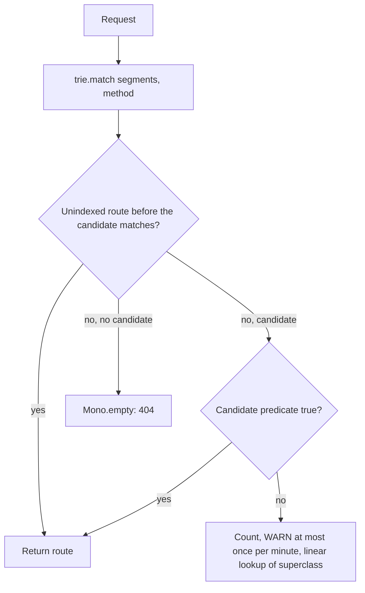

# 017 — Indexed route lookup

| Field | Value |
|---|---|
| Status | Implemented |
| Phase | 5 — Path trie and route lookup performance |
| Depends on | [013](013-oas-route-locator.md), [015](015-path-trie.md), [016](016-routing-benchmark.md) |
| Modules | `gateway` |

## Summary

This spec replaces the linear route lookup of Spring Cloud Gateway with an indexed lookup. `IndexedRoutePredicateHandlerMapping` uses a `PathTrie<Route>` ([015](015-path-trie.md)) to select one candidate route in O(number of path segments). The gateway then evaluates the real predicate of that one route, so the routing behavior does not change. The spec is required (see "Decisions"). The benchmark of [016](016-routing-benchmark.md) measures the gain, but it does not decide if the team implements this spec.

## Motivation

`RoutePredicateHandlerMapping.lookupRoute` evaluates routes in order. With many routes, the lookup cost grows linearly, and a request to an undocumented path (404) evaluates all routes. The routes come from OAS files ([013](013-oas-route-locator.md)), so the gateway knows the path pattern and the methods of each route. An index on this information removes the linear cost.

## Scope

### In scope

- Route metadata `oas-path` and `oas-methods`, added by the converter of [013](013-oas-route-locator.md).
- Class `RouteIndex`: a trie of OAS routes and a list of routes without OAS metadata, each with its position in the route order.
- Class `IndexedRoutePredicateHandlerMapping` that overrides `lookupRoute`.
- Index rebuild on `RefreshRoutesResultEvent` with an atomic swap. The newest route snapshot always wins.
- A counter of the fallbacks to the linear lookup.
- Bean replacement of the default `RoutePredicateHandlerMapping`.

### Out of scope

- The trie itself. See [015](015-path-trie.md).
- The security index. See [024](024-authorization-manager.md).
- Changes to route predicates, filters, or route order.

## Design

### Decision criteria (gate from 016)

The gate is informational. This spec is required, independent of the gate. The results file of [016](016-routing-benchmark.md) records which criterion is true at the target of about 10,000 routes.

| Id | Criterion | Proposed threshold |
|---|---|---|
| D1 | JMH `lookupRoute` p99 for `notFound` | greater than 50 µs |
| D2 | k6 p99 for `notFound` at the expected N compared to N = 100 | more than 10% higher |
| D3 | k6 p99 for `lastMatch` at the expected N compared to N = 100 | more than 10% higher |

[016](016-routing-benchmark.md) owns the thresholds. If they change there, they change here.

### Route metadata

The converter of [013](013-oas-route-locator.md) adds two metadata entries to each `RouteDefinition` that it creates from an OAS file:

| Key | Type | Example | Meaning |
|---|---|---|---|
| `oas-path` | `String` | `/orders-api/orders/{id}` | Public path pattern (prefix + OAS path), the same value as the `Path` predicate |
| `oas-methods` | `List<String>` | `[GET, DELETE]` | Uppercase methods, the same values as the `Method` predicate |

Routes from other sources (for example a test route or a route in `application.yaml`) do not have these keys.

### Route index

```java
record RouteIndex(List<Entry> unindexed, PathTrie<Entry> trie, int size) {
    record Entry(Route route, int position) {}
    static RouteIndex build(List<Route> routesInOrder, String basePath) { ... }
}
```

`build` keeps the route order of the `RouteLocator`. The position of a route is its index in this order (0 for the first route).

1. A route without `oas-path` goes to `unindexed`, in route order.
2. A route with `oas-path` goes into the trie: `trie.insert(basePath + oasPath, oasMethods, entry)`. The `Path` predicate adds `spring.webflux.base-path` before each pattern, so the trie does the same. Without a base path, `basePath` is empty.
3. If `insert` throws an exception, `build` fails. The handler mapping keeps the previous index.

### Lookup algorithm



1. Read the current `RouteIndex`. If no index exists yet, call `super.lookupRoute(exchange)`.
2. Build the segments from the same path that the `Path` predicate matches: `PathContainer.parsePath(exchange.getRequest().getURI().getRawPath())`, stored in the exchange attribute `GATEWAY_PREDICATE_PATH_CONTAINER_ATTR`. Take the decoded segments (`valueToMatch()`). Call `trie.match(segments, method)`. The result is one candidate or no candidate.
3. Evaluate the predicates of the `unindexed` routes whose position is lower than the position of the candidate, in order, with the same logic as the superclass. Without a candidate, evaluate all `unindexed` routes. Return the first match.
4. If no unindexed route matches and there is no candidate, return `Mono.empty()`. The gateway returns 404.
5. Evaluate the real predicate of the candidate once: `route.getPredicate().apply(exchange)`. This call keeps the semantics of the `Path` and `Method` predicates. It also stores the URI template variables in the exchange, which filters such as `SetPath` read.
6. If the predicate is true, set the same exchange attributes as the superclass and return the route.
7. If the predicate is false, increment the fallback counter and return `super.lookupRoute(exchange)`. Log at WARN with the route id, the path, and the counter, at most once per minute, so that requests cannot flood the log. This case shows a difference between the trie and the predicates. A test MUST cover the known causes, and the tests assert that the counter stays 0.

Exception (finding SEC-59-1): the trie gives no candidate for a case variant of a literal sibling, for example `GET /users/ME` with the routes `/users/me` and `/users/{id}` ([015](015-path-trie.md), "Case variants of a literal"). The linear lookup gives `/users/{id}`. The indexed lookup is stricter on purpose: the security index of [024](024-authorization-manager.md) also finds nothing, so the request gets `404` before routing. The random requests of the differential tests use lowercase segments only.

Route order rule: an unindexed route wins over the trie candidate only if it comes before the candidate in route order. `CachingRouteLocator` sorts the routes by `getOrder()` with a stable sort, so the rule compares `getOrder()` first and the locator position for equal order. This is the order of the superclass. Example: a hand-written route with order 0 wins over an OAS template route (order 100). A last-resort route `/**` with order 1000 gets only the requests that no OAS route matches.

### Rebuild and atomic swap

`IndexedRoutePredicateHandlerMapping` implements `ApplicationListener<RefreshRoutesResultEvent>`:

1. On a successful event, take the next rebuild number (generation), then read `routeLocator.getRoutes().collectList()`. A failed event does not change the index.
2. Build a new `RouteIndex` off the event loop (bounded elastic scheduler).
3. Install the new index with compare-and-set, only if its generation is higher than the generation of the installed index. So if two rebuilds overlap, the rebuild that started last wins, also when the older rebuild finishes last. Requests in progress keep the old index.
4. If the build fails, log at ERROR and keep the old index.

The handler mapping also builds the index at startup, after the first route load. The reload of [014](014-route-reload.md) uses the same event, so the index follows each reload.

### Bean replacement

A configuration class `IndexedRouteLookupConfiguration` declares a bean of type `RoutePredicateHandlerMapping` with the class `IndexedRoutePredicateHandlerMapping`. This approach works only if the auto-configuration declares its bean with `@ConditionalOnMissingBean`.

Verified in Spring Cloud Gateway 5.0.4 (Spring Cloud 2025.1.4): `GatewayAutoConfiguration.routePredicateHandlerMapping` has `@ConditionalOnMissingBean`. Its arguments are `FilteringWebHandler`, `RouteLocator`, `GlobalCorsProperties`, `Environment`, and an optional `ApiVersionStrategy` (`org.springframework.web.reactive.accept`). The replacement bean takes the same arguments. It also takes the optional `WebFluxProperties` (for the base path) and the optional `MeterRegistry` (for the fallback counter).

### Implementation notes

- `lookupRoute` of the superclass sets only `GATEWAY_PREDICATE_ROUTE_ATTR` (the id of the route under test) before each predicate call. `getHandlerInternal` of the superclass sets the other attributes, and the subclass does not change it. The indexed lookup sets the same attribute before each predicate call.
- `PathPattern` compares **decoded** path segments (`PathSegment.valueToMatch()`). The trie therefore receives the decoded segments: `/%6Frders/1` gives `[orders, 1]`, and `/orders;p=1/1` gives `[orders, 1]`. Raw segments would make the two lookups disagree.
- The trie uses the full raw path, not `pathWithinApplication()`. The `Path` predicate also matches the full raw path, with the context path. So a context path cannot split the two lookups. With forwarded headers (`server.forward-headers-strategy`), `X-Forwarded-Prefix` adds the prefix to the path and sets it as the context path. Example: `X-Forwarded-Prefix: /proxy` and `GET /orders/1` give the path `/proxy/orders/1`. The OAS route `/orders/{id}` does not match it, with the indexed lookup and with the linear lookup. The gateway returns 404. This spec does not change `server.forward-headers-strategy`.
- A request path with a trailing slash gets no OAS route. `path-pattern-supported` ([007](007-route-model.md)) rejects trailing slashes in OAS paths, and `PathPattern` does not match an optional trailing slash.
- A request path with two adjacent separators (`/a//b`, `//a/b`) gets no OAS route, the same as a trailing slash. `PathContainer.parsePath` drops the empty segment, but `PathPattern` does not match it. The lookup does not ask the trie and does not fall back to the linear lookup.
- `rebuild()` builds the index on the bounded elastic scheduler and installs it with compare-and-set on the generation. On a failure, it logs the error and the previous index stays.
- `fallbackCount()` (package-private) returns the number of fallbacks to the linear lookup. If a Micrometer `MeterRegistry` bean exists, the function counter `gateway.route.index.fallback` shows the same value.
- `linearLookup(exchange)` calls the lookup of the superclass. Tests and the benchmark use it to compare both lookups.
- Memory: the routes keep their `Path` predicate (with a compiled `PathPattern`), because step 5 evaluates the real predicate. At the target of about 10,000 routes, the gateway starts in about 4 seconds with about 0.9 GB resident memory ([013](013-oas-route-locator.md)). Removing the per-route `PathPattern` is possible later; it is not part of this implementation.

## Behavior and errors

| Condition | Result |
|---|---|
| Path and method of a documented operation | Same route as the linear lookup |
| Undocumented path | 404, without evaluation of OAS route predicates |
| Documented path, undocumented method | 404 |
| Route without OAS metadata matches, before the candidate in route order | That route |
| Route without OAS metadata matches, after the candidate in route order | The candidate, if its predicate is true |
| Path with a trailing slash or two adjacent separators | No OAS route; only routes without OAS metadata can match |
| Case variant of a literal segment, for example `/users/ME` next to `/users/me` and `/users/{id}` | No OAS route. The linear lookup gives `/users/{id}`. |
| Path with a context path or `X-Forwarded-Prefix` | Same route as the linear lookup; the prefix is part of the path |
| Trie candidate, predicate false | Linear lookup, fallback counter + 1, WARN log at most once per minute |
| Two rebuilds overlap | The index of the rebuild that started last stays |
| Index build fails on refresh | Old index stays, ERROR log |

## Acceptance criteria

- [x] Every route from the locator of [013](013-oas-route-locator.md) has `oas-path` and `oas-methods` metadata.
- [x] The application context contains exactly one `RoutePredicateHandlerMapping` bean, and its class is `IndexedRoutePredicateHandlerMapping`.
- [x] All routing tests of [013](013-oas-route-locator.md) pass with the indexed lookup.
- [x] For 10,000 random requests on a generated route set, both lookups return the same route id, or both return no route.
- [x] A `SetPath` filter that uses a URI template variable works on an indexed route. (The test checks the URI template variables in the exchange, which `SetPath` reads.)
- [x] A route without OAS metadata that matches a request wins over an OAS route for the same request, if it comes before the OAS route in route order. A route without OAS metadata that comes after it loses.
- [x] Tests that expect no fallback assert that the fallback counter is 0.
- [x] After a `RefreshRoutesEvent` that adds a route, a request to the new path finds the new route.
- [x] If the index build fails, requests use the previous index.
- [ ] The JMH `notFound` result for N = 5,000 is lower with the indexed lookup than with the linear lookup ([016](016-routing-benchmark.md)). This criterion waits for the official run of [016](016-routing-benchmark.md) and its results file. The smoke run below is informational only.

## Test plan

- Unit tests of `RouteIndex.build`: route order, unindexed routes, insert failure.
- Integration tests with `WebTestClient`: run the routing test suite of [013](013-oas-route-locator.md) with the indexed lookup.
- Differential test: the same generator as [016](016-routing-benchmark.md); compare the indexed lookup with `super.lookupRoute`.
- Refresh test: publish `RefreshRoutesEvent`, then check the new route and the atomic swap.
- Benchmark: add the indexed lookup to `RouteLookupBenchmark` of [016](016-routing-benchmark.md) and update the results file.

Results of the tests:

- `IndexedRouteLookupTest` (unit): route order between unindexed routes and the candidate (also a `/**` route with order 1000), decoded segments, matrix parameters, trailing slash, adjacent separators, context path, `X-Forwarded-Prefix`, base path, URI template variables, fallback counter, refresh, failed rebuild, failed `RefreshRoutesResultEvent`, two overlapping rebuilds where the older one finishes last. Each test that expects no fallback asserts that the counter is 0.
- `IndexedRouteLookupIT`: exactly one `RoutePredicateHandlerMapping` bean, of class `IndexedRoutePredicateHandlerMapping`; the metric `gateway.route.index.fallback`; a `RefreshRoutesEvent` after a new route definition gives a new index that finds the route. Differential test: 10,000 random requests on 1,000 generated routes and one route without OAS metadata (`Path=/svc-1*-api/**`, order 50) give the same route id with both lookups, with 0 fallbacks. The requests use the methods GET, POST, PUT, DELETE, PATCH, HEAD, and OPTIONS, and these path variations: percent-encoded character, `;p=1`, trailing `/`, `//`, context path, and `X-Forwarded-Prefix`.
- `OpenApiRoutingIT` ([013](013-oas-route-locator.md)) waits for the index before each test and asserts 0 fallbacks after each test.
- JMH smoke run (informational) (laptop, 1 fork, 2 × 1 s, N = 5,000): `lastMatch` 478 µs linear against 10.7 µs indexed; `notFound` 490 µs against 9.3 µs. About 10 µs of each result is the creation of the mock exchange. `RouteLookupBenchmark` has the parameter `lookup` (`linear`, `indexed`).

## Delivery

One PR. Main files: `RouteIndex.java`, `IndexedRoutePredicateHandlerMapping.java`, `IndexedRouteLookupConfiguration.java`, metadata in the converter of [013](013-oas-route-locator.md) (about 250 lines without tests).

## Decisions (2026-11-12)

- This spec is required. It is no longer conditional on [016](016-routing-benchmark.md). The target is about 10,000 routes. The implementation SHOULD also reduce memory: no compiled `PathPattern` for each route, shared filter instances for equal configurations, and no retained list of `RouteDefinition` objects.
- `route-collision` ([007](007-route-model.md)) rejects overlapping patterns with variables, in the same file and across files. The only allowed overlap is a path without variables that specializes a template in one file. The trie and the linear lookup select the same route for it, so the differential test needs no exclusion for overlaps.

## Open questions

- Do we need a property to switch back to the linear lookup without a new release?

## References

- [013 — OAS route locator](013-oas-route-locator.md)
- [014 — Route reload](014-route-reload.md)
- [015 — Path trie](015-path-trie.md)
- [016 — Routing benchmark](016-routing-benchmark.md)
- Spring Cloud Gateway `RoutePredicateHandlerMapping` and `GatewayAutoConfiguration` source code (version from [001](001-project-skeleton.md)).
