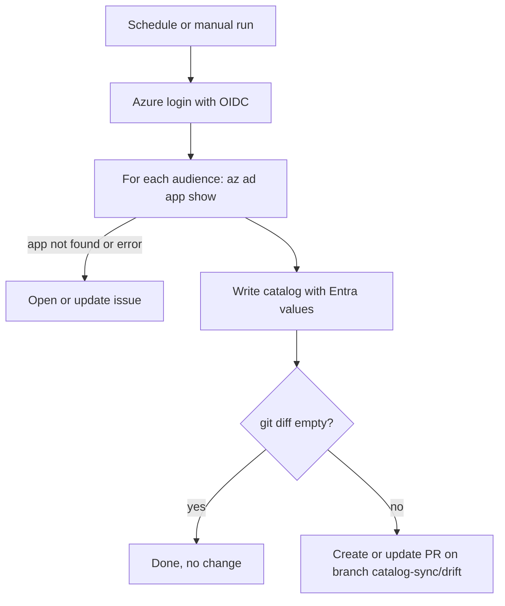

# 020 — Permission catalog sync

| Field | Value |
|---|---|
| Status | Superseded by [035](035-entra-permission-validation.md) |
| Phase | 6 — Authorization contract (core and CLI) |
| Depends on | [019](019-permission-catalog.md), [021](021-entra-app-registrations.md) |
| Modules | `.github/workflows/`, `scripts/` (no Java module) |

## Summary

This spec adds a scheduled GitHub Actions workflow that compares `catalog/permissions.yaml` with the app registrations in Microsoft Entra ID. When the App Roles in Entra differ from the catalog, the workflow opens or updates a pull request (PR) with the corrected catalog. When the workflow cannot read an app, it opens an issue. The workflow logs in to Azure with an OpenID Connect (OIDC) federated credential, so the repository stores no Azure secret. The catalog stays a versioned file for deterministic PR validation, and drift becomes visible within one day.

## Motivation

[019](019-permission-catalog.md) validates OAS files against the catalog, not against Entra. If an app owner renames or removes an App Role in Entra, the catalog is wrong. The CLI then accepts a permission that no token contains, and users get 403. If an app owner adds a role, specs cannot use it until someone edits the catalog. A manual comparison is slow and people forget it.

## Scope

### In scope

- Workflow `.github/workflows/permission-catalog-sync.yml` with a schedule and a manual trigger.
- Script `scripts/sync-permission-catalog.sh` that reads Entra and writes the catalog.
- Drift detection for `roles` and `application-id-uri` of each audience in the catalog.
- One PR for role drift; one issue for errors.
- Azure login with an OIDC federated credential.

### Out of scope

- Discovery of new app registrations. The workflow checks only audiences that are already in the catalog.
- Generation of the catalog from Terraform (see "Open questions").
- Changes to Entra. The workflow only reads Entra.
- Validation of OAS files. The PR triggers the normal pipeline of [011](011-pr-validation-pipeline.md).

## Design

### Flow



### Comparison rules

For each entry in `audiences`, the script runs:

```bash
az ad app show --id "$CLIENT_ID" \
  --query "{roles: appRoles[?isEnabled].value, uris: identifierUris}" -o json
```

| Catalog field | Entra source | Rule |
|---|---|---|
| `roles` | `appRoles[].value` where `isEnabled` is `true` | The catalog gets the Entra list, sorted alphabetically. |
| `application-id-uri` | `identifierUris` | The catalog value MUST be in the list. If not, the script reports an error (issue), because the correct value is ambiguous. |
| `client-id` | `--id` | If the app does not exist, the script reports an error (issue). |
| `name` | none | The script does not change it. |

A disabled App Role does not appear in tokens, so the catalog excludes it. The script sorts roles so that the output is deterministic and a diff shows only real changes.

### Pull request and issue

- Branch: `catalog-sync/drift`. The workflow force-pushes the branch on each run, so one PR stays open at a time.
- PR title: `chore(catalog): sync App Roles from Entra ID`. The PR body lists added and removed roles for each audience.
- If a removed role is still used by an OAS file, the PR check of [011](011-pr-validation-pipeline.md) fails with `permission-exists`. The failure shows the impact to the reviewers.
- Issue title: `Permission catalog sync failed`, label `catalog-drift`. The workflow updates the open issue with the same label instead of opening a new one.
- The PR needs the normal PR review. The repository has no `CODEOWNERS` file ([034](034-access-change-review.md)).

### Pull request checks

GitHub does not start workflows for a PR that the `GITHUB_TOKEN` creates. The required checks of [011](011-pr-validation-pipeline.md) would then never run. The workflow therefore creates the PR with a token of a GitHub App (`actions/create-github-app-token`). The GitHub App needs `contents: write` and `pull-requests: write` on this repository.

### Azure identity

- A dedicated app registration `gateway-catalog-sync` with a federated credential. Subject: `repo:<org>/<repo>:ref:refs/heads/main`.
- Microsoft Graph application permission `Application.Read.All` with admin consent. The implementer MUST confirm that this permission is the least privilege that `az ad app show` needs.
- Repository variables (not secrets): `AZURE_CLIENT_ID`, `AZURE_TENANT_ID`. GitHub App credentials: variable `CATALOG_SYNC_APP_ID`, secret `CATALOG_SYNC_APP_PRIVATE_KEY`.

### Workflow

```yaml
name: permission-catalog-sync

on:
  schedule:
    - cron: "0 5 * * 1-5"        # 05:00 UTC, Monday to Friday
  workflow_dispatch: {}

permissions:
  contents: read
  id-token: write                 # OIDC token for Azure login
  issues: write

concurrency:
  group: permission-catalog-sync
  cancel-in-progress: false

jobs:
  sync:
    runs-on: ubuntu-latest
    timeout-minutes: 15
    steps:
      - uses: actions/checkout@v4

      - uses: azure/login@v2
        with:
          client-id: ${{ vars.AZURE_CLIENT_ID }}
          tenant-id: ${{ vars.AZURE_TENANT_ID }}
          allow-no-subscriptions: true

      - id: sync
        run: scripts/sync-permission-catalog.sh catalog/permissions.yaml
        # writes the catalog; sets outputs: changed=true|false, errors=<file or empty>

      - id: app-token
        if: steps.sync.outputs.changed == 'true'
        uses: actions/create-github-app-token@v1
        with:
          app-id: ${{ vars.CATALOG_SYNC_APP_ID }}
          private-key: ${{ secrets.CATALOG_SYNC_APP_PRIVATE_KEY }}

      - if: steps.sync.outputs.changed == 'true'
        env:
          GH_TOKEN: ${{ steps.app-token.outputs.token }}
        run: scripts/sync-permission-catalog.sh --open-pr catalog-sync/drift

      - if: steps.sync.outputs.errors != ''
        env:
          GH_TOKEN: ${{ github.token }}
        run: scripts/sync-permission-catalog.sh --report-issue "${{ steps.sync.outputs.errors }}"
```

The action versions are examples. The implementer pins each action to a full commit SHA.

### Script

`scripts/sync-permission-catalog.sh` uses `az`, `jq`, `yq`, `git`, and `gh`. It has three modes:

| Mode | Action |
|---|---|
| `<catalog>` | Read Entra, rewrite `roles`, write errors to a file, set step outputs. |
| `--open-pr <branch>` | Commit, force-push the branch with the GitHub App token in `GH_TOKEN`, create the PR or update the body of the open PR. |
| `--report-issue <file>` | Create or update the issue with label `catalog-drift`. |

The script exits with code 1 on an unexpected failure (for example `az` login lost). The workflow run then fails and GitHub notifies the owners.

## Behavior and errors

| Condition | Result |
|---|---|
| Catalog equals Entra | No PR, no issue, run succeeds. |
| Role added, removed, or disabled in Entra | PR on `catalog-sync/drift` with the sorted roles. |
| PR already open and the drift changes | The branch and PR body are updated. |
| App not found for a `client-id` | Issue with the audience name. Other audiences are still synced. |
| `application-id-uri` not in `identifierUris` | Issue with both values. |
| Azure login fails | Run fails, no PR, no issue. |

## Acceptance criteria

- [ ] The workflow runs on the schedule and on `workflow_dispatch`.
- [ ] The workflow uses no Azure client secret.
- [ ] With a catalog equal to Entra, the run creates no PR and no issue.
- [ ] After a role is added in a test app, the next run opens one PR that adds the role in alphabetical order.
- [ ] A second run with the same drift updates the existing PR and does not open a new PR.
- [ ] A disabled App Role is removed from the catalog in the PR.
- [ ] The required checks of [011](011-pr-validation-pipeline.md) run on the sync PR.
- [ ] A `client-id` with no app in Entra produces one issue with label `catalog-drift`, and the other audiences are still compared.
- [ ] The script leaves `name` and the order of `audiences` unchanged.

## Test plan

- Script tests with a fake `az` command on `PATH` that returns fixture JSON. Cases: no drift, added role, removed role, disabled role, unknown app, URI mismatch.
- A manual `workflow_dispatch` run against a test tenant or test app registration before the schedule is enabled.

## Delivery

One PR. Main files: workflow (about 60 lines), script (about 150 lines), script tests (about 120 lines). The Azure app registration and the GitHub App are configuration steps, listed in the PR description.

## Decisions (2026-11-12)

> Note: [035](035-entra-permission-validation.md) replaces the versioned catalog file in CI. The CLI reads the App Roles from Microsoft Graph in each PR, so the repository needs no `catalog/permissions.yaml` and no sync. Do not implement this spec.

## Open questions

- Do backend teams manage their app registrations with Terraform? If yes, does the catalog come from Terraform output instead of this job? See [021](021-entra-app-registrations.md).
- Does the workflow also check `requestedAccessTokenVersion: 2` for each app? The brief requires v2 tokens, but does not assign the check to a spec.
- Does the catalog include roles whose `allowedMemberTypes` contains only `Application`? These roles never appear in user tokens of the session flow.
- Which team owns the GitHub App and the `gateway-catalog-sync` app registration?
- Is the schedule (once per working day) correct, or do we need a faster detection?

## References

- [011 — PR validation pipeline](011-pr-validation-pipeline.md)
- [019 — Permission catalog](019-permission-catalog.md)
- [021 — Entra app registrations](021-entra-app-registrations.md)
- [034 — Access change review](034-access-change-review.md)
- Azure login with OIDC: <https://learn.microsoft.com/azure/developer/github/connect-from-azure-openid-connect>
- `az ad app show`: <https://learn.microsoft.com/cli/azure/ad/app#az-ad-app-show>
- GitHub, triggering a workflow from a workflow: <https://docs.github.com/actions/using-workflows/triggering-a-workflow#triggering-a-workflow-from-a-workflow>
