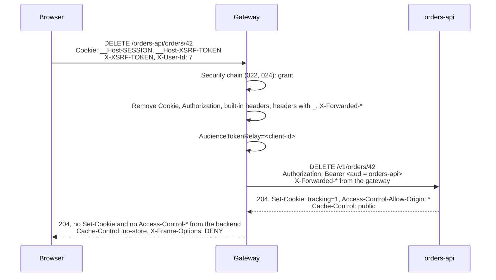

# 025 — Token relay and header hygiene

| Field | Value |
|---|---|
| Status | Implemented |
| Phase | 7 — Session authentication and authorization in the gateway |
| Depends on | [013](013-oas-route-locator.md), [023](023-per-audience-tokens.md) |
| Modules | `gateway` |

## Summary

This spec controls what the gateway sends to backends and what it returns from backends. Each non-public route relays the access token of its own audience in the `Authorization: Bearer` header. The gateway removes `Cookie`, the incoming `Authorization`, and the CSRF header from every request to a backend. It also removes spoofable headers: identity, method override, URL override, and client address headers. It removes headers with `_` in the name, the client `Connection` header, and client-sent forwarding headers. It removes cookie, CORS, and site-wide browser headers, and `WWW-Authenticate`, from every backend response. It sets its own browser policies, `no-store` for private responses, and a `Location` on the gateway. As a result, the session cookie never leaves the gateway, a backend receives only a token with its own `aud`, and a backend cannot change the policies of the gateway site.

## Motivation

The browser sends the `__Host-SESSION` cookie and the `__Host-XSRF-TOKEN` cookie with every request. If the gateway forwards them, a backend (or a compromised backend) can reuse the session through the gateway. A client can also add headers such as `X-User-Id` to impersonate another user, if a backend trusts them. A backend needs a token that it can validate for itself: the access token for its own audience.

## Scope

### In scope

- `AudienceTokenRelay` filter with the audience of the route, on each route with an audience. It relays the token only for a non-public operation.
- Removal of `Cookie` and of the incoming `Authorization` on every route.
- Removal of spoofable request headers on every route: a built-in list plus configured additions, and every header with `_` in its name.
- Removal of `X-XSRF-TOKEN` on every route.
- Removal of client-sent `Forwarded` and `X-Forwarded-*` headers, and new `X-Forwarded-*` values from the gateway.
- Removal of the client `Connection` header.
- Removal of `Set-Cookie`, `Set-Cookie2`, `Access-Control-*`, `Clear-Site-Data`, the site-wide browser headers, and `WWW-Authenticate` from backend responses.
- Gateway values for `X-Frame-Options`, `X-Content-Type-Options`, `Referrer-Policy`, and `Strict-Transport-Security`.
- `Cache-Control: no-store` on private backend responses.
- Rewrite or removal of an absolute `Location` of a backend response.
- Filter order so that the relayed token replaces any client value.
- Tests that the backend never receives the cookie or a client `Authorization` value.

### Out of scope

- Token redemption. See [023](023-per-audience-tokens.md).
- Authorization decisions. See [024](024-authorization-manager.md).
- Forwarding of bearer tokens from services. See [026](026-service-to-service-bearer.md).
- Network policy or mutual TLS (mTLS) between gateway and backends. This is infrastructure work. [021](021-entra-app-registrations.md) lists it in the onboarding checklist. This spec states the requirement for backends (see "Security invariants").
- Trusted proxies and the real client address. See "Open questions".

## Design

### Security invariants

- The session cookie MUST NOT reach backends. The gateway MUST remove the whole `Cookie` header.
- The gateway MUST NOT forward the incoming `Authorization` header to backends.
- A backend MUST receive only an access token whose `aud` is its own client id.
- The ID token and the refresh token MUST NOT reach backends.
- The gateway MUST remove the built-in and the configured headers of "Request header removal" that the client sends. Configuration MUST NOT remove a built-in entry.
- The gateway MUST remove every request header whose name contains `_`.
- The gateway MUST NOT forward `Forwarded` or `X-Forwarded-*` values that the client sends. The gateway MUST NOT use these client values for its own URLs.
- The gateway MUST remove the `Connection` header of the client. Reason: Spring Cloud Gateway removes each header that `Connection` names. With `Connection: Authorization`, the backend would not receive the relayed token.
- A backend MUST NOT set cookies, CORS headers, or site-wide browser policies on the gateway site. The gateway MUST remove the headers of "Response headers" from each backend response, and MUST set its own value for the headers that "Response headers" lists as overwritten.
- A response to an authenticated request, and a response with a gateway cookie, MUST have `Cache-Control: no-store`, also when the backend sends another value.
- A backend `Location` MUST NOT send the browser to another host. A backend `Location` MUST NOT show the internal address of the backend.
- Backends MUST accept traffic only from the gateway. Reason: an access token from Redis ([022](022-session-login.md), "Redis protection") or from a log must not reach a backend directly. Backends MAY validate the token again (defense in depth).
- The relayed token goes to `x-gateway.upstream`. An `http` upstream sends it without TLS. The gateway writes one `WARN` line at startup for each route with an audience and an `http` upstream, with the route id, the audience, and the upstream, and starts. No CONTRACT rule requires `https` in this phase (SEC-62-2): the restriction of upstream hosts was declined on 2026-11-12, and a rule for `https` is an open question. Without TLS, the network between the gateway and the backend MUST be private.
- Backends MUST NOT honor method override or URL override inputs, for example the header `X-HTTP-Method-Override`, the header `X-Original-URL`, or a query parameter `_method`. The gateway removes the known headers, but it cannot know every input of every framework.

### Filters on each route

The route conversion of [013](013-oas-route-locator.md) adds these filters to each `RouteDefinition`, in this order, before `StripPrefix` and `PrefixPath`:

| Order | Filter | Routes | Purpose |
|---|---|---|---|
| 1 | `RemoveRequestHeader=Cookie` | All | The session cookie and the CSRF cookie stay in the gateway. |
| 2 | `RemoveRequestHeader=Authorization` | All | No client value reaches the backend. |
| 3 | `AudienceTokenRelay=<audience>` | Routes with an audience | Adds `Authorization: Bearer <access token>` for the route audience, only for a non-public operation. |

The argument is the value of `x-gateway.audience`, the client id of the backend app. The token comes from the registration `AudienceRegistrationIds.forAudience(audience)` ([023](023-per-audience-tokens.md)), for example `entra-6f1c2e8a-0000-0000-0000-000000000000`. The argument is the audience and not the registration id, because the route conversion ([013](013-oas-route-locator.md)) does not depend on the security code.

Example of a generated route for `orders-api` (client id `6f1c2e8a-0000-0000-0000-000000000000`):

```yaml
id: orders-api-orders-id
uri: http://orders-service:8080
predicates:
  - Path=/orders-api/orders/{id}
  - Method=GET,DELETE
filters:
  - RemoveRequestHeader=Cookie
  - RemoveRequestHeader=Authorization
  - AudienceTokenRelay=6f1c2e8a-0000-0000-0000-000000000000
  - StripPrefix=1
  - PrefixPath=/v1
```

The gateway does not use the `TokenRelay` filter of Spring Cloud Gateway. Verified in Spring Cloud 2025.1.4 (Spring Cloud Gateway 5.0.4): `TokenRelay` takes a client registration id, but it forwards the request without a token when it finds no token. It also calls the authorized client manager again, without the exchange. For a token in the clock skew window of [023](023-per-audience-tokens.md), a second call redeems a second token. `AudienceTokenRelay` is a small `GatewayFilter` of the gateway instead.

`AudienceTokenRelay` never calls the authorized client manager or Entra. [024](024-authorization-manager.md) has already resolved and checked the token for this request. The resolver of [023](023-per-audience-tokens.md) stores this token in the exchange attribute `AUDIENCE_TOKEN` (class `AudienceAccessToken`, with the `aud` of the token), after the signature, the `aud`, and the `oid` passed. The relay sends exactly this token. So the backend receives the token that the authorization manager checked, also when a parallel request renews the token in the session. The attribute exists only in the exchange. Its text form does not contain the token.

The relay sends the token only if its `aud` equals the filter argument and the audience of the access rule of the request.

A route has all methods of one OAS path ([013](013-oas-route-locator.md)), so one route can have a public and a non-public operation. The relay therefore checks the access rule of the request ([024](024-authorization-manager.md), `OPERATION_ACCESS`), not the route. A public operation gets no `Authorization` header: `RemoveRequestHeader=Authorization` removes the client value, and the relay adds nothing. A route without an audience has only public operations (CONTRACT rule `audience-required`), so it has no relay filter.

If the relay finds no token for a non-public route, the gateway does not send the request to the backend. It returns `500` with the generic 500 body of [024](024-authorization-manager.md). It also writes an `ERROR` log line with the route id and the principal name, without a token. Reason for `500` and not `401`: the session is valid, and the case is a gateway error. A `401` would send the SPA to the login again, and the login would not fix the error, so the SPA could loop. This case is not expected after the grant of [024](024-authorization-manager.md). The same answer applies when the token or the access rule has another audience than the filter argument, or when the request has no access rule. Each case is a defect of the gateway.

### Request header removal

`IdentityHeaderRemovalFilter` is a `GlobalFilter`. It runs on all routes, directly after `RouteOperationFilter` of [024](024-authorization-manager.md) (order `HIGHEST_PRECEDENCE + 1`), and before the route filters. It removes every request header whose name matches a built-in or configured name or prefix, and every request header whose name contains `_`. The comparison is case-insensitive. The configuration can add entries to this list (a denylist). A mode that forwards only allowed headers (an allowlist) is an open question.

Built-in list. Configuration cannot remove these entries:

| Kind | Values | Reason |
|---|---|---|
| Prefixes | `X-User-`, `X-Authenticated-`, `X-Ms-Client-Principal`, `X-Ms-Token-` | Spoofable identity and token headers. Azure App Service authentication uses `X-MS-CLIENT-PRINCIPAL*` and `X-MS-TOKEN-*`. |
| Prefixes | `X-Auth-Request-`, `X-Amzn-Oidc-`, `X-Goog-Authenticated-` | Identity headers of authentication proxies: OAuth2 Proxy, AWS Application Load Balancer, and Google Identity-Aware Proxy. |
| Prefixes | `X-Arr-`, `X-Waws-` | Headers of Azure App Service, for example `X-ARR-ClientCert` (client certificate) and `X-WAWS-Unencoded-URL` (URL override). |
| Names | `X-Forwarded-User`, `X-Remote-User`, `Remote-User`, `X-User`, `X-UserId`, `X-Username`, `X-Principal`, `X-Roles`, `X-Groups`, `X-Remote-Group`, `X-Webauth-User` | Spoofable identity headers. |
| Names | `X-Id-Token`, `X-Access-Token`, `X-Auth-Token`, `X-Api-Key` | Spoofable token and key headers. |
| Names | `X-Client-Cert`, `Ssl-Client-Cert` | Spoofable client certificate headers. |
| Names | `X-HTTP-Method-Override`, `X-HTTP-Method`, `X-Method-Override` | Method override. A backend could run `DELETE` for a `GET` that the gateway authorized. |
| Names and prefixes | `X-Original-URL`, `X-Rewrite-URL`, `X-Envoy-Original-Path`, `X-Override-URL` (names), `X-Original-` (prefix) | URL override. A backend could serve another path than the path that the gateway authorized. |
| Names | `X-Host`, `X-HTTP-Host-Override` | Host override. |
| Names | `X-Real-IP`, `X-Client-IP`, `True-Client-IP`, `CF-Connecting-IP`, `X-Cluster-Client-IP`, `Client-IP` | Spoofable client address. |
| Names | `X-XSRF-TOKEN` | The CSRF token stays in the gateway. |
| Prefixes and names | `X-Forwarded-` (prefix), `Forwarded` (name) | Client-sent forwarding headers. See "Forwarding headers". |
| Names | `Connection` | Hop-by-hop header. See "Connection header". |

Headers with `_` in the name: some servers and frameworks read `X_User_Id` as `X-User-Id`. Example: with Common Gateway Interface (CGI) variables, both names become `HTTP_X_USER_ID`. A header with `_` could therefore pass the list above and still reach the backend as an identity header. The gateway removes every header with `_` in its name. Configuration cannot turn this rule off.

The `__Host-XSRF-TOKEN` cookie does not reach the backend, because the gateway removes the whole `Cookie` header.

### Connection header

`Connection` is a hop-by-hop header. Its value can name other headers, and a proxy removes the named headers before it forwards the request. `RemoveHopByHopHeadersFilter` of Spring Cloud Gateway does this, after the route filters. So a client could send `Connection: close, Authorization` and remove the relayed token, or `Connection: X-Request-Id` and remove any other header.

The gateway removes the whole `Connection` header of the client. It does not reject the request. The connection between the client and the gateway does not change: Reactor Netty reads `Connection: close` before the filters run. Netty sets its own `Connection` value for the connection to the backend.

The OAS routes do not describe WebSocket. A WebSocket upgrade needs `Connection: Upgrade`. A later spec that adds WebSocket routes must handle this header.

| Client request header | Sent to backend? |
|---|---|
| `Cookie: __Host-SESSION=abc; __Host-XSRF-TOKEN=def` | No |
| `Authorization: Bearer <client value>` | No. Replaced by the relayed token on non-public routes. |
| `X-User-Id: 42` (prefix `X-User-`) | No |
| `X_User_Id: 42` (contains `_`) | No |
| `X-MS-CLIENT-PRINCIPAL-NAME: alice` (prefix `X-Ms-Client-Principal`, any letter case) | No |
| `X-MS-TOKEN-AAD-ACCESS-TOKEN: eyJ...` (prefix `X-Ms-Token-`) | No |
| `Remote-User: alice` | No |
| `X-HTTP-Method-Override: DELETE` | No |
| `X-Original-URL: /admin` | No |
| `True-Client-IP: 203.0.113.9` | No |
| `X-XSRF-TOKEN: def` | No |
| `X-Forwarded-For: 203.0.113.9` | No. The gateway sets its own value. |
| `Forwarded: for=203.0.113.9` | No |
| `X-Api-Key: abc` | No |
| `Connection: close, Authorization` | No. The relayed `Authorization` still reaches the backend. |
| `Accept: application/json` | Yes |

### Forwarding headers

The gateway does not support trusted proxies in this phase. It treats every `Forwarded` and `X-Forwarded-*` header from the client as untrusted:

1. `IdentityHeaderRemovalFilter` removes `Forwarded` and each header with the prefix `X-Forwarded-`.
2. The gateway sets its own forwarding headers. It does not append to a client value:

   | Header | Source | Example with `gateway.public-base-url=https://gateway.example.com` |
   |---|---|---|
   | `X-Forwarded-Proto` | Scheme of `gateway.public-base-url` | `https` |
   | `X-Forwarded-Host` | Host of `gateway.public-base-url`, with the port if the URL has an explicit port | `gateway.example.com` |
   | `X-Forwarded-Port` | Port of `gateway.public-base-url`; without an explicit port, `443` for `https` and `80` for `http` | `443` |
   | `X-Forwarded-For` | Address of the connection peer of the gateway. An IPv6 address has the compressed form of RFC 5952 and no zone id. | `198.51.100.7`, `::1`, `fe80::1` (not `fe80::1%eth0`) |

3. The gateway sends no `Forwarded` header and no other `X-Forwarded-*` header, for example no `X-Forwarded-Prefix`.
4. The gateway does not use forwarding headers or the `Host` header for its own URLs. It builds the redirect URIs of [022](022-session-login.md) from the required property `gateway.public-base-url`.

`X-Forwarded-For` is not the client address in this phase. It is the address of the connection peer. When a load balancer is in front of the gateway, the peer is the load balancer. Backends MUST NOT use `X-Forwarded-For` to identify a client, for example for rate limits or audit logs.

Verified in Spring Cloud 2025.1.4 (Spring Cloud Gateway 5.0.4): Spring Cloud Gateway registers `XForwardedHeadersFilter` and `ForwardedHeadersFilter` only when `spring.cloud.gateway.server.webflux.trusted-proxies` is set. Without this property, it registers `RemoveXForwardedHeadersFilter` and `RemoveForwardedHeadersFilter` instead. The gateway does not set the property. `GatewayForwardedHeadersFilter`, a request `HttpHeadersFilter` with the lowest precedence, runs after these filters. It removes `Forwarded` and every `X-Forwarded-*` header again, and then sets the four headers of the table above. So a configured trusted proxy cannot add a client value.

Spring Boot MUST NOT apply forwarding headers to the request. The configuration sets `server.forward-headers-strategy: none` explicitly. Reason: Spring Boot turns on native forwarded header handling of Reactor Netty when it detects a cloud platform, for example Kubernetes. Then the request would use the `Host` and the scheme that the client sends in `X-Forwarded-*`.

```yaml
server:
  forward-headers-strategy: none
```

Example: the gateway receives a connection from `198.51.100.7` with `Host: internal-gw:8080`. `gateway.public-base-url` is `https://gateway.example.com`. The client sends `X-Forwarded-For: 203.0.113.9` and `X-Forwarded-Host: evil.example.com`. The backend receives `X-Forwarded-For: 198.51.100.7`, `X-Forwarded-Proto: https`, `X-Forwarded-Host: gateway.example.com`, and `X-Forwarded-Port: 443`.

### Response headers

`BackendResponseHeadersFilter`, a response `HttpHeadersFilter` of Spring Cloud Gateway, changes the headers of each backend response before the gateway copies them to the client response. It replaces `BackendCookieHeadersFilter` of [022](022-session-login.md).

It removes these headers:

| Header | Reason |
|---|---|
| `Set-Cookie`, `Set-Cookie2` | A backend MUST NOT set cookies on the gateway site. |
| Each header with the prefix `Access-Control-` | The gateway does not support CORS ([022](022-session-login.md)). A backend MUST NOT open the gateway site to other origins. |
| `Clear-Site-Data` | A backend MUST NOT delete the cookies or the storage of the gateway site. |
| `Strict-Transport-Security` | A backend MUST NOT change the HTTPS policy of the gateway host, for example with `max-age=0`. The gateway sets its own value. |
| `NEL`, `Report-To`, `Reporting-Endpoints` | A backend MUST NOT send the error reports of the browser for the gateway site to another host. |
| `Service-Worker-Allowed` | A backend MUST NOT give a service worker a scope larger than its path. |
| `Alt-Svc` | A backend MUST NOT send the browser to another host for later requests. |
| `Origin-Agent-Cluster` | A backend MUST NOT change the process isolation of the gateway origin. |
| `Accept-CH`, `Critical-CH` | A backend MUST NOT ask the browser for client hints on all requests to the gateway site. |
| `WWW-Authenticate` | The gateway decides how the browser signs in ([022](022-session-login.md)). A `Basic` challenge of a backend would open a login dialog in the browser. |

It sets these headers with the gateway value, also when the backend sends another value:

| Header | Value |
|---|---|
| `X-Frame-Options` | `DENY` |
| `X-Content-Type-Options` | `nosniff` |
| `Referrer-Policy` | `no-referrer` |

These are the default values of Spring Security. The gateway responses that do not come from a backend get the same values from Spring Security.

`Strict-Transport-Security`: when `gateway.public-base-url` uses `https`, the gateway sets `Strict-Transport-Security: max-age=31536000` (one year) on each response, also on its own responses. It does not set `includeSubDomains` or `preload`, because the gateway does not know the other hosts of its domain. The default writer of Spring Security checks the scheme of the request. TLS can end at a load balancer, so the gateway can see `http`. The gateway therefore uses `gateway.public-base-url`. With the profile `local` and `http`, the gateway sets no `Strict-Transport-Security`.

`Location`:

| Backend `Location` | Client `Location` |
|---|---|
| Relative, without a host, for example `/orders-api/orders/43` | Unchanged. |
| Absolute, with the scheme, host, and port of the route upstream, and a path in the upstream base path | `gateway.public-base-url`, `spring.webflux.base-path`, the route prefix, and the path after the upstream base path, with the query and the fragment. |
| Absolute, with the route upstream, and a path outside the upstream base path | Removed. The path has no public URL. |
| With another host, also `//other.example.com/a`, with user information, or not a valid URI | Removed. |

Example: the route of `orders-api` has the upstream `http://orders-service:8080`, the prefix `/orders-api`, and the upstream base path `/v1`. The backend sends `Location: http://orders-service:8080/v1/orders/43?page=2`. The client receives `Location: https://gateway.example.com/orders-api/orders/43?page=2`. The route conversion of [013](013-oas-route-locator.md) stores the prefix and the upstream base path in the route metadata `public-prefix` and `upstream-base-path`.

A backend `401` keeps its status and its body. Only `WWW-Authenticate` is removed. The gateway `401` of [022](022-session-login.md) has `Content-Type: application/problem+json` and a fixed body. A new login does not fix a backend `401`: on a non-public operation, the backend already has the token of the session, and on a public operation, the backend receives no token. The SPA should start a login only for the gateway `401`. How the SPA tells the two cases apart is an open question.

`Cache-Control`: Spring Security writes `Cache-Control: no-cache, no-store, max-age=0, must-revalidate` only when the response has no cache header. So a backend value, for example `public, max-age=3600`, would stay. `PrivateResponseCacheFilter`, a `GlobalFilter`, sets `Cache-Control: no-store` and `Pragma: no-cache` just before the gateway sends the response, when one of these is true:

- The request is authenticated. The response can contain data of the user.
- The response has a gateway cookie (`__Host-SESSION` or `__Host-XSRF-TOKEN`). A shared cache must not give the cookie to another user.

Otherwise, the backend value stays. A public operation without a session can therefore use shared caches.

The gateway MUST still send its own `__Host-SESSION` and `__Host-XSRF-TOKEN` cookies ([022](022-session-login.md)). A filter that removes `Set-Cookie` from the final client response would also remove these cookies, so the implementer MUST NOT use it.

### Request flow



### Token size

Backend tokens with many roles are large. The backend must accept the `Authorization` header size. Keep permissions medium-grained ([021](021-entra-app-registrations.md)).

## Behavior and errors

| Condition | Result |
|---|---|
| Non-public route, token in session | Backend receives `Authorization: Bearer <audience token>`. |
| Non-public route, no token in session | Not expected after the grant of [024](024-authorization-manager.md). If it happens: `500` with the generic 500 body of [024](024-authorization-manager.md), one `ERROR` log line, and no request to the backend. |
| Public route | Backend receives no `Authorization`, no `Cookie`. |
| Client sends `Authorization` on a public route | Removed. |
| Client sends a header of the built-in list, a configured header, or a header with `_` in the name | Removed. |
| Client sends `Forwarded` or `X-Forwarded-*` | Removed. The backend receives the gateway values of `X-Forwarded-For`, `X-Forwarded-Proto`, `X-Forwarded-Host`, and `X-Forwarded-Port`. |
| Client sends `Connection`, with any value | Removed. The headers that it names reach the backend. |
| Backend response contains a header of the removed list of "Response headers" | Removed. The gateway cookies of [022](022-session-login.md) are not affected. |
| Backend response contains `X-Frame-Options`, `X-Content-Type-Options`, or `Referrer-Policy` | The gateway value replaces it. |
| `gateway.public-base-url` uses `https` | Each response has `Strict-Transport-Security: max-age=31536000`. |
| Authenticated request, or a response with a gateway cookie | `Cache-Control: no-store` and `Pragma: no-cache`, also when the backend sends another value. |
| Backend response has an absolute `Location` | Rewritten to the gateway URL for the route upstream. Removed for another host. |
| Backend returns `401` | `401` with the backend body, without `WWW-Authenticate`. |

## Configuration

| Property | Type | Default | Meaning |
|---|---|---|---|
| `gateway.security.remove-request-headers.names` | List of strings | `[]` | Exact header names to remove, in addition to the built-in names. |
| `gateway.security.remove-request-headers.prefixes` | List of strings | `[]` | Header name prefixes to remove, in addition to the built-in prefixes. |
| `server.forward-headers-strategy` | Enum | `none` (set explicitly) | Spring Boot property. MUST be `none`. See "Forwarding headers". |

The configured values add to the built-in list. They cannot remove a built-in entry or the rule for `_`. A blank value stops the startup, because a blank prefix would remove every header. The properties are the record `GatewaySecurityProperties.RemoveRequestHeaders`. Example: this configuration also removes `X-Tenant-Id` and every header that starts with `X-Internal-`:

```yaml
gateway:
  security:
    remove-request-headers:
      names: [X-Tenant-Id]
      prefixes: [X-Internal-]
```

## Acceptance criteria

Token relay:

- [x] For a non-public route, the mock backend receives `Authorization: Bearer` with the token of the route audience.
- [x] For a route of `payments-api`, the mock backend receives the `payments-api` token and not the `orders-api` token of the same session.
- [x] When the client sends `Authorization: Bearer forged`, the mock backend never receives `forged`.
- [x] For a public route, the mock backend receives no `Authorization` header.
- [x] A non-public route without a token in the session returns `500` with `Content-Type: application/problem+json` and the generic 500 body of [024](024-authorization-manager.md). The request writes exactly one `ERROR` log line, with the route id and the principal name, and the mock backend receives no request. The test counts all `ERROR` lines of the request.
- [x] One route has the public operation `GET /orders-api/items/{id}` and the protected operation `DELETE /orders-api/items/{id}`. For the `GET`, the mock backend receives no `Authorization`. For the `DELETE`, it receives the `orders-api` token of the session.
- [x] On a protected operation, the client sends `Connection: Authorization`, `Connection: X-Forwarded-For`, or `Connection: close, Authorization, X-Forwarded-For`. Each time, the mock backend receives the relayed token and `X-Forwarded-For: 127.0.0.1`.
- [x] At startup, the gateway writes one `WARN` line for each route with an audience and an `http` upstream, and none for an `https` upstream.
- [x] The backend never receives the ID token or the refresh token in any header.
- [x] A request with a token in the session causes no call to the Entra token endpoint during relay.

Request headers:

- [x] For every route, the mock backend receives no `Cookie` header, also when the client sends several cookies.
- [x] Headers that match a configured name or prefix (any letter case) do not reach the mock backend.
- [x] Each built-in name and a header for each built-in prefix (any letter case) do not reach the mock backend, also when the configuration sets other names and prefixes.
- [x] `X-HTTP-Method-Override`, `X-HTTP-Method`, `X-Method-Override`, `X-Original-URL`, `X-Rewrite-URL`, `X-Real-IP`, `X-Client-IP`, `True-Client-IP`, `X-MS-TOKEN-AAD-ACCESS-TOKEN`, and `X-Original-Host` do not reach the mock backend.
- [x] `X_User_Id`, `x_custom`, and `Accept_Language` do not reach the mock backend.
- [x] `X-XSRF-TOKEN` does not reach the mock backend.
- [x] Each name and a header for each prefix that SEC-61-4 added, for example `X-User`, `X-Api-Key`, `X-ARR-ClientCert`, `X-WAWS-Unencoded-URL`, `CF-Connecting-IP`, and `X-Amzn-Oidc-Identity`, do not reach the mock backend.
- [x] When the client sends `Connection: X-Request-Id, X-Forwarded-For` and `X-Request-Id: r-1`, the mock backend receives `X-Request-Id: r-1` and `X-Forwarded-For: 127.0.0.1`, on a public and a protected operation.
- [x] Other headers, for example `Accept` and `Content-Type`, reach the mock backend unchanged.

Forwarding headers. The criteria in this group run the gateway on a real port (`webEnvironment = RANDOM_PORT`). The test client connects to that port and sends raw HTTP with the forged headers. A mock-bound `WebTestClient` is not allowed, because it skips the HTTP server, and the forwarded header handling of Reactor Netty would not run. The test gets a session with a real login against the mock identity provider, or with a session that the test writes into Redis.

- [x] When the client sends `Forwarded` and `X-Forwarded-For: 203.0.113.9`, the mock backend receives no `Forwarded` header, and `X-Forwarded-For` is exactly `127.0.0.1`, the address of the test client connection.
- [x] `X-Forwarded-For` is `::1` for the peer `::1`, and `fe80::1` for a peer `fe80::1` with a zone id (unit test).
- [x] With `gateway.public-base-url=https://gateway.example.com`, the mock backend receives `X-Forwarded-Proto: https`, `X-Forwarded-Host: gateway.example.com`, and `X-Forwarded-Port: 443`, also when the request has `Host: other.example.com` and `X-Forwarded-Host: evil.example.com`. It receives no `X-Forwarded-Prefix`.
- [x] With `gateway.public-base-url=http://localhost:8080` and the profile `local`, the mock backend receives `X-Forwarded-Proto: http`, `X-Forwarded-Host: localhost:8080`, and `X-Forwarded-Port: 8080`.
- [x] The test runs with `spring.main.cloud-platform=kubernetes`. A request with `X-Forwarded-Host: evil.example.com`, `X-Forwarded-Proto: http`, `X-Forwarded-For: 203.0.113.9`, and `Forwarded: for=203.0.113.9` gives the same `redirect_uri` of [022](022-session-login.md) and the same forwarding headers at the mock backend as a request without these headers. The mock backend receives `X-Forwarded-For: 127.0.0.1`. The test fails with `server.forward-headers-strategy: native`.
- [x] The default configuration has `server.forward-headers-strategy: none`.

Response headers:

- [x] When the mock backend returns `Set-Cookie` or `Set-Cookie2`, the client response contains neither header from the backend.
- [x] When the mock backend returns `Access-Control-Allow-Origin: *`, `Access-Control-Allow-Credentials: true`, and `Clear-Site-Data: "cookies"`, the client response contains none of these headers.
- [x] The client sends a request without a `__Host-XSRF-TOKEN` cookie to a public route, and the mock backend returns `Set-Cookie: tracking=1`. The response contains the `__Host-XSRF-TOKEN` cookie of the gateway and no `tracking` cookie.
- [x] Other response headers of the backend, for example `Content-Type`, reach the client unchanged.
- [x] When the mock backend returns `Strict-Transport-Security: max-age=0`, `NEL`, `Report-To`, `Reporting-Endpoints`, `Service-Worker-Allowed`, `Alt-Svc`, `Origin-Agent-Cluster`, `Accept-CH`, `Critical-CH`, and `WWW-Authenticate`, the client response contains none of these backend values. With `gateway.public-base-url=https://gateway.example.com`, it contains `Strict-Transport-Security: max-age=31536000`. With `gateway.public-base-url=http://localhost:8080` and the profile `local`, a response has no `Strict-Transport-Security`.
- [x] When the mock backend returns `X-Frame-Options: ALLOWALL`, `X-Content-Type-Options: none`, and `Referrer-Policy: unsafe-url`, the client response contains `X-Frame-Options: DENY`, `X-Content-Type-Options: nosniff`, and `Referrer-Policy: no-referrer`.
- [x] When the mock backend returns `Cache-Control: public, max-age=3600`, the response to an authenticated request and the response with a new `__Host-XSRF-TOKEN` cookie have `Cache-Control: no-store` and `Pragma: no-cache`. A public operation without a session and without a new cookie keeps `public, max-age=3600`.
- [x] A backend `Location` to the route upstream becomes `https://gateway.example.com/orders-api/...`, with the query. A `Location` to another host is removed. A relative `Location` is unchanged. The unit test also covers the upstream base path, `spring.webflux.base-path`, a path outside the upstream base path, `//host`, user information, and an invalid value.

## Test plan

- Unit test for the route conversion: filter list and order for public and non-public operations.
- Unit test for `IdentityHeaderRemovalFilter`: built-in names and prefixes, configured names and prefixes, letter case, headers with `_`, configuration cannot remove a built-in entry.
- Unit test for the response header filter: each removed header, the overwritten headers, each case of the `Location` table, other response headers kept.
- Unit test for `PrivateResponseCacheFilter`: authenticated, gateway cookie, anonymous without a cookie.
- Unit test for the forwarding header values from `gateway.public-base-url`, with and without an explicit port, and for IPv6 peers with and without a zone id.
- Integration tests with `WebTestClient`, `mockOidcLogin()`, the stub permission resolver of [024](024-authorization-manager.md) with a known token value, or a real login against the mock identity provider, and a mock backend that records request headers. Cases: non-public, public, forged `Authorization`, cookies, identity headers, override headers, headers with `_`, `X-XSRF-TOKEN`, forwarding headers, backend response headers, no token at relay, two audiences in one session.
- Integration tests on a real port (`RANDOM_PORT`) for the forwarding headers, with and without `spring.main.cloud-platform=kubernetes`. The client sends raw HTTP with forged `Host`, `Forwarded`, and `X-Forwarded-*` headers. The session comes from a real login against the mock identity provider, or is written into Redis by the test.
- Property-style test: for all generated routes in a test set of OpenAPI Specification (OAS) files, the mock backend never receives `Cookie`.

## Delivery

One PR. Main files: change in the route conversion of [013](013-oas-route-locator.md), `AudienceTokenRelayGatewayFilterFactory`, `AudienceAccessToken`, `IdentityHeaderRemovalFilter`, `GatewaySecurityProperties.RemoveRequestHeaders`, `BackendResponseHeadersFilter`, `PrivateResponseCacheFilter`, `GatewayForwardedHeadersFilter`, `application.yaml` (`server.forward-headers-strategy`), tests. Estimate: 350 lines.

The implementation is two stacked PRs, because the tests are larger than the estimate:

1. Header hygiene: request header removal, forwarding headers, and response headers.
2. Token relay: removal of the incoming `Authorization`, and the relay of the audience token.

## Decisions (2026-11-13)

The product owner asked for conservative defaults so that the implementation can start. The team chose these defaults. The team can change each of them later.

- Identity headers: the gateway removes every header with the prefix `X-User-`, `X-Authenticated-`, or `X-Ms-Client-Principal`, and the headers `X-Forwarded-User`, `X-Remote-User`, and `Remote-User`. The list is configurable, but only by addition. The defaults cannot be removed. This answers the open question about the list of identity headers.
- CSRF header: the gateway removes `X-XSRF-TOKEN` (and the `__Host-XSRF-TOKEN` cookie, with the `Cookie` header) before it forwards the request. This answers the open question about `X-XSRF-TOKEN`.
- Forwarding headers: the gateway removes `Forwarded` and `X-Forwarded-*` that the client sends, and sets its own `X-Forwarded-For`, `X-Forwarded-Proto`, `X-Forwarded-Host`, and `X-Forwarded-Port`. Trusted proxies are not supported in this phase. The gateway builds its own URLs from `gateway.public-base-url` ([022](022-session-login.md)), never from request headers. This answers the open question about forwarding headers.
- Backend cookies: the gateway removes `Set-Cookie` from backend responses. This answers the open question about `Set-Cookie`.

Defaults chosen by the team after the review of PR #47 (QA-47, SEC-47). The team can change each of them later:

- No token at relay (QA-47-5): `500` with the generic 500 body of [024](024-authorization-manager.md) and an `ERROR` log line. This replaces the earlier default of `401`, because a `401` can start a login loop.
- Forwarded header handling (QA-47-6): `server.forward-headers-strategy: none`, set explicitly.
- Forwarding header values (QA-47-7, SEC-47-5): `X-Forwarded-Host`, `X-Forwarded-Proto`, and `X-Forwarded-Port` come from `gateway.public-base-url`. `X-Forwarded-For` is the connection peer. It is not the client address in this phase.
- More removed request headers (SEC-47-4): method override, URL override, and client address headers, the prefixes `X-Ms-Token-` and `X-Original-`, and every header with `_` in its name. Backends MUST NOT honor method or URL override inputs.
- Backends (SEC-47-1): backends MUST accept traffic only from the gateway. This was a SHOULD before.
- More removed response headers (SEC-47-7): `Set-Cookie2`, `Access-Control-*`, and `Clear-Site-Data`.
- Forwarding header tests (QA-47-15): the tests run on a real port with raw HTTP, not with a mock-bound `WebTestClient`.

Decisions in the implementation (2026-11-14). Each one is the safest reading of an unclear point of this spec:

- The relay filter is `AudienceTokenRelay=<audience>`, a gateway filter, not `TokenRelay=<registration id>`. Reason: `TokenRelay` forwards a request without a token, and it calls the authorized client manager again.
- The relay sends the token that the authorization manager checked for the request (exchange attribute `AUDIENCE_TOKEN`). It does not read the session again.
- The relay filter is on each route with an audience, and it checks the access rule of each request. Reason: one route can have a public and a non-public operation.
- A blank value in `gateway.security.remove-request-headers` stops the startup.
- `BackendCookieHeadersFilter` of [022](022-session-login.md) is now `BackendResponseHeadersFilter`. It removes all backend response headers of "Response headers".

## Review findings

| Finding | Resolution in this spec |
|---|---|
| QA-47-5 | "Filters on each route", "Behavior and errors", and the criterion for no token at relay. |
| QA-47-6 | "Forwarding headers", "Configuration", and the criterion with `spring.main.cloud-platform=kubernetes`. |
| QA-47-15 | "Acceptance criteria" (forwarding headers) and "Test plan": a real server, raw HTTP, and the peer address `127.0.0.1`. |
| QA-47-7, SEC-47-5 | "Forwarding headers": the values come from `gateway.public-base-url`. `X-Forwarded-For` is the connection peer. |
| SEC-47-1 | "Security invariants": backends MUST accept traffic only from the gateway. |
| SEC-47-4 | "Security invariants" and "Request header removal". |
| SEC-47-7 | "Response headers" and the criteria for response headers. |
| SEC-61-1 | "Response headers": the site-wide browser headers are removed, `X-Frame-Options`, `X-Content-Type-Options`, and `Referrer-Policy` get the gateway value, and `Strict-Transport-Security: max-age=31536000` comes from `gateway.public-base-url`. Its criteria. |
| SEC-61-2 | "Response headers" (`Cache-Control`): `PrivateResponseCacheFilter`. Its criterion. |
| SEC-61-3 | "Response headers" (`Location`, backend `401`): the `Location` table, the removal of `WWW-Authenticate`, and an open question for the SPA. Its criteria. |
| SEC-61-4 | "Request header removal": the new names and prefixes. The allowlist mode is an open question. Its criterion. |
| SEC-62-1, QA-62-1 | "Connection header": the gateway removes the client `Connection` header and does not reject the request. The header-level criterion is in "Request headers". The criterion with the relayed token is in "Token relay". |
| QA-62-2 | The criterion for one route with a public `GET` and a protected `DELETE`. |
| QA-62-3 | The criterion for no token at relay: exactly one `ERROR` line of the request, with the route id and the principal name. |
| SEC-62-2 | "Security invariants": a startup `WARN` for each route with an audience and an `http` upstream. A CONTRACT rule is an open question. Its criterion. |
| QA-61-1 | The criterion with `spring.main.cloud-platform=kubernetes` forges `X-Forwarded-For` and `Forwarded`. |
| QA-61-2 | "Forwarding headers": `X-Forwarded-For` has no IPv6 zone id. Its criterion. |
| QA-61-3 | Test change only: the `Cookie` check of `HeaderHygieneIT` is case-insensitive. |

## Open questions

1. Backends receive the address of the connection peer in `X-Forwarded-For`, not the client address. When a load balancer is in front of the gateway, that is the load balancer. Do backends need the client address? If yes, the gateway needs support for trusted proxies in a later phase.
2. Request headers (SEC-61-4): does the gateway need an allowlist mode, in which it forwards only listed headers? A denylist cannot know every identity header of every framework. An allowlist also removes headers that a backend needs, so each OAS file or each route would need its own list.
3. Backend `401` (SEC-61-3): how does the SPA tell a backend `401` from the gateway `401` of [022](022-session-login.md)? The gateway `401` has the problem body of [022](022-session-login.md), but a backend can send the same body. Options: a gateway response header, for example `X-Gateway-Auth: login-required`, on the gateway `401` only; or a rule that maps a backend `401` to another status, for example `502`.
4. Upstream TLS (SEC-62-2): must a CONTRACT rule require an `https` upstream for each OAS file with `x-gateway.audience`? Today the gateway only writes a `WARN` line. A rule would stop the startup for a backend in a private network without TLS, so it may need a deviation for local development.

## References

- [013 — OAS route locator](013-oas-route-locator.md)
- [021 — Entra app registrations](021-entra-app-registrations.md)
- [022 — Session login](022-session-login.md)
- [023 — Per-audience tokens](023-per-audience-tokens.md)
- [024 — Authorization manager](024-authorization-manager.md)
- [026 — Service-to-service bearer](026-service-to-service-bearer.md)
- Spring Cloud Gateway reference: `TokenRelay` and `RemoveRequestHeader` filters, forwarded headers. The gateway does not use `TokenRelay` (see "Filters on each route").
- Spring Boot reference: `server.forward-headers-strategy`.
