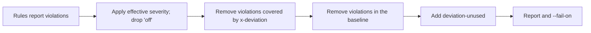

# 028 — Deviations and baseline

| Field | Value |
|---|---|
| Status | Implemented |
| Phase | 8 — Best-practice rules |
| Depends on | [005](005-validation-engine.md), [008](008-cli-basic.md), [027](027-rule-configuration.md) |
| Modules | `openapi-gateway-core`, `openapi-gateway-cli` |

## Summary

This spec adds two ways to accept known best-practice violations. A deviation entry (`x-deviation`) accepts one rule on one operation, with a mandatory reason. A baseline file (`.oas-baseline.json`) accepts all violations that exist today, so that only new violations fail the pipeline. Neither mechanism applies to CONTRACT rules. Both mechanisms are CLI-only: the gateway never reads `x-deviation` or the baseline. Teams can then enable new rules on old specs without a large cleanup PR, and reviewers can see each accepted exception.

## Motivation

A rule that reports hundreds of old violations is usually disabled. A disabled rule does not protect new code either. The baseline keeps the rule active for new code. Some violations are correct decisions, for example an internal endpoint that has its documentation elsewhere. A deviation entry records that decision and its reason next to the operation.

## Decision (2026-11-12): `x-deviation`

The extension is named `x-deviation`, not `x-lint-ignore`. An entry records an accepted deviation from a best-practice rule, with a reason. It is a visible decision, not an instruction to "ignore the linter". An entry has only the keys `rule` and `reason`. The rules are `deviation-schema` and `deviation-unused`. The project had no release and no consumers, so there is no alias for the old name.

## Scope

### In scope

- The `x-deviation` operation extension and its validation.
- The rule `deviation-schema` (ERROR, not configurable) for an invalid deviation entry.
- The rule `deviation-unused` (WARN) for a deviation entry that covers nothing.
- The baseline file format and the fingerprint.
- The subcommand `baseline create` and the option `--baseline <file>`.
- The order in which the engine applies severity, deviations, baseline, and `--fail-on`.

### Out of scope

- Deviations or baseline entries for CONTRACT rules. They are not allowed.
- Deviations at the root of the spec or at path item level (see "Open questions").
- Automatic removal of stale baseline entries.
- Deviations and the baseline in the gateway. The gateway runs only the CONTRACT rules ([005](005-validation-engine.md)) and ignores `x-deviation`.

## Design

### Deviation format

`x-deviation` is allowed on an operation object ([006](006-x-gateway-extension.md) lists it in the allowlist).

```yaml
paths:
  /internal/metrics:
    get:
      x-deviation:
        - rule: operation-summary-required
          reason: "Internal endpoint documented elsewhere."
```

| Key | Type | Required | Rule |
|---|---|---|---|
| `rule` | string | Yes | The id of a configurable rule. |
| `reason` | string | Yes | Not empty after trimming white space. |

A deviation entry covers a violation when all conditions are true:

1. The violation has the same rule id.
2. The violation is in the same file.
3. The violation pointer equals the operation pointer, or starts with the operation pointer followed by `/`.

Example: a deviation entry on `/paths/~1orders/get` covers a violation at `/paths/~1orders/get/responses/404/content/application~1json`.

### Validation of deviation entries

| Condition | Rule id | Severity | Pointer |
|---|---|---|---|
| `x-deviation` is not a list, an entry is not an object, an entry has an unknown key, `rule` is missing, or `reason` is missing or blank | `deviation-schema` | ERROR | the entry, for example `/paths/~1orders/get/x-deviation/0` |
| `rule` is not a known rule id. The known ids are the ids of all built-in rules. After the removal of the permission catalog (2026-11-13), `audience-known`, `permission-exists`, and `permissions-unused` are unknown ids. | `deviation-schema` | ERROR | `.../x-deviation/0/rule` |
| `rule` is a rule with `configurable=false` (each CONTRACT rule, and `deviation-schema`) | `deviation-schema` | ERROR | `.../x-deviation/0/rule` |
| The operation has the old key `x-lint-ignore` | `deviation-schema` | ERROR | `.../x-lint-ignore` |
| The deviation entry covers no violation in this run | `deviation-unused` | WARN | `.../x-deviation/0` |

Decision (2026-11-10): the two deviation rules are not CONTRACT rules. They run only in the CLI, because the gateway never reads `x-deviation`.

| Rule id | Category | Default severity | `configurable` | Runs in |
|---|---|---|---|---|
| `deviation-schema` | `DESIGN` (proposal) | ERROR | `false` | CLI only |
| `deviation-unused` | `DESIGN` (proposal) | WARN | `true` | CLI only |

`deviation-schema` is always ERROR. A configuration entry, an `x-deviation` entry, or a baseline entry cannot change it ([005](005-validation-engine.md) allows `configurable=false` for a non-CONTRACT rule). `deviation-unused` is configurable. A deviation entry for a rule with effective severity `off` does not produce `deviation-unused`, because the rule did not run.

Implementation of the deviations (package `com.johnowl.gateway.core.suppress`):

- `Deviations.entries(SpecFile)` reads the well-formed entries from the raw document.
- `DeviationSuppressions` is the `SuppressionPolicy` of the engine for one CLI run. It uses only entries for known configurable rules, and records which entries covered a violation.
- `SuppressionPolicy` has a new default method `unused(List<SpecFile>)`. After all rules, the engine reports each unused entry with the rule `deviation-unused`, if the run contains that rule. The engine skips an entry for a rule that is not in the run or that is `off` for the file. Example: an entry for `path-no-verbs` when `.oas-gateway.yaml` sets `path-no-verbs: off`. The message is `Deviation from '<rule>' covers no violation. Remove it.`
- `deviation-unused` is a metadata-only rule, like `oas-parse` ([005](005-validation-engine.md)). The fixture harness runs all built-in rules with `DeviationSuppressions` for its fixtures.
- Decision (2026-11-12): an entry for `deviation-unused` is a `deviation-schema` violation (`Rule 'deviation-unused' cannot have a deviation. Configure it in .oas-gateway.yaml.`). Such an entry would cover the warning about itself.
- The gateway never reads `x-deviation`. A test proves that a malformed entry does not stop the gateway.

### Baseline file format

```json
{
  "version": 1,
  "entries": [
    {
      "ruleId": "operation-summary-required",
      "file": "gateway/src/main/resources/openapi/orders.yaml",
      "pointer": "/paths/~1orders~1{id}/get"
    },
    {
      "ruleId": "path-no-verbs",
      "file": "gateway/src/main/resources/openapi/orders.yaml",
      "pointer": "/paths/~1orders~1{id}~1cancel-order/post"
    }
  ]
}
```

- `version` is the format version. This spec defines version `1`.
- `file` is relative to the current working directory, with `/` as separator. The same rule applies to the text output in [008](008-cli-basic.md).
- `baseline create` sorts entries by `ruleId`, then `file`, then `pointer`, and removes duplicates. The output is deterministic, so a diff of the file shows only real changes. The file uses two-space indentation and `\n` line ends on every operating system.
- The file has no timestamp, no severity, and no message. A severity change or a message change does not make a baselined violation new.

### Fingerprint

The fingerprint of a violation is the triple (`ruleId`, `file`, `pointer`). It does not contain the line number, the column, the severity, or the message. An edit above an operation therefore does not change the fingerprint. A baseline entry covers all violations with the same fingerprint.

### Commands

```bash
# Create a baseline (JSON on stdout).
java -jar oas-gateway-validate.jar baseline create \
  --config .oas-gateway.yaml gateway/src/main/resources/openapi > .oas-baseline.json

# Validate; only violations that are not in the baseline count.
java -jar oas-gateway-validate.jar --config .oas-gateway.yaml \
  --baseline .oas-baseline.json gateway/src/main/resources/openapi
```

`baseline create` accepts the same `--config` option as validation. The options `--catalog` and `--entra` are removed with the permission catalog (decision of 2026-11-13, [Removal of the permission catalog (2026-11-13)](README.md#removal-of-the-permission-catalog-2026-11-13)). The options come after `baseline create`. An option or a path before `baseline` (for example `--config x.yaml baseline create dir`) is a usage error with exit code 2, because `baseline create` would not use it and would write a wrong baseline. It writes an entry for each violation that remains after severity and deviations, at any severity, except violations of rules with `configurable=false`. The violation limit of [005](005-validation-engine.md) does not apply: the baseline has an entry for each violation, also above 100 violations of a rule in a file. It returns exit code 0 when it writes the file, and 2 for usage, I/O, or configuration errors.

### Baseline entries for removed rules

The rule `permissions-unused` is removed with the permission catalog (decision of 2026-11-13). A baseline file with an entry for `permissions-unused` then has an unknown rule id. The CLI rejects such a file with exit code 2 (`unknown rule id 'permissions-unused'`). Remove these entries from `.oas-baseline.json` ([Removal of the permission catalog (2026-11-13)](README.md#removal-of-the-permission-catalog-2026-11-13)).

### Processing order



Suppressed and baselined violations are not in the report. They do not count for `--fail-on`. Violations of rules with `configurable=false` (CONTRACT rules and `deviation-schema`) skip steps C and D.

## Behavior and errors

| Condition | Result | Exit code |
|---|---|---|
| Violation covered by `x-deviation` | Not reported | Not changed |
| Violation in the baseline | Not reported | Not changed |
| New violation at or above `--fail-on`, not in the baseline | Reported | 1 |
| Baseline entry that matches no violation | Ignored | Not changed |
| `--baseline` file does not exist, is not valid JSON, or has an unknown `version` | Error on stderr | 2 |
| Baseline entry with the id of a rule with `configurable=false`, or an unknown rule id | Error on stderr, one line for each problem. The CLI escapes control characters, the same as in [008](008-cli-basic.md). | 2 |
| An option or a path before `baseline` | Usage error on stderr | 2 |

## Acceptance criteria

- [x] An `x-deviation` entry for `operation-summary-required` removes that violation from the report of that operation only.
- [x] A deviation entry covers a violation whose pointer is below the operation pointer.
- [x] An entry without `reason`, or with `reason: "  "`, produces `deviation-schema` with severity ERROR.
- [x] An entry with `rule: security-explicit` produces `deviation-schema`, and the `security-explicit` violation stays in the report.
- [x] An entry with an unknown rule id produces `deviation-schema`.
- [x] An entry with `rule: permissions-unused` or `rule: audience-known` produces `deviation-schema` for an unknown rule id. (Code PR 1 of the removal of the permission catalog.)
- [x] A deviation entry that covers no violation produces `deviation-unused` with severity WARN.
- [x] A deviation entry for a rule configured `off` does not produce `deviation-unused`.
- [x] `baseline create` writes JSON in the format above, sorted, without CONTRACT violations, and returns 0.
- [x] Two runs of `baseline create` on the same input produce identical files.
- [x] `baseline create --catalog <file>` and `baseline create --entra` return 2 for an unknown option. (Code PR 1 of the removal of the permission catalog.)
- [x] A baseline file with an entry for `permissions-unused` returns 2. (Code PR 1 of the removal of the permission catalog.)
- [x] With `--baseline`, a run on unchanged specs returns 0 for `--fail-on error`, even with ERROR best-practice violations.
- [x] With `--baseline`, a new violation (new fingerprint) is reported and returns 1.
- [x] Adding lines above a baselined operation does not make its violation new.
- [x] A CONTRACT violation is reported and returns 1, even if its fingerprint is in the baseline file.
- [x] An invalid baseline file returns 2.
- [x] `deviation-schema` and `deviation-unused` are in `BuiltInRules.all()` and are not in `BuiltInRules.contract()`.
- [x] A `.oas-gateway.yaml` entry `deviation-schema: warn` returns exit code 2.
- [x] An `x-deviation` entry with `rule: deviation-schema` produces `deviation-schema`.
- [x] The gateway starts with an OAS file that has a malformed `x-deviation` entry, if the file has no CONTRACT violation.

## Test plan

- Fixture tests (harness from [005](005-validation-engine.md)) for `deviation-schema` and `deviation-unused`: `rules/<rule-id>/valid.yaml`, `invalid.yaml`, `expected.txt`.
- Unit tests for deviation matching: same pointer, child pointer, sibling operation not covered, other rule id not covered.
- Unit tests for `Baseline` read and write: round trip, sort order, duplicates, unknown version, rule id with `configurable=false`.
- Gateway startup test ([013](013-oas-route-locator.md)): a malformed `x-deviation` entry does not stop the gateway.
- CLI command tests: `baseline create` output, `--baseline` with an unchanged spec, with a new violation, and with lines added above a baselined operation.

## Delivery

Two PRs:

1. Deviations: `x-deviation` parsing, `deviation-schema`, `deviation-unused`, engine step. Estimate: 250–300 lines. Done.
2. Baseline: `Baseline`, `BaselineCommand`, `--baseline`, engine step. Estimate: 250–300 lines. Done.

Implementation of the baseline:

- `Baseline` (package `com.johnowl.gateway.core.suppress`) reads and writes the file and is the `BaselinePolicy` of the engine. The engine never asks the policy for a rule with `configurable=false` ([005](005-validation-engine.md)), so a CONTRACT violation is always reported.
- A baseline file with an entry for a rule with `configurable=false` is invalid and returns exit code 2. The criterion "A CONTRACT violation is reported and returns 1, even if its fingerprint is in the baseline file" therefore holds by two mechanisms: the file is rejected, and the engine skips the baseline for such rules.
- The CLI moved the shared steps (configuration, baseline, OAS files, engine) to `ValidationRun`. `ValidateCommand` and `baseline create` both use `ValidationRun`. Code PR 1 of the removal of the permission catalog removed the catalog step from `ValidationRun`.
- The positional parameter of the root command is optional for picocli, so that the subcommand `baseline` works. picocli resolves the subcommand name first, so a directory named `baseline` must be written as `./baseline`. `ValidateCommand` reports a missing path as a usage error (exit code 2). `baseline` without `create` is also a usage error.

## Open questions

- How does a team accept a violation that is not inside an operation, for example `components-unused` at `/components/schemas/Order` or `servers-https-only` at `/servers/0/url`? Option: allow `x-deviation` at the root of the spec. The brief defines it only at operation level.
- Confirm the category of `deviation-schema` and `deviation-unused`. `DESIGN` is a proposal, because no category of [005](005-validation-engine.md) fits well.
- Should the report show the number of violations covered by deviations or the baseline in the summary line?
- Should the CLI warn about stale baseline entries, so that teams remove them?
- `file` paths depend on the working directory. Should the CLI always run from the repository root, or should paths be relative to the baseline file?
- Renaming a path changes the pointer, so its baselined violations become new. Is this acceptable?

## References

- [005 — Validation engine](005-validation-engine.md)
- [006 — `x-gateway` extension](006-x-gateway-extension.md)
- [008 — CLI basic](008-cli-basic.md)
- [013 — OAS route locator](013-oas-route-locator.md)
- [027 — Rule configuration](027-rule-configuration.md)
- [Removal of the permission catalog (2026-11-13)](README.md#removal-of-the-permission-catalog-2026-11-13)
- RFC 6901, JavaScript Object Notation (JSON) Pointer: <https://www.rfc-editor.org/rfc/rfc6901>
