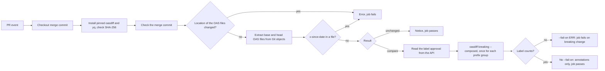

# 033 — Breaking change detection

Note (2026-11-18): the repository is now public (`johnowl/oas-spring-boot-gateway`). The statements about a private repository in this spec describe the situation when the decision was made. For the current state, see [docs/ci-change-control.md](../docs/ci-change-control.md).

| Field | Value |
|---|---|
| Status | Draft |
| Phase | 9 — Change control |
| Depends on | [011](011-pr-validation-pipeline.md) |
| Modules | `.github/workflows` |

## Summary

This spec adds a pull request (PR) check. The check compares the OpenAPI Specification (OAS) files of the PR with the OAS files of the base branch. The check uses the open-source tool `oasdiff`. It fails when a change can break existing clients, for example a removed operation or a new required parameter. A maintainer can accept a breaking change with the label `breaking-change-approved`. The gateway exposes only documented operations, so an OAS change is an API change for every client. This check makes each breaking change visible and explicit.

## Motivation

The validation in [011](011-pr-validation-pipeline.md) checks one version of each spec. It cannot see that a PR removes `DELETE /orders/{id}` or changes a response field type. After the merge, the gateway stops routing the removed operation at once, and clients receive 404. A comparison between the base and the head of the PR finds these changes before the merge.

## Scope

### In scope

- A new workflow `.github/workflows/openapi-change-control.yml` with the job `breaking-changes`.
- Extraction of the base and head OAS files from the Git objects with `git ls-tree -z` and `git cat-file blob`.
- Installation of pinned `oasdiff` and `yq` release binaries with SHA-256 checksums.
- A check that the PR does not change the location of the OAS files.
- The `oasdiff breaking` command in composed mode, once for each value of `x-gateway.prefix`, with GitHub Actions annotations.
- The label `breaking-change-approved`, read from the live state of the PR through the GitHub API.
- The job as a required status check on `main`. Until then, the check is advisory (see "Enforcement").

### Out of scope

- Access control changes (permissions, public operations, audience): [034](034-access-change-review.md). `oasdiff` does not understand `x-gateway-authorization`.
- Breaking changes in the backend behavior that the OAS file does not describe.
- A Java implementation with OpenAPITools `openapi-diff`. The brief lists it as an alternative that is not chosen now.

## Design

### Flow



### Workflow

The workflow is separate from `openapi.yml`. It must run again when a reviewer adds or removes the label, so it listens to the `labeled` and `unlabeled` events. It also listens to `edited`, so that a change of the base branch of the PR runs the check again. [034](034-access-change-review.md) adds a second job to the same file.

The file `.github/workflows/openapi-change-control.yml` is the reference. This outline shows the structure:

```yaml
name: OpenAPI change control

on:
  pull_request:
    branches: [main]
    types: [opened, synchronize, reopened, edited, labeled, unlabeled]

permissions:
  contents: read

concurrency:
  group: openapi-change-control-${{ github.event.pull_request.number }}
  cancel-in-progress: true

env:
  OAS_DIR: gateway/src/main/resources/openapi

jobs:
  breaking-changes:   # 10 minutes; contents: read, pull-requests: read; versions and SHA-256 of oasdiff and yq in the job env
    steps:
      # checkout: fetch-depth 2, persist-credentials false
      # Install oasdiff and yq
      # Check the merge commit (id merge): sets base and merge
      # Check the location of the OAS files
      # Extract base and head OAS files (id oas): sets result=unchanged|compare
      # Read the label approval (id label): only if result == 'compare'; sets approved=true|false
      # oasdiff breaking: reads RESULT and APPROVED from env
```

The job reads the files of the PR as data only. It runs no code and no build tool from the PR. It runs only `git`, `gh`, `jq`, standard shell tools, and the pinned `oasdiff` and `yq` binaries. No `run:` script contains `${{ }}`: each value from the event comes through an environment variable.

`edited` also runs the job after a change of the title or the description of the PR. The steps have no condition on the event type. A skipped job reports "Success", and `cancel-in-progress` would cancel the run that does the work.

The job `access-changes` of [034](034-access-change-review.md) is in the same workflow. It uses the job env and the scripts of the steps "Install oasdiff and yq", "Check the merge commit", "Check the location of the OAS files", "Extract base and head OAS files", and "Read the label approval" through YAML anchors (`&name` and `*name`). A change of one of these scripts therefore changes both jobs.

### Base and head

`actions/checkout` checks out the merge commit of the PR (`refs/pull/<number>/merge`). The first parent of this commit is the base commit. The second parent is the head of the PR.

1. The step "Check the merge commit" checks that `HEAD` has exactly two parents and that the second parent is `github.event.pull_request.head.sha`. Otherwise the job fails. The step sets the outputs `base` (the first parent) and `merge` (`HEAD`).
2. The base is the first parent. The head is the merge commit: this is the state of `main` after the merge.
3. The later steps read the files of both commits from the Git objects, not from the checkout (see "OAS files").

The job does not run `git fetch`. Reasons: the checkout has `persist-credentials: false`, so a fetch from a private repository fails. A base branch that moves during the run also does not change the comparison, because the merge commit fixes both sides.

### OAS files

An OAS file is a file directly in the OAS folder with the extension `.yaml`, `.yml`, or `.json`, also when its name starts with a dot. These are the files that the gateway loads with the default value of `gateway.openapi.specs` (`classpath:openapi/*.yaml`, `*.yml`, `*.json`, [013](013-oas-route-locator.md)). Files in subfolders and other files (for example `README.md`) are not OAS files, because the gateway does not load them.

The step "Extract base and head OAS files" writes the OAS files of the base to `$RUNNER_TEMP/oas/base/$OAS_DIR` and the OAS files of the merge commit to `$RUNNER_TEMP/oas/head/$OAS_DIR`. For each commit:

1. It checks each path component of `$OAS_DIR` with `git ls-tree`. When a component does not exist, the side has no OAS file. When a component exists and is not a folder (mode `040000`), the step fails. A symbolic link (mode `120000`) is not a folder.
2. It lists the OAS folder with `git ls-tree -z "$commit" -- "$OAS_DIR/"`. The `-z` output is safe for each file name.
3. It writes each OAS file with the mode `100644` or `100755` with `git cat-file blob <oid>`.
4. It fails on an OAS file with the mode `120000` (symbolic link) or `160000` (submodule).

Reasons:

- `git cat-file blob` applies no `.gitattributes` rule. `git archive` applies `export-ignore` (a file is missing) and `export-subst` (the content changes). A base `.gitattributes` could therefore hide a removed operation.
- A symbolic link can point outside the repository, and the Maven build copies the target of the link into the gateway.
- Both sides use the same code. The checkout of the merge commit is not read.

### Location of the OAS files

The comparison is correct only when the gateway loads the files of `$OAS_DIR`. The step "Check the location of the OAS files" fails when the PR (base compared with the merge commit) changes one of these:

| Change | How the step finds it |
|---|---|
| The value of `gateway.openapi.specs` | `yq` reads each `application*.yaml`, `application*.yml`, and `application*.properties` of the repository, except the files in a folder `src/test/`. The file of another module counts too: the gateway can read it from the classpath, for example `config/application.yaml`. It writes one line for each value, with the file path and the canonical key of Spring relaxed binding (lowercase, without `-` and `_`, `[n]` as `.n`). The step compares the lines of the keys `gateway.openapi.specs` and `gateway.openapi.specs.*` of both commits. A value in a new file, a removed value, and an empty list are changes. |
| The value of `spring.config.import`, `spring.config.location`, or `spring.config.additional-location` | The same lines as for `gateway.openapi.specs`, with these keys. These keys load more configuration files, which can set `gateway.openapi.specs` (finding SEC-75-2). |
| A YAML or properties file in `gateway/src/main/resources` whose name does not start with `application` | `git ls-tree` lists `*.yaml`, `*.yml`, and `*.properties` in `gateway/src/main/resources` and its subfolders, outside `$OAS_DIR`. An added or changed file is a change, a removed file is not. Spring can load such a file with `spring.config.name` or `spring.config.import` from outside the repository (finding SEC-75-2). |
| `GatewayOpenApiProperties.java` | `git ls-tree` compares the mode and the object id of `gateway/src/main/java/com/johnowl/gateway/routing/GatewayOpenApiProperties.java`. The file has the default value of `gateway.openapi.specs` (finding SEC-75-2). |
| A Maven `<resource>` with a `targetPath` that contains `openapi` in `gateway/pom.xml` | `yq` reads the XML and selects each element with a `targetPath` that contains `openapi` (case-insensitive). An added, changed, or removed element is a change. |
| `OAS_DIR` in this workflow | `yq` reads each `OAS_DIR` value of the workflow file in both commits. When the base has no workflow file, the step skips this check. |

Before each query, `yq` runs `explode(.)`. So the step reads a value behind a YAML alias or a merge key (`<<`) like Spring does (finding SEC-75-2).

The message is: "The pull request changes ... This change can move the OAS files that the gateway loads. Update spec 033 and this check in a dedicated reviewed pull request." The label does not change this result. The step reads each file with `git cat-file blob` and fails on a configuration file that is a symbolic link or a submodule.

The step also fails when the base or the head has a path in a folder `src/main/resources/openapi` of any module (also the root module) outside `$OAS_DIR`, for example `openapi-gateway-core/src/main/resources/openapi/x.yaml` (finding SEC-75-1). The gateway reads `classpath:openapi/` from the first classpath entry with this folder, but the jobs compare only `$OAS_DIR`. The message names the path. The gateway also stops at startup when a classpath pattern matches a file outside its own classes ([013](013-oas-route-locator.md), "OAS file location"). The test resources (`src/test/`) do not count.

Limits: the step does not see other ways to load OAS files, for example an environment variable, a command line argument, or a `<resource>` without `targetPath` whose folder contains an `openapi` folder. A reviewer MUST check such changes.

### `x-since-date`

`oasdiff` reads the extension `x-since-date` in composed mode. When two files of one side have the same operation, `oasdiff` keeps the operation with the newest `x-since-date` and drops the other one without an error. A duplicate operation is then not visible to the comparison.

The extraction step therefore fails when an OAS file of the base or of the head contains the key `x-since-date` in any object. A head file gets an error annotation on the line of the object. The label does not change this result. The gateway and the CLI do not use `x-since-date`.

### Result

The extraction step compares the two copies with `diff -r` and sets the step output `result`:

| `result` | Condition | Job |
|---|---|---|
| `unchanged` | The copies are the same, also when both are empty. | Success, with a notice. `oasdiff` does not run. |
| `compare` | The copies are different. | `oasdiff` decides for each changed prefix group. |

The extraction step runs with `set -euo pipefail`. It writes the output of each `git` command to a file or a variable before it uses it. A failed `git`, `yq`, `find`, `cp`, or `diff` command (exit code 2) fails the job. The job then does not report a wrong "Success". An unknown `result` also fails the job.

### Prefix groups

The gateway exposes the operations of each OAS file under its `x-gateway.prefix` ([006](006-x-gateway-extension.md)). The public path of an operation is the prefix plus the OAS path. `oasdiff` does not know the prefix. The extraction step therefore groups the files by prefix:

1. `yq` reads `x-gateway.prefix` of each OAS file. A file without a prefix belongs to the root group. A prefix that is not one string fails the step, for example a list or a file with two YAML documents.
2. Each distinct prefix of both sides gets a number `<n>`. The step copies the files of the group to `$RUNNER_TEMP/oas/base-<n>/$OAS_DIR` and `$RUNNER_TEMP/oas/head-<n>/$OAS_DIR`.
3. When a group has files on one side only, the other side gets a generated empty OAS file `empty.yaml` (`openapi: 3.0.3`, `info`, `paths: {}`). All operations of the group are then new or removed.
4. The step writes the number and the prefix of each group with different copies to `$RUNNER_TEMP/oas/groups`. A group with the same copies does not run `oasdiff`.

Results:

- An operation that moves to another file with the same prefix is not a change.
- An operation that moves to a file with another prefix is a removal: its public path changes.
- A change of `x-gateway.prefix` is a removal of each operation of the old prefix.
- Two files with different prefixes can have the same OAS path, for example `GET /health`.
- When all OAS files are removed, each group is compared with an empty file, and each operation is a removal.

`yq` reads each file with its YAML parser, also a `.json` file. `oasdiff` reads the files in the same way.

### Command

For each line of `$RUNNER_TEMP/oas/groups`:

```bash
cd "$RUNNER_TEMP/oas/head-$group"
"$RUNNER_TEMP/tools/oasdiff" breaking --composed --allow-external-refs=false \
  --format githubactions "${fail_on[@]}" \
  "../base-$group/$OAS_DIR/*" "$OAS_DIR/*"
```

Notes:

- `fail_on` is `--fail-on ERR` when the label does not count, and empty when it counts.
- The step runs `oasdiff` for all groups, also after a failure, so that all annotations appear. The job fails when one run exits with a code other than 0.
- The globs are in quotes, so `oasdiff` expands them and not the shell. The copies contain only OAS files, so `*` matches only OAS files.
- `--fail-on ERR` fails the job only for changes that `oasdiff` classifies as `ERR` (breaking). `WARN` changes appear as annotations and do not fail the job.
- `--allow-external-refs=false`: `oasdiff` refuses each `$ref` to a URL or to another file (exit code 123). It reads no URL and no file outside the OAS files. The gateway allows only local references in classpath OAS files ([004](004-oas-loading.md)), so a valid OAS file has no external `$ref`.
- The working directory contains only the copied OAS folder of the group. `oasdiff` reads its configuration file `.oasdiff.*` or `oasdiff.*` only from the working directory, so a PR cannot add a configuration file that ignores changes.
- The working directory also gives the head files their paths in the repository. The annotations of changed operations therefore appear on the lines of the PR files. The annotation of a removed operation names the base file (`../base-<n>/...`) and has no line.

### Installation of `oasdiff` and `yq`

Decision (2026-11-15): the job installs two release binaries for `linux_amd64` from GitHub releases:

| Tool | Version | Release file | SHA-256 |
|---|---|---|---|
| `oasdiff` | 1.38.0 (released 2026-11-14) | `oasdiff_1.38.0_linux_amd64.tar.gz` | `613037fd6a1d3362a1b742d6d86c338c0eb5ab3511f4942ce3948e78720ea2da` |
| `yq` | 4.54.3 (released 2026-11-09) | `yq_linux_amd64` | `129534601871538efe0ba4c5e62a34fb1d5f469bcb975c4fddeb467d82974973` |

1. `curl` downloads each file over HTTPS only (`--proto '=https' --proto-redir '=https'`).
2. `sha256sum --check --strict` compares each file with the SHA-256 in the job env (`OASDIFF_SHA256`, `YQ_SHA256`). A different file fails the job before the file is used.
3. `tar` extracts only the file `oasdiff`. Both binaries go to `$RUNNER_TEMP/tools`, outside the checkout.

Sources of the checksums:

- `oasdiff`: the file `checksums.txt` of the release. The `digest` of the release asset in the GitHub API has the same value, and a download on 2026-11-15 gave the same value.
- `yq`: the file `checksums` of the release has many hashes on each line. The file `checksums_hashes_order` gives their order, and SHA-256 is the 18th hash. The `digest` of the release asset in the GitHub API has the same value, and a download on 2026-11-15 gave the same value.

Neither release has a build attestation.

Reasons for this choice:

- The workflow file contains the versions and the checksums. A change of a binary needs a reviewed change of the workflow.
- The action `oasdiff/oasdiff-action` reads `.oasdiff.yaml` from the root of the checkout. A PR could add this file and ignore breaking changes.
- The `yq` of the runner image has no fixed version. A container image would need a digest and Docker in the job. It is not simpler.

To update a tool, change its version and its SHA-256 together. Take the checksum from the checksum file of the new release. Check the flags below against the new version of `oasdiff`.

The flags were checked against the documentation of the tag `v1.38.0` and `oasdiff breaking --help` of the release binary:

| Flag | Meaning in 1.38.0 |
|---|---|
| `breaking` | Reports changes with the level `ERR` or `WARN`. |
| `--composed` (`-c`) | Compares the paths of all files that match the base glob with the paths of all files that match the head glob. |
| `--fail-on ERR` (`-o`) | Exit code 1 when there is at least one `ERR` change. |
| `--format githubactions` (`-f`) | One workflow command `::error`, `::warning`, or `::notice` per change. It also writes `error_count`, `warning_count`, and `info_count` to `GITHUB_OUTPUT`. |
| `--allow-external-refs=false` | Refuses each external `$ref`. The `=` is necessary for a boolean flag. |

Exit codes of 1.38.0 in composed mode, checked with the release binary:

| Code | Meaning |
|---|---|
| 0 | No failure |
| 1 | `--fail-on`: at least one `ERR` change |
| 101 | Invalid flags |
| 103 | A glob matches no file (`no matching files`), or a file cannot be loaded (`failed to unmarshal`) |
| 104 | The diff failed, for example `duplicate endpoint` |
| 123 | An external `$ref` is refused |

Each code other than 0 fails the job, also when the label counts. The job never treats a code other than 0 as success.

### Composed mode

`--composed` merges all files of the base group into one API, and all files of the head group into another API. It then compares the two APIs by path and method. A file rename or a split of one file into two therefore does not produce false breaking changes.

Composed mode does not support the path prefix flags of `oasdiff`, so the job compares each prefix group on its own (see "Prefix groups"). When two files of one group and one side have the same method and the same path (path parameter names are ignored), `oasdiff` 1.38.0 stops with the error `duplicate endpoint` (exit code 104), and the job fails. The label does not change this. Without `x-since-date`, `oasdiff` cannot drop one of the two operations.

### Label `breaking-change-approved`

| Rule | Value |
|---|---|
| Name | `breaking-change-approved` |
| Effect | The job still runs and writes annotations, but breaking changes do not fail it. A file that `oasdiff` cannot load, `x-since-date`, and a change of the location of the OAS files still fail the job. |
| Who adds it | A user with the role admin or maintain, after checking the client impact. |
| New commits | The label counts only when it was added after the last push. After a new push, remove the label and add it again. |
| Removal | Removing the label runs the job again, and the job fails again on breaking changes. |

Decision (2026-11-15, finding SEC-72-2): the step "Read the label approval" reads the live state through the GitHub API with `gh api` and the token of the job (`pull-requests: read`). A re-run of an old workflow run therefore uses the current state, not the payload of its original event. The label counts only when all these conditions are true:

1. `GET /repos/{repo}/pulls/{number}`: the PR has the label now, and its head is `github.event.pull_request.head.sha`. A newer head means that a newer run comes.
2. `GET /repos/{repo}/issues/{number}/timeline`: the latest `labeled` event of the label is newer than each `head_ref_force_pushed` and `head_ref_restored` event and than the committer date of each `committed` event.
3. `GET /repos/{head repo}/activity?ref=refs/heads/{head ref}`: the latest activity of the head branch is the push of the head SHA, and the `labeled` event is newer than this push.
4. `GET /repos/{repo}/collaborators/{actor}/permission`: the actor of the `labeled` event has the `role_name` `admin` or `maintain`.

A `committed` event has only the committer date of the commit, and the person who pushes the commit chooses this date. Condition 3 therefore gives the time of the push from GitHub. Condition 2 only makes the check stricter.

When a call fails, the label does not count (fail closed), and the step writes a notice with the reason. The step itself does not fail: without the label, `oasdiff` decides. GitHub decides who can add a label (triage, write, maintain, or admin role). The job accepts only admin and maintain, so an author with write access cannot approve their own PR.

For a PR from a fork, the head branch is in the fork. When the token of the job cannot read the activity of the fork, the label does not count. A maintainer can then push the commits to a branch of the repository and open a new PR.

### Pull requests from forks

GitHub runs `pull_request` workflows of a fork with a read-only token and without secrets. The job needs no secret and only read permissions, so it runs the same for a fork (see the label rules for a fork above). In a private repository, a fork PR runs workflows only if the setting "Run workflows from fork pull requests" is on. If it is off, the required check never reports, and the PR cannot merge.

### Enforcement

Decision (2026-11-15, finding SEC-72-1): the check is advisory until a repository administrator configures a ruleset or a branch protection rule that requires `breaking-changes` on `main` ([011](011-pr-validation-pipeline.md), "Advisory checks"). The repository is private and on the GitHub Free plan, which has neither. Also with a required check:

- A `pull_request` workflow runs the workflow file of the PR. A PR can change or remove this job in its own copy of the file.
- GitHub matches a required check by its name. A second workflow with a job named `breaking-changes` can report "Success".

The recommended configuration is a ruleset with a required workflow, which runs the workflow file of the default branch. Until then, a reviewer MUST read each change to `.github/workflows/**` and `specs/**`.

### Output

`oasdiff` writes one GitHub Actions workflow command per change. GitHub shows them as annotations on the PR. The example below is illustrative. The exact text comes from the pinned `oasdiff` version. `oasdiff` escapes line breaks and `%` in the message, so a description in an OAS file cannot start a new workflow command. The job writes each prefix in JSON form, so a prefix cannot start a new line in the log.

```text
Prefix group 1, x-gateway.prefix "/orders":
::error title=api-removed-without-deprecation,file=../base-1/gateway/src/main/resources/openapi/orders.yaml::in API DELETE /orders/{id} API removed without deprecation
::error title=new-required-request-parameter,file=gateway/src/main/resources/openapi/orders.yaml,line=12,col=11::in API GET /orders added the new required 'query' request parameter 'status'
```

## Behavior and errors

| Condition | Label counts | Job result |
|---|---|---|
| No OAS change | Any | Success, with a notice |
| The base has no OAS file | Any | Success: each operation is new |
| Only non-breaking changes (for example a new operation, or a new prefix) | Any | Success |
| An operation moves to another file with the same prefix | Any | Success |
| At least one `ERR` change (for example a removed operation) | No | Failure, with annotations |
| At least one `ERR` change | Yes | Success, with annotations and a notice |
| An operation moves to another prefix, or a prefix changes | No | Failure: the old public path is removed |
| The PR removes all OAS files | No | Failure: each operation is removed |
| The label is present, but it was added before the last push, by a user without the role admin or maintain, or the API cannot be read | Does not count | As without the label, with a notice that gives the reason |
| An OAS file of the base or the head contains `x-since-date` | Any | Failure |
| The PR changes a value or a file of "Location of the OAS files" | Any | Failure |
| The base or the head has a file in a folder `src/main/resources/openapi` outside `$OAS_DIR` | Any | Failure |
| `x-gateway.prefix` is not one string | Any | Failure |
| A file cannot be parsed, `oasdiff` cannot load a file, or a file has an external `$ref` | Any | Failure (the validation job of [011](011-pr-validation-pipeline.md) also reports the file) |
| Two files of one prefix group and one side have the same method and path | Any | Failure (`duplicate endpoint`) |
| `HEAD` is not the merge commit of the PR | Any | Failure |
| A path component of the OAS folder is not a folder, or an OAS file is a symbolic link or a submodule | Any | Failure |
| A `git`, `yq`, `find`, `cp`, or `diff` command fails | Any | Failure |
| A download does not match its SHA-256 | Any | Failure |

## Acceptance criteria

The criteria about job results on GitHub need test PRs. They stay open until the test PRs ran.

- [ ] A PR that removes an operation from an OAS file fails the `breaking-changes` job. (Needs a test PR.)
- [ ] The failed job shows an annotation that names the removed operation. (Needs a test PR.)
- [ ] A PR that only adds a new operation passes the `breaking-changes` job. (Needs a test PR.)
- [ ] A PR that adds a required query parameter to an existing operation fails the job. (Needs a test PR.)
- [ ] A maintainer adds the label `breaking-change-approved`: the job runs again and passes with annotations. (Needs a test PR. It also confirms that the token of the job can read the activity and the permission endpoints.)
- [ ] Removing the label runs the job again, and the job fails again. (Needs a test PR.)
- [ ] A push after the label makes the job fail again, until a maintainer adds the label again. (Needs a test PR.)
- [ ] A change of the base branch of the PR runs the job again. (Needs a test PR.)
- [x] A PR that only moves an operation to another OAS file with the same prefix passes the job. A move to another prefix fails it. (Checked with a local run of the step scripts and the pinned `oasdiff`.)
- [x] A PR on a base branch without the OAS folder passes the job. (Checked with a local run of the step scripts.)
- [x] The workflow token has only `contents: read` and `pull-requests: read`.
- [x] Each action is pinned to a commit SHA, and the `oasdiff` and `yq` binaries are pinned to a fixed version and a SHA-256 checksum.
- [x] The install step fails when a download does not match its SHA-256. (Checked with a local run of the step with a wrong checksum for each tool.)
- [x] The extraction reads the Git objects: a base `.gitattributes` with `export-ignore` or `export-subst` does not change the comparison. (Checked with a local run of the step scripts.)
- [x] The extraction step fails when `HEAD` is not the merge commit of the PR head, when a path component of the OAS folder is not a folder, when an OAS file is a symbolic link or a submodule, and when an OAS file contains `x-since-date`. (Checked with a local run of the step scripts.)
- [x] The location step fails on a change of `gateway.openapi.specs`, of a Maven resource with `targetPath` `openapi`, and of `OAS_DIR`, also with the label. (Checked with a local run of the step scripts.)
- [x] The location step fails on a file in `src/main/resources/openapi` of another module, in the base or in the head, on a change of `spring.config.import`, `spring.config.location`, or `spring.config.additional-location`, on an added or changed YAML or properties file in `gateway/src/main/resources` that is not `application*`, on a change of `GatewayOpenApiProperties.java`, and on `gateway.openapi.specs` behind a merge key, also with the label (SEC-75-1, SEC-75-2). (Checked with the container harness.)
- [x] The label counts only when it is present now, newer than the last push, and added by a user with the role admin or maintain. An API error means that it does not count. (Checked with a local run of the step with a stub of `gh`.)
- [x] A PR that removes all OAS files fails the job without the label, and passes with the label. (Checked with a local run of the step scripts.)
- [x] No `run:` script contains `${{ }}`. The job runs `oasdiff` with `--allow-external-refs=false`, in a working directory without files of the PR outside the OAS folder.

## Test plan

- Workflow lint with `actionlint` (Docker image `rhysd/actionlint`, with `shellcheck`), a YAML parse, and `bash -n` for each `run:` script. Done: no problems.
- Local run of all `run:` scripts in an `ubuntu:24.04` container (`linux/amd64`), with the harness `.github/test/breaking-changes.sh` (see [034](034-access-change-review.md), "Test harness"), with the pinned `oasdiff` and `yq` binaries after a check of their SHA-256, and a stub of `gh` that serves the API responses from files. Each case builds a Git repository with a real merge commit and checks out `refs/pull/1/merge` with depth 2, like `actions/checkout`. Done: all cases pass. The cases:
  - Results: both sides empty, no base, unchanged, a removed operation, all files removed (with and without the label).
  - Prefix groups: a move with the same prefix, a move to another prefix, a prefix change, a new group in the head only, a removed root group, the same OAS path in two prefixes, a duplicate in one prefix (with the label), a prefix that is not a string, two YAML documents, a JSON file with tab indentation.
  - Files: `export-ignore` and `export-subst` in the base `.gitattributes`, a dot file, a subfolder and a `README.md`, an OAS file that is a symbolic link (base and head), a submodule entry, the OAS folder as a symbolic link, a path component as a symbolic link, the OAS folder as a file, a file that cannot be parsed, a file that `oasdiff` cannot load (exit code 103), an external `$ref` (exit code 123, with the label), and `x-since-date` in the head (with the label) and in the base.
  - Location: `gateway.openapi.specs` added in YAML, in a profile properties file with relaxed binding, as a dotted key, as an empty list, in a second file; no failure for a test resource, for an unrelated change, and for an unchanged value; a configuration file that is a symbolic link; a Maven resource with `targetPath` `openapi` added and changed, and an unrelated resource; `OAS_DIR` changed, and a base without the workflow file.
  - Location (SEC-75-1, SEC-75-2): a file in `src/main/resources/openapi` of another module in the head and in the base only, of the root module, and a symbolic link named `openapi`; no failure for a test resource and for a subfolder of the OAS folder. `spring.config.import` added, `spring.config.additional-location` with relaxed binding, `spring.config.location` as a list; no failure for an unchanged value. `gateway.openapi.specs` in `config/application.yaml` of another module, behind an alias, and behind a merge key. A YAML file added and a properties file changed in `gateway/src/main/resources`; no failure for a removed YAML file and for another file. `GatewayOpenApiProperties.java` changed and unchanged. `x-gateway.prefix` behind a merge key.
  - Label: valid, added before the last push (activity), a commit date after the label, added by a user with the role triage, the API cannot be read, not present now, a newer head, and a head branch whose last activity is not the push of the head.
  - `HEAD` is not the merge commit of the head.
- Local run of the install step with the correct checksums, and with a wrong checksum for each tool. Done.
- Manual test PRs on a test branch, one for each open acceptance criterion about job results. The PR description of this spec's implementation lists the test PRs and their results.

## Delivery

One PR: `.github/workflows/openapi-change-control.yml` (about 470 lines), and `edited` in the trigger of `.github/workflows/openapi.yml`. After the merge, an administrator adds `breaking-changes` as a required check on `main`, as described in [011](011-pr-validation-pipeline.md), when the plan of the repository allows it. The job has no `changes` job and no `paths` filter: it runs on each PR and passes at once when the OAS files do not change. A required check therefore never stays "Pending".

## Decisions (2026-11-15)

- `oasdiff` 1.38.0 and `yq` 4.54.3 as release binaries with SHA-256 checksums in the workflow (see "Installation of `oasdiff` and `yq`").
- The base is the first parent of the merge commit, not a `git fetch` of the base branch (see "Base and head").
- The job reads the OAS files of both sides with `git ls-tree -z` and `git cat-file blob`, not with `git archive` (findings SEC-72-3 and QA-72-2).
- The OAS files are the files that the gateway loads: `.yaml`, `.yml`, and `.json` directly in the OAS folder. This answers the question about the globs.
- `--allow-external-refs=false`, and a working directory without a configuration file of the PR.
- The job compares each value of `x-gateway.prefix` on its own, with an empty OAS file for a group on one side only (finding QA-72-3). This answers the question about the same OAS path in two files with different prefixes.
- The job fails on `x-since-date` in any OAS file (finding QA-72-1).
- The job fails when the PR changes the location of the OAS files (finding SEC-72-4).
- The label counts only from the live state, after the last push, and from a user with the role admin or maintain (finding SEC-72-2). This answers the questions about who may add the label and about new commits after the label.
- The trigger has `edited`, so that a change of the base branch runs the check again (finding QA-72-5).
- The check is advisory until a ruleset requires it (finding SEC-72-1).

## Review findings (PR #75, spec 034)

The review of the job `access-changes` (PR #75) found these gaps in the shared script of the step "Check the location of the OAS files". The fix changes this job too:

| Finding | Change |
|---|---|
| SEC-75-1 | The step fails on a file in a folder `src/main/resources/openapi` of another module, in the base or in the head. The gateway also stops at startup on such a file ([013](013-oas-route-locator.md)). |
| SEC-75-2 | The step fails on a change of `spring.config.import`, `spring.config.location`, `spring.config.additional-location`, or `GatewayOpenApiProperties.java`, and on an added or changed YAML or properties file in `gateway/src/main/resources` that is not `application*`. It reads `application*` files of all modules. `yq` runs `explode(.)` before each query, also in the extraction step. |
| QA-75-3 | The container harness is in `.github/test/` (`breaking-changes.sh`). The harness reads the `if:` condition and the `env` of each step from the workflow. |

## Open questions

- A change of `x-gateway.upstream` breaks clients, but `oasdiff` does not see it. Do we need a check for this field?
- Should `CODEOWNERS` require a review by a code owner for `.github/workflows/**` and `specs/**`? The decision of 2026-11-12 is "no `CODEOWNERS`". See [011](011-pr-validation-pipeline.md), "Open questions".
- Should the label be limited to the members of a team instead of the roles admin and maintain? This needs the permission `members: read` of the organization.

## References

- [004 — OAS loading](004-oas-loading.md)
- [006 — x-gateway extension](006-x-gateway-extension.md)
- [011 — PR validation pipeline](011-pr-validation-pipeline.md)
- [013 — OAS route locator](013-oas-route-locator.md)
- [034 — Access change review](034-access-change-review.md)
- oasdiff: <https://github.com/oasdiff/oasdiff>
- oasdiff 1.38.0 release: <https://github.com/oasdiff/oasdiff/releases/tag/v1.38.0>
- oasdiff breaking changes, composed mode, external refs, configuration files, errors: <https://github.com/oasdiff/oasdiff/tree/v1.38.0/docs>
- yq 4.54.3 release: <https://github.com/mikefarah/yq/releases/tag/v4.54.3>
- GitHub Actions workflow commands: <https://docs.github.com/en/actions/reference/workflow-commands-for-github-actions>
- GitHub REST API, timeline events: <https://docs.github.com/en/rest/issues/timeline>
- GitHub REST API, repository activities: <https://docs.github.com/en/rest/repos/repos#list-repository-activities>
- GitHub REST API, permission of a collaborator: <https://docs.github.com/en/rest/collaborators/collaborators#get-repository-permissions-for-a-user>
- GitHub, rulesets and required workflows: <https://docs.github.com/en/repositories/configuring-branches-and-merges-in-your-repository/managing-rulesets/available-rules-for-rulesets>
- GitHub, repository roles: <https://docs.github.com/en/organizations/managing-user-access-to-your-organizations-repositories/managing-repository-roles/repository-roles-for-an-organization>