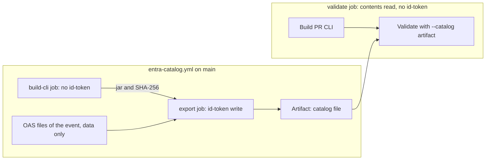

# 035 — Entra permission validation

Note (2026-11-18): the repository is now public (`johnowl/oas-spring-boot-gateway`). The statements about a private repository in this spec describe the situation when the decision was made. For the current state, see [docs/ci-change-control.md](../docs/ci-change-control.md).

| Field | Value |
|---|---|
| Status | Superseded by the decision of 2026-11-13 ([Removal of the permission catalog](README.md#removal-of-the-permission-catalog-2026-11-13)) |
| Phase | 6 — Authorization contract (core and CLI) |
| Depends on | [011](011-pr-validation-pipeline.md), [019](019-permission-catalog.md), [021](021-entra-app-registrations.md), [028](028-suppressions-and-baseline.md) |
| Modules | `openapi-gateway-core`, `openapi-gateway-cli`, `.github/workflows`, `gateway`, `infra/` (Terraform for the validator app registration) |

> **Superseded (2026-11-13).** The product owner removed the permission catalog. These items are removed: the CLI options `--catalog` and `--entra`, the subcommand `catalog export`, the Microsoft Graph client, and `azure-identity`. The rules `audience-known`, `permission-exists`, and `permissions-unused`, and the gateway property `gateway.security.catalog` are also removed. The app registration `gateway-oas-validator` is destroyed. Its Terraform, the OpenID Connect (OIDC) setup, and the workflows `entra-catalog.yml` and `entra-drift.yml` are removed. PR #45 was closed without merge. The gateway derives the audience, the token scope, and the `aud` check from `x-gateway.audience` ([023](023-per-audience-tokens.md), [024](024-authorization-manager.md)). The admin consent of `gateway-bff` and the CONTRACT rules `audience-unique` and `audience-not-first-party` limit the audiences ([021](021-entra-app-registrations.md), [018](018-authorization-extension.md)). Parts of this spec are still on `main`. Follow-up code PRs remove them. See [Removal of the permission catalog (2026-11-13)](README.md#removal-of-the-permission-catalog-2026-11-13). The text below is the old design. Do not implement it.

## Summary

This spec lets the CLI read audiences and App Roles directly from Microsoft Entra ID through Microsoft Graph, instead of from the versioned file `catalog/permissions.yaml`. A new subcommand, `catalog export --entra`, writes a catalog file in the format of [019](019-permission-catalog.md). In the pull request (PR) pipeline, a trusted workflow on `main` builds the CLI in one job and runs this subcommand in a second job. Neither job builds or runs PR code. The `validate` job then validates the PR with `--catalog <exported file>` and has no Graph credential. For local use, the validation command also accepts `--entra`. A scheduled workflow detects drift between Entra and the OpenAPI Specification (OAS) files on `main`. The rules `audience-known`, `permission-exists`, and `permissions-unused` run unchanged. The product owner chose this option on 2026-11-12 (option B: "validate against Azure instead of a versioned catalog file").

## Motivation

[019](019-permission-catalog.md) validates OAS files against a versioned file. The file can differ from Entra. [020](020-permission-catalog-sync.md) detects the difference once per working day and opens a PR, but the file is wrong until someone merges that PR. Example: an app owner removes the App Role `Orders.Refund` in Entra. Until the sync PR is merged, the CLI accepts an OAS file that requires `Orders.Refund`. No token contains that role, so every user gets 403.

With this spec, each PR validation reads the current state of Entra. There is no file to maintain, no sync PR, and no GitHub App for sync PRs.

The first version of this spec gave the Graph credential to the `validate` job, which builds and runs PR code. The security review (SEC-40-1) and the QA review (QA-40-5) rejected this design, because it breaks the MUST of [019](019-permission-catalog.md) (SEC-36-2). This version uses two jobs. See "Review findings".

## Scope

### In scope

- The interface `CatalogSource` and its implementations: file source, Entra source, and a stub for tests.
- CLI option `--entra` for the validation command and for `baseline create`, and a Microsoft Graph client in `openapi-gateway-cli`.
- CLI subcommand `catalog export --entra <files-or-dirs>`.
- Mapping from a Graph service principal object to `CatalogAudience`.
- Credentials: `AzureCliCredential` of the Azure Identity library. In CI, `azure/login` with GitHub Actions OpenID Connect (OIDC) workload identity federation.
- Error handling, timeouts, retries, and limits.
- The reusable workflow `.github/workflows/entra-catalog.yml` and the change to `.github/workflows/openapi.yml` ([011](011-pr-validation-pipeline.md)).
- The scheduled drift workflow `.github/workflows/entra-drift.yml`.
- The customization of the repository OIDC subject template.
- The gateway rule for `gateway.security.catalog`.
- A description of the Terraform for the app registration `gateway-oas-validator` and its federated credentials. The code PR implements it.
- Small changes to the catalog model and schema of [019](019-permission-catalog.md) (see "Changes to other specs").

### Out of scope

- Changes to the logic of the rules `audience-known`, `permission-exists`, and `permissions-unused`. They stay as [019](019-permission-catalog.md) defines them.
- Removal of `--catalog`. It stays for the `validate` job, offline use, and tests.
- The change of the scope form in [023](023-per-audience-tokens.md). This spec gives a proposal only. [023](023-per-audience-tokens.md) records the decision after the verification.
- Changes to Entra. The CLI only reads Entra.
- Discovery of service principals that no OAS file references.
- The events `merge_group` and `push`. The workflows do not support them yet.
- A ruleset that protects `.github/workflows/**`. The team decided against it on 2026-11-12. See "Accepted risks".

## Design

### Overview



The Graph credential exists only in the `export` job of `entra-catalog.yml`. The `build-cli` job builds the CLI from `main` without the credential. The `export` job checks the SHA-256 checksum of the jar and runs it. It reads the OAS files of the PR as data only. The `validate` job builds and runs the PR code, and it gets only the catalog file.

### Catalog sources

The CLI has three catalog sources. `ValidationRun` receives one `CatalogSource`, or none. A source works in two steps:

1. `open()` runs before the CLI reads the OAS files. Errors of this step are file and configuration errors.
2. `load(audiences)` runs after the CLI has parsed the OAS files. It receives the audiences of the parsed files.

```java
/** Gives the permission catalog for one run. */
interface CatalogSource {
    /**
     * Runs before the CLI reads the OAS files.
     * @throws CatalogSourceException for an error that gives exit code 2
     */
    void open() throws CatalogSourceException;

    /**
     * Runs after the CLI has parsed the OAS files. Only called after open().
     * @param audiences the distinct valid audiences of the parsed OAS files, sorted
     * @throws CatalogSourceException for an error that gives exit code 2
     */
    PermissionCatalog load(SortedSet<String> audiences) throws CatalogSourceException;
}
```

| Implementation | Option | `open()` | `load(audiences)` |
|---|---|---|---|
| `FileCatalogSource` | `--catalog <file>` | Reads the file and checks the schema and the duplicates, as in [019](019-permission-catalog.md). A file error gives exit code 2 before the CLI reads the OAS files, as today. | Returns the catalog of `open()`. Ignores `audiences`. |
| `EntraCatalogSource` | `--entra` | Checks that the environment variable `AZURE_TENANT_ID` is a lowercase GUID. Otherwise exit code 2. Sends no request. | Sends one Graph request for each audience and maps the results. |
| Stub in tests | None | Does nothing, or throws `CatalogSourceException`. | Returns a fixed catalog or throws `CatalogSourceException`. CLI tests use it instead of Graph. |

`EntraCatalogSource` receives a `GraphClient`, a `TokenCredential`, and the tenant id in its constructor. Tests pass a stub credential and a `GraphClient` that points to a local mock server.

### Test injection in `ValidateCommand`

The commands do not create a catalog source or read an environment variable directly. `ValidateCommand` gets a package-private constructor for tests:

```java
ValidateCommand(List<Rule> rules, CatalogSourceFactory sources, Function<String, String> environment)

interface CatalogSourceFactory {
    CatalogSource file(Path catalog);
    CatalogSource entra(String tenantId);
}
```

| Rule | Behavior |
|---|---|
| Production | `Main` uses the default constructor. It creates the real factory (`GraphClient` and `AzureCliCredential`) and the lookup `System::getenv`. |
| Tests | A test passes a stub factory and a lookup from a `Map`. Example: `Map.of("GITHUB_STEP_SUMMARY", tempFile.toString())::get`. |
| Subcommands | `baseline create` and `catalog export` read the factory and the lookup from the parent `ValidateCommand` (`@ParentCommand`). |
| Environment variables | The CLI reads `AZURE_TENANT_ID` and `GITHUB_STEP_SUMMARY` only through the lookup. |

A test that runs on GitHub Actions therefore never writes to the real job summary. The existing constructor `ValidateCommand(List<Rule>)` of [008](008-cli-basic.md) stays. It uses an empty lookup, so a test with this constructor never reads `AZURE_TENANT_ID` or `GITHUB_STEP_SUMMARY` of the machine. In the test constructor, `rules` can be `null` for the built-in rules.

### CLI options for validation

```bash
# Local use, after az login. AZURE_TENANT_ID is the tenant of the backend app registrations.
export AZURE_TENANT_ID=<tenant-id>
java -jar oas-gateway-validate.jar --entra --format text \
  gateway/src/main/resources/openapi
```

| Rule | Behavior |
|---|---|
| `--entra` is a flag. | It has no value. |
| `--entra` and `--catalog` are mutually exclusive. | Both options together give a usage error and exit code 2. The CLI sends no Graph request. |
| No `--entra` and no `--catalog` | The behavior of [019](019-permission-catalog.md) stays: a protected operation gives exit code 2. |
| `--entra` | The CLI reads Graph only after it has parsed the OAS files. |
| `--entra` without a valid `AZURE_TENANT_ID` | Configuration error, exit code 2, before the CLI reads the OAS files. Message: `Error: --entra requires the environment variable AZURE_TENANT_ID with the tenant id (a lowercase GUID).` |
| `baseline create` | Accepts `--entra` and `--catalog` with the same rules. See [028](028-suppressions-and-baseline.md). |

The error message for a missing source changes, because two options can now satisfy it:

```text
Error: --catalog or --entra is required, because orders.yaml has protected operations, for example GET /orders.
```

### Subcommand `catalog export`

```bash
java -jar oas-gateway-validate.jar catalog export --entra \
  gateway/src/main/resources/openapi > entra-catalog.yaml
```

| Rule | Behavior |
|---|---|
| `--entra` is required. | `catalog export` without `--entra` is a usage error, exit code 2. Entra is the only source. |
| `--base-dir <dir>` is optional. | The OAS folder of the base branch. The CLI parses these files only to compare audiences. It sends no Graph request for them, and they do not change the catalog file. See "Audience names for reviewers". |
| `--base-dir` with a folder that does not exist | The CLI treats the base as empty. Each audience is then new. |
| `--base-dir` with a path that is not a folder | Error, exit code 2. |
| No OAS file in `<files-or-dirs>` | Error, exit code 2, as in the validation ([008](008-cli-basic.md)). |
| Options come after `catalog export`. | An option or a path before `catalog` is a usage error, exit code 2. This rule is the same as for `baseline create` in [028](028-suppressions-and-baseline.md). |
| `catalog` without `export` | Usage error, exit code 2. |
| A directory named `catalog` | picocli reads `catalog` as the subcommand name. Write the path as `./catalog` or `catalog/`. |
| Output | The catalog file goes to stdout. The audience table goes to stderr (see "Audience names for reviewers"). |
| Exit code 0 | The CLI wrote the complete file. |
| Exit code 2 | The CLI wrote nothing to stdout, or it cannot write to stdout (see the next row). |
| The CLI cannot write to stdout, for example a closed pipe or a full disk | Message `Error: cannot write the catalog to stdout.`, exit code 2. The file on stdout can be incomplete. |

`catalog export` does not validate the OAS files. A file that does not parse gives no audience, and the export continues. The `validate` job reports the parse error.

The exported file uses the format of [019](019-permission-catalog.md), with these rules:

- The file contains one entry for each audience that has a service principal. An audience without a service principal is not in the file.
- `name` is the client id. A lowercase GUID matches the `name` pattern of [019](019-permission-catalog.md) and is unique. See "Open questions".
- `application-id-uri` is the Application ID URI of the backend app: the single value of `servicePrincipalNames` that starts with `api://` (see "Mapping to the catalog"). [023](023-per-audience-tokens.md) builds the scope from it. Until the follow-up PR of "Delivery", the export writes the placeholder `api://<client-id>`.
- The audiences are sorted by `client-id`. The roles are sorted by `String.compareTo` (Unicode code point order).
- The file uses two-space indentation and `\n` line ends on every operating system. It has no timestamp, so the same Entra state gives the same file.
- The list `audiences` can be empty. [019](019-permission-catalog.md) changes its schema for this case (see "Changes to other specs").

Example:

```yaml
audiences:
  - name: 6f1c2e8a-0000-0000-0000-000000000000
    client-id: 6f1c2e8a-0000-0000-0000-000000000000
    application-id-uri: api://orders-api
    roles:
      - Orders.Read
      - Orders.Write
```

### Compatibility of the export format

Two different CLI versions write and read the exported file. The `export` job runs the CLI of the current `main`. The `validate` job loads the file with the CLI of the PR branch. The schema of [019](019-permission-catalog.md) has `additionalProperties: false`. A PR branch with an older loader therefore rejects a field that only the newer export writes.

A new field in the export format MUST use two steps:

1. A PR makes the schema and `PermissionCatalogLoader` accept the field as optional. `catalog export` does not write the field yet.
2. A later PR makes `catalog export` write the field. This PR merges only after step 1 is on `main`.

Example: the optional field `display-name` of open question 1. Step 1 adds `display-name` to the schema as optional. Step 2 writes it.

After step 2, a PR branch that does not contain step 1 fails the `validate` check with a catalog schema error, exit code 2. The author updates the branch from `main`. The removal of a field uses the reverse order: the export stops writing it first, and the schema removes it later.

### Audiences to read

1. The CLI collects the distinct values of `x-gateway.audience` from the OAS files that parsed. A file with a parse error gives no audience.
2. The CLI reads only values that match the lowercase GUID pattern of [006](006-x-gateway-extension.md). The `x-gateway` schema rule reports the other values. A value from an OAS file never goes into a Graph URL without this check.
3. If no OAS file has a valid audience, the CLI requests no token and sends no Graph request. The catalog is then empty.
4. If there are more than 200 distinct valid audiences, the CLI gives exit code 2. It requests no token and sends no Graph request.

Only usage errors and configuration errors (exit code 2) stop the run before the CLI reads Graph. A parse error of one OAS file does not stop it.

### Graph request

For each audience, the CLI sends one request:

```http
GET https://graph.microsoft.com/v1.0/servicePrincipals(appId='{client-id}')?$select=appId,appOwnerOrganizationId,displayName,appRoles,servicePrincipalNames
Authorization: Bearer <token>
```

The follow-up PR of "Delivery" adds `servicePrincipalNames` to `$select`. PR 1 sends the request without it.

The CLI reads the service principal, not the application object. The service principal issues the tokens in the tenant. An application without a service principal in the tenant cannot issue tokens, so the CLI treats it as a missing audience.

The token scope is `https://graph.microsoft.com/.default`. The client uses the JDK `java.net.http.HttpClient`.

Example response (shortened). In the examples of this spec, the tenant id is `9a8b7c6d-0000-0000-0000-000000000000`.

```json
{
  "appId": "6f1c2e8a-0000-0000-0000-000000000000",
  "appOwnerOrganizationId": "9a8b7c6d-0000-0000-0000-000000000000",
  "displayName": "orders-api",
  "servicePrincipalNames": ["6f1c2e8a-0000-0000-0000-000000000000", "api://orders-api"],
  "appRoles": [
    { "value": "Orders.Read",   "isEnabled": true,  "allowedMemberTypes": ["User"] },
    { "value": "Orders.Refund", "isEnabled": false, "allowedMemberTypes": ["User"] },
    { "value": "Orders.Sync",   "isEnabled": true,  "allowedMemberTypes": ["Application"] },
    { "value": "Orders.Write",  "isEnabled": true,  "allowedMemberTypes": ["User", "Application"] }
  ]
}
```

### Implementation rules for the Graph client

- The Graph host is fixed in code: `https://graph.microsoft.com/v1.0`. No CLI option, environment variable, or configuration file changes it. Only a package-private constructor accepts another base URL, for tests with a mock server.
- The client does not follow redirects (`HttpClient.Redirect.NEVER`). A 3xx response is an error with exit code 2.
- The `appId` in the response MUST equal the requested client id (lowercase comparison). A different value is an error with exit code 2.
- The CLI MUST NOT write the token, the `Authorization` header, or a response body to any output. An error message contains the client id, the HTTP status, and the Graph error code only. The CLI prints the error code (`error.code`) only if it matches `^[A-Za-z0-9_.]{1,64}$`.
- For a network error or a timeout, the message names the client id and the kind of error (for example the exception class), not the URL or the exception message.
- An unexpected error of a request is an error with exit code 2. Its message names the exception class only, because the message of an exception of the HTTP client can contain a header value.
- A response body larger than 4 MiB is an error with exit code 2. A 200 response that is not valid JSON is an error with exit code 2.
- The request timeout covers the complete response, also the body.
- The first error stops the other requests. The CLI then exits with code 2.

### Mapping to the catalog

The Entra source builds the same `PermissionCatalog` and `CatalogAudience` objects as [019](019-permission-catalog.md). `catalog export` writes the same objects to the file. The local `--entra` run and a run with the exported file therefore give the same catalog.

| `CatalogAudience` field | Graph source | Rule |
|---|---|---|
| `name` | `appId` | The client id. See "Open questions". |
| `clientId` | `appId` | Lowercase. |
| `roles` | `appRoles[].value` | See the role rules below. Sorted by `String.compareTo`. |
| `applicationIdUri` | `servicePrincipalNames` | The single value that starts with `api://` (case-sensitive comparison of the prefix). The value is copied without a change. See the rules below. |

A role is in the catalog only if all of these conditions are true:

| Condition | Reason |
|---|---|
| `isEnabled` is `true`. | Entra does not put a disabled App Role into tokens. |
| `allowedMemberTypes` contains `"User"`. | The gateway sends user tokens ([023](023-per-audience-tokens.md)). A role for applications only is never in a user token. |
| `value` exists and matches `^[A-Z][A-Za-z0-9]*(\.[A-Z][A-Za-z0-9]*)+$`. | This is the role pattern of [019](019-permission-catalog.md) and the permission pattern of [018](018-authorization-extension.md). An OAS file cannot use another value. |

The CLI writes one notice line to stderr for each role that it skips because of the pattern. Only an enabled role with `User` in `allowedMemberTypes` can get a notice. It writes the notices after all Graph requests have finished, sorted by client id and then by role value. Example: `Notice: role 'orders.admin' of 6f1c2e8a-0000-0000-0000-000000000000 does not match the role pattern and is ignored.` The CLI escapes control characters in the value, the same as in [008](008-cli-basic.md).

The example response above gives this audience:

```text
name=6f1c2e8a-0000-0000-0000-000000000000, clientId=6f1c2e8a-0000-0000-0000-000000000000, applicationIdUri=api://orders-api, roles=[Orders.Read, Orders.Write]
```

Other rules:

- A missing service principal (HTTP 404) is not in the catalog. The rule `audience-known` then reports a violation. A 404 is not a CLI error.
- The service principal MUST have exactly one value in `servicePrincipalNames` that starts with `api://`. With zero such values, or with more than one, the audience is not in the catalog. `audience-known` then reports a violation with a specific message (see "Catalog file and violation pointers"). This case is not a CLI error. Reason: [023](023-per-audience-tokens.md) builds the scope `<application-id-uri>/access_as_user` from this value, and the gateway cannot choose between two values.
- The single `api://` value MUST match the pattern `^api://[A-Za-z0-9][A-Za-z0-9._~:/-]*[A-Za-z0-9]$`. Otherwise the audience is not in the catalog, and `audience-known` reports a violation with a specific message. The loader of [019](019-permission-catalog.md) checks the same pattern. Reason: the gateway puts the value into the scope of a token request.
- The application of the audience MUST belong to the tenant. If `appOwnerOrganizationId` is missing, or is not the tenant id of `AZURE_TENANT_ID` (lowercase comparison), the audience is not in the catalog. `audience-known` then reports a violation with a specific message (see "Catalog file and violation pointers"). This case is not a CLI error.

### Tenant of the application

Any user who can register applications can choose a `displayName`. The tenant check rejects an application that another tenant owns, for example a multi-tenant look-alike app with a service principal in this tenant. The check does not reject a look-alike app that a user of this tenant registers. For that case, see "Audience names for reviewers" and open question 6.

The CLI gets the tenant id from the environment variable `AZURE_TENANT_ID`. The same value selects the tenant of the Graph token: the CLI builds `AzureCliCredential` with this tenant id. The implementer verifies the method `AzureCliCredentialBuilder.tenantId` in the `azure-identity` version in use.

The Entra source records the reason for each audience that it does not put into the catalog: `no-service-principal`, `other-tenant`, `no-application-id-uri`, `several-application-id-uris`, or `invalid-application-id-uri`. The last three reasons come with the follow-up PR of "Delivery". `PermissionCatalog` keeps these reasons for the message of `audience-known`. The logic of the rule does not change: an audience that is not in the catalog is a violation.
- `permission-exists` and `permissions-unused` run unchanged on this catalog. `permissions-unused` runs with any catalog source: `--catalog` or `--entra`.

### Catalog file and violation pointers

`PermissionCatalog` gets a label for messages, in addition to `file()`. For the file source, the label is the file path. For the Entra source, `file()` is empty and the label is `Microsoft Entra ID`.

| Source | `audience-known` message | File of a `permissions-unused` violation | Pointer of a `permissions-unused` violation |
|---|---|---|---|
| `--catalog .entra-catalog/catalog.yaml` (exported file in CI) | `Audience '6f1c2e8a-...' is not in .entra-catalog/catalog.yaml.` | `.entra-catalog/catalog.yaml` | `/audiences/0/roles/1` |
| `--entra` (local), no service principal | `Audience '6f1c2e8a-...' is not in Microsoft Entra ID.` | Empty | `/audiences/0/roles/1` |
| `--entra` (local), other tenant | `Audience '6f1c2e8a-...' belongs to an application of another tenant (appOwnerOrganizationId '1e2d3c4b-...'). Only applications of tenant '9a8b7c6d-...' are allowed.` | Empty | `/audiences/0/roles/1` |
| `--entra` (local), no `api://` value in `servicePrincipalNames` | `Audience '6f1c2e8a-...' has no Application ID URI that starts with api:// in Microsoft Entra ID. Add exactly one Application ID URI to the app registration.` | Empty | `/audiences/0/roles/1` |
| `--entra` (local), more than one `api://` value | `Audience '6f1c2e8a-...' has 2 Application ID URIs that start with api:// in Microsoft Entra ID. Exactly one is allowed.` | Empty | `/audiences/0/roles/1` |
| `--entra` (local), the `api://` value does not match the pattern | `Audience '6f1c2e8a-...' has an Application ID URI that is not allowed: 'api://orders api'.` The CLI escapes control characters in the value, the same as in [008](008-cli-basic.md). | Empty | `/audiences/0/roles/1` |

The exported file does not contain the reason. In the `validate` job, all these cases give the message `is not in .entra-catalog/catalog.yaml`. The job summary of the `export` job shows the reason (see "Audience names for reviewers"). The CLI escapes control characters in `appOwnerOrganizationId`, the same as in [008](008-cli-basic.md). If the value is missing, the message shows `(appOwnerOrganizationId (none))`.

A run with `--entra` and a run with `--catalog <exported file>` therefore give the same rule ids and the same pointers. The files are also the same, except for `permissions-unused`. These parts can differ: the file of a `permissions-unused` violation, and the catalog label and the reason in the `audience-known` message.

The text, GitHub, JSON, and SARIF formatters already accept a violation with an empty file ([009](009-cli-github-and-json-output.md), [010](010-cli-sarif-output.md)).

The exported file is sorted, so the same Entra state gives the same pointers. The pointers are still index pointers. A role or an audience that someone adds or removes in Entra moves the index of the following entries. A baseline entry ([028](028-suppressions-and-baseline.md)) for `permissions-unused` can then cover a different role, or no role.

Recommendation: do not baseline `permissions-unused`. To accept unused roles, set `permissions-unused: off` or keep the rule at WARN in `.oas-gateway.yaml` ([027](027-rule-configuration.md)). A baseline entry from a local `--entra` run has an empty file. It never matches a CI run, which uses the exported file.

### Audience names for reviewers

`audience-known` proves only that a service principal with this client id exists and that its application belongs to the tenant. A reviewer must also see which app the GUID is, and which audiences the PR adds or changes. Each time the CLI reads Graph (`--entra` or `catalog export`), it prints one line for each audience to stderr:

```text
Audiences from Microsoft Entra ID:
  0b7d3f10-0000-0000-0000-000000000000  (no service principal)                               NEW
  4c5d6e7f-0000-0000-0000-000000000000  (other tenant 1e2d3c4b-0000-0000-0000-000000000000)
  5d6e7f80-0000-0000-0000-000000000000  billing-api  (no api:// Application ID URI)
  6f1c2e8a-0000-0000-0000-000000000000  orders-api  2 roles                                  NEW
Changed audiences:
  file payments.yaml  3a4b5c6d-0000-0000-0000-000000000000 -> 6f1c2e8a-0000-0000-0000-000000000000
```

Rules for the table:

- The CLI writes the table, the "Changed audiences" list, the job summary, and the role notices after all Graph requests have finished. The lines are sorted by client id. The "Changed audiences" lines are sorted by file path.
- The flag `NEW` marks an audience that no OAS file of `--base-dir` uses. With `--base-dir`, the flag column starts two spaces after the longest description, so that the flags align. A row without a flag has no trailing spaces.
- Each "Changed audiences" line starts with `file ` and then the relative path, so that no line starts with a value from the PR.
- "Changed audiences" lists each OAS file whose relative path exists in `--base-dir` with a different valid audience. A file that is not in the base is not in this list. Its audience can still have the flag `NEW`.
- The relative path of an OAS file is its path relative to the folder argument that contains it, or its file name for a file argument. The relative path of a base file is its path relative to `--base-dir`.
- A file with a valid audience whose base file has no valid audience is also in the list. Its base audience is `(none)`. A file without a valid audience is not in the list.
- A service principal without `displayName` shows `(none)` as name.
- After the follow-up PR of "Delivery", an audience with zero or more than one `api://` value shows its name, then `(no api:// Application ID URI)` or `(2 api:// Application ID URIs)`. The number is the count of such values.
- The CLI writes nothing to stderr and to the job summary when it sends no Graph request (no valid audience).
- Without `--base-dir` (for example `--entra` or the scheduled run), the table has no flags and no "Changed audiences" list.
- The CLI writes the table to stderr, so stdout of `--format json`, `--format sarif`, and `catalog export` stays valid.

When the lookup returns a value for `GITHUB_STEP_SUMMARY`, the CLI also appends a Markdown table to that file. The table then appears in the job summary of the `export` job. If the CLI cannot write the file, it exits with code 2, because the table is a control for reviewers. Example:

```markdown
| Client id | Name | Roles | Flag |
|---|---|---|---|
| `0b7d3f10-0000-0000-0000-000000000000` | (no service principal) | 0 | **New audience** |
| `6f1c2e8a-0000-0000-0000-000000000000` | `orders-api` | 2 | **New audience** |
```

A second table lists the changed audiences with the columns "File", "Base audience", and "Audience". Its title is "Changed audiences". Each row has the flag **Audience changed**.

`displayName` is data from the tenant. A user who owns an app can choose any name, for example a name with Markdown or a link. The CLI makes the name inert:

1. The CLI escapes control characters, the same as in [008](008-cli-basic.md). In the Markdown table, it replaces each line break with a space.
2. In the Markdown table, the name is always in a code span. Markdown shows a code span as literal text, so a link or an autolink in the name has no effect.
3. A backslash cannot escape a backtick inside a code span. The CLI therefore uses a delimiter of backticks that is one backtick longer than the longest run of backticks in the name. It puts one space after the opening delimiter and before the closing delimiter. Example: the name ``a`b`` gives ``` `` a`b `` ```.
4. The CLI escapes each `|` as `\|`, so the name cannot add a table column. GitHub accepts this escape also inside a code span in a table.
5. The file paths of "Changed audiences" and the `appOwnerOrganizationId` of an "other tenant" row are also in code spans, with the same rules.

On stderr, the GitHub runner reads workflow commands, for example `::error::` at the start of a line or the older form `##[error]`. A name, a role value, or an `appOwnerOrganizationId` from Graph must not start one. The CLI therefore makes each such value inert on stderr:

1. It escapes control characters, as above.
2. It writes the second `#` of each `##[` as the Java escape `\u0023`.
3. If the value starts with `::`, also after spaces, it writes the first `:` as the Java escape `\u003A`.
4. No stderr line starts with such a value. A fixed text comes first, for example the client id, `Notice: `, or `file `.

The file paths of "Changed audiences" come from the PR. The CLI makes them inert on stderr with the same rules.

### Credentials

The CLI gets the Graph token from `AzureCliCredential` of the Azure Identity library for Java (`com.azure:azure-identity`). The CLI does not use `DefaultAzureCredential`, because its chain can pick up other credentials of the environment. The CLI stores no secret and has no credential option. The CLI builds the credential with the tenant id of `AZURE_TENANT_ID` (see "Tenant of the application").

| Environment | Credential source |
|---|---|
| GitHub Actions | `azure/login` logs in the Azure CLI with OIDC workload identity federation. `AzureCliCredential` uses this session. No client secret exists. |
| Developer machine | The `az login` session of the developer. The developer needs read access to the service principals. |

If the Azure CLI is missing or has no session, the token request fails, and the CLI exits with code 2. The message names the exception class only. It does not contain the output of the Azure CLI. The CLI uses `getTokenSync` and requests one token for all Graph requests of a run.

Before the first Graph request, the CLI checks that the token matches `^[A-Za-z0-9._~+/=-]+$`, the characters of a bearer token. A token with other characters, for example a carriage return, is an error with exit code 2. The message does not contain the token.

The CLI jar contains `azure-identity` 1.19.0 without `azure-core-http-netty`, `msal4j-persistence-extension`, and `jna-platform`. `AzureCliCredential` runs the Azure CLI and sends no HTTP request, and the Graph client uses `java.net.http`, so the CLI needs none of them. `azure-core` needs `reactor-core`, so the jar contains it ([008](008-cli-basic.md)). The shaded jar grows from 6.55 MB to 10.45 MB.

### Retries and limits

| Condition | Behavior |
|---|---|
| HTTP 429, 503, or 504 | Wait the time in `Retry-After`, then send the request again. |
| `Retry-After` is missing, or is not a non-negative integer number of seconds | Wait 1 second. |
| `Retry-After` is greater than 30 seconds | Do not wait. Exit code 2. |
| 3 attempts in total for one audience, all with 429, 503, or 504 | Exit code 2. |
| More than 200 distinct valid audiences | Exit code 2 before the token request. |
| Parallel Graph requests | 4 at most. |

### App registration `gateway-oas-validator`

| Setting | Value |
|---|---|
| Name | `gateway-oas-validator` |
| Credential | Federated credentials only. No client secret, no certificate. |
| Federated credential issuer | `https://token.actions.githubusercontent.com` |
| Federated credential audience | `api://AzureADTokenExchange` |
| Federated credential subjects | Two subjects. See "OIDC subject". |
| API permission | Microsoft Graph application permission `Application.Read.All`, with admin consent |

`Application.Read.All` allows `GET /servicePrincipals`. It can read all app registrations and service principals of the tenant, not only the backend apps. See "Accepted risks".

### OIDC subject

By default, the subject of a GitHub OIDC token is `repo:<owner>/<repo>:<context>`. With that subject, every workflow and every job of a PR could get the token, also a workflow that the PR adds. The subject also depends on the repository name, so a new repository with the same name could match it.

An administrator customizes the OIDC subject template of the repository. The template includes these claims, in this order:

```json
{
  "use_default": false,
  "include_claim_keys": ["repository_owner_id", "repository_id", "context", "job_workflow_ref"]
}
```

The administrator sets it with the GitHub REST API (`PUT /repos/{owner}/{repo}/actions/oidc/customization/sub`) or with Terraform. The template applies to all workflows of the repository. No other federated credential of this repository exists today.

`gateway-oas-validator` has two federated credentials. Both bind to the reusable workflow on `refs/heads/main`:

| Name | Context | Subject (form) |
|---|---|---|
| `pull-request` | PR | `repository_owner_id:<owner-id>:repository_id:<repository-id>:pull_request:job_workflow_ref:johnowl/oas-spring-boot-gateway/.github/workflows/entra-catalog.yml@refs/heads/main` |
| `schedule-main` | Scheduled run on `main` | `repository_owner_id:<owner-id>:repository_id:<repository-id>:ref:refs/heads/main:job_workflow_ref:johnowl/oas-spring-boot-gateway/.github/workflows/entra-catalog.yml@refs/heads/main` |

`<owner-id>` and `<repository-id>` are the numeric ids of the owner and of the repository. The implementer MUST verify the exact subject strings with a test run before the credentials are final. The `azure/login` error message shows the subject that Entra received.

A PR can change `openapi.yml` and call a changed copy of `entra-catalog.yml` from its own branch. The `job_workflow_ref` of that job then ends with the PR branch, not `@refs/heads/main`, so Entra gives no token. A PR cannot change the version of `entra-catalog.yml` on `main`.

### Reusable workflow `entra-catalog.yml`

The file `.github/workflows/entra-catalog.yml` is on `main`. It has only the trigger `workflow_call`. The outline shows the structure. The file is the reference.

The workflow has two jobs:

| Job | Permissions | Work |
|---|---|---|
| `build-cli` | `contents: read`. No `id-token`. | Builds the CLI from `main`. Writes the SHA-256 checksum of the jar as the job output `cli-sha256`. Uploads the jar as an artifact. |
| `export` | `contents: read` and `id-token: write` | Downloads the jar. Checks the checksum against the job output `cli-sha256` before it runs anything from the artifact. Then it logs in and runs `catalog export --entra`. |

```yaml
name: Entra catalog

on:
  workflow_call:
    outputs:
      catalog:
        value: ${{ jobs.export.outputs.catalog }}

env:
  OAS_DIR: gateway/src/main/resources/openapi

jobs:
  build-cli:
    # Same-repository PRs that Dependabot did not open, and the schedule. Nothing else.
    if: >-
      github.event_name == 'schedule' ||
      (github.event_name == 'pull_request' &&
       github.event.pull_request.head.repo.full_name == github.repository &&
       github.event.pull_request.user.login != 'dependabot[bot]')
    runs-on: ubuntu-latest
    timeout-minutes: 15
    permissions:
      contents: read                  # no id-token
    outputs:
      cli-sha256: ${{ steps.hash.outputs.sha256 }}
    steps:
      - name: Check out the CLI source of main
        uses: actions/checkout@<commit-sha>
        with:
          ref: refs/heads/main
          persist-credentials: false
      - uses: actions/setup-java@<commit-sha>
        with:
          distribution: temurin
          java-version: '25'
          # No Maven cache. See the rules below.
      - name: Build the trusted CLI
        run: ./mvnw -B -pl openapi-gateway-cli -am package -DskipTests
      - name: Compute the checksum
        id: hash
        run: |
          set -euo pipefail
          sum=$(sha256sum openapi-gateway-cli/target/oas-gateway-validate.jar | cut -d ' ' -f 1)
          echo "sha256=$sum" >> "$GITHUB_OUTPUT"
      - name: Keep the CLI
        uses: actions/upload-artifact@<commit-sha>
        with:
          name: entra-catalog-cli
          path: openapi-gateway-cli/target/oas-gateway-validate.jar
          retention-days: 1

  export:
    needs: build-cli
    runs-on: ubuntu-latest
    timeout-minutes: 15
    permissions:
      contents: read
      id-token: write
    outputs:
      catalog: ${{ steps.export.outputs.catalog }}
    steps:
      - name: Download the CLI
        uses: actions/download-artifact@<commit-sha>
        with:
          name: entra-catalog-cli
          path: cli
      - name: Check the checksum of the CLI
        env:
          CLI_SHA256: ${{ needs.build-cli.outputs.cli-sha256 }}
        run: |
          set -euo pipefail
          [[ "$CLI_SHA256" =~ ^[0-9a-f]{64}$ ]]
          echo "$CLI_SHA256  cli/oas-gateway-validate.jar" | sha256sum -c -
      - name: Check out the OAS files of the event (data only)
        uses: actions/checkout@<commit-sha>
        with:
          path: data
          persist-credentials: false
          sparse-checkout: gateway/src/main/resources/openapi
      - name: Check out the OAS files of the base branch (data only)
        if: github.event_name == 'pull_request'
        uses: actions/checkout@<commit-sha>
        with:
          ref: ${{ github.event.pull_request.base.sha }}
          path: base
          persist-credentials: false
          sparse-checkout: gateway/src/main/resources/openapi
      - name: Check the OAS folder
        id: folder
        run: |
          set -euo pipefail
          inside() {                    # fails if the folder resolves outside its checkout
            local resolved
            resolved=$(realpath -e "$1/$OAS_DIR")
            case "$resolved/" in
              "$GITHUB_WORKSPACE/$1/"*) ;;
              *) echo "::error::$1/$OAS_DIR resolves to a folder outside $1/."; exit 1 ;;
            esac
          }
          if [ "$GITHUB_EVENT_NAME" = "pull_request" ] && [ -e "base/$OAS_DIR" ]; then
            inside base
          fi
          if [ -d "data/$OAS_DIR" ]; then
            inside data
            echo "exists=true" >> "$GITHUB_OUTPUT"
          else
            echo "::notice::$OAS_DIR does not exist. No catalog."
            echo "exists=false" >> "$GITHUB_OUTPUT"
          fi
      - uses: actions/setup-java@<commit-sha>
        if: steps.folder.outputs.exists == 'true'
        with:
          distribution: temurin
          java-version: '25'
          # Only the Java runtime. No Maven cache and no build in this job.
      - name: Azure login
        if: steps.folder.outputs.exists == 'true'
        uses: azure/login@<commit-sha>
        with:
          client-id: ${{ vars.AZURE_CLIENT_ID }}
          tenant-id: ${{ vars.AZURE_TENANT_ID }}
          allow-no-subscriptions: true
      - name: Export the catalog
        id: export
        env:
          ACTIONS_ID_TOKEN_REQUEST_TOKEN: ''    # the CLI does not need the OIDC request token
          ACTIONS_ID_TOKEN_REQUEST_URL: ''
          AZURE_TENANT_ID: ${{ vars.AZURE_TENANT_ID }}
          EXISTS: ${{ steps.folder.outputs.exists }}
        run: |
          set -euo pipefail
          if [ "$EXISTS" != "true" ]; then
            echo "catalog=false" >> "$GITHUB_OUTPUT"
            exit 0
          fi
          base=()
          if [ "$GITHUB_EVENT_NAME" = "pull_request" ]; then base=(--base-dir "base/$OAS_DIR"); fi
          java -jar cli/oas-gateway-validate.jar \
            catalog export --entra "${base[@]}" "data/$OAS_DIR" > "$RUNNER_TEMP/catalog.yaml"
          echo "catalog=true" >> "$GITHUB_OUTPUT"
      - name: Keep the catalog
        if: steps.export.outputs.catalog == 'true'
        uses: actions/upload-artifact@<commit-sha>
        with:
          name: entra-catalog
          path: ${{ runner.temp }}/catalog.yaml
          retention-days: 1
```

Rules:

- No job of the workflow builds or runs PR code. `build-cli` builds the CLI from `main`. `export` checks out the OAS files of the event in the folder `data`, and the OAS files of the base branch in the folder `base`. It only reads them.
- `build-cli` has no `id-token` permission. The build runs Maven and its plugins, so the build MUST NOT run in a job that can request the OIDC token.
- `export` MUST NOT build code. It runs only these items: the pinned actions, the `run` steps of the workflow file on `main`, and the jar after the checksum check.
- `export` MUST check the checksum before it runs anything from the artifact. The expected value comes from the job output of `build-cli`, not from an artifact. Reason: other jobs of the same workflow run, for example the `validate` job with PR code, can upload artifacts. Only `build-cli` can set its job output.
- A different checksum, or a value that is not 64 lowercase hex characters, fails the step. "Azure login" then does not run.
- The data checkout uses the default commit of the event (`github.sha`). For a PR, this commit is the same as in the `validate` job.
- Each checkout sets `persist-credentials: false`.
- `build-cli` checks out `refs/heads/main`, not `main`. A tag with the name `main` cannot replace the branch.
- The step "Check the OAS folder" resolves the OAS folder of the event and, if it exists, the OAS folder of the base branch with `realpath -e`. Each folder MUST resolve inside its own checkout (`$GITHUB_WORKSPACE/data/` or `$GITHUB_WORKSPACE/base/`). Otherwise the step fails, and "Azure login" does not run. Reason: a PR can replace a parent folder with a symbolic link to a folder outside the checkout.
- The step "Export the catalog" sets `ACTIONS_ID_TOKEN_REQUEST_TOKEN` and `ACTIONS_ID_TOKEN_REQUEST_URL` to empty values. The CLI parses PR files and does not need the OIDC request token. The Azure CLI session of "Azure login" stays available to the CLI. Open question 15 proposes a job without `id-token` that extracts the audiences.
- `setup-java` MUST NOT use the Maven cache in either job. The jobs run in the context of the PR, so they can read cache entries that PR runs wrote. A poisoned entry in `build-cli` could change the jar before the checksum is computed. [012](012-cli-distribution.md) uses the same rule for the release.
- The OAS folder is fixed in the reusable workflow. The workflow has no inputs, so a caller cannot change what the jobs read.
- `AZURE_CLIENT_ID` and `AZURE_TENANT_ID` are repository variables, not secrets. They identify `gateway-oas-validator` and the tenant. The CLI reads `AZURE_TENANT_ID` for the tenant check.
- The implementer pins each action to a full commit SHA, the same as in [011](011-pr-validation-pipeline.md).
- After the first release of the CLI ([012](012-cli-distribution.md)), `build-cli` MAY download a released jar instead of the build from `main`. The workflow then pins the SHA-256 checksum of the released jar. See "Open questions".

### Change to `openapi.yml`

The workflow `.github/workflows/openapi.yml` ([011](011-pr-validation-pipeline.md)) gets the job `entra-catalog` and changes the `validate` job. The outline shows the changed parts only.

```yaml
jobs:
  changes:            # unchanged
  entra-catalog:
    needs: changes
    if: >-
      needs.changes.outputs.relevant == 'true' &&
      github.event.pull_request.head.repo.full_name == github.repository &&
      github.event.pull_request.user.login != 'dependabot[bot]'
    permissions:
      contents: read
      id-token: write
    uses: johnowl/oas-spring-boot-gateway/.github/workflows/entra-catalog.yml@main

  validate:
    needs: [changes, entra-catalog]
    if: ${{ !cancelled() && needs.changes.outputs.relevant == 'true' }}
    permissions:
      contents: read                  # no id-token
    steps:
      # checkout, setup-java, Build CLI: unchanged
      - name: Check the entra-catalog job
        env:
          CATALOG_RESULT: ${{ needs.entra-catalog.result }}
        run: |
          if [ "$CATALOG_RESULT" != "success" ] && [ "$CATALOG_RESULT" != "skipped" ]; then
            echo "::error::The entra-catalog job did not succeed ($CATALOG_RESULT)."
            exit 1
          fi
      - name: Download the catalog
        if: needs.entra-catalog.outputs.catalog == 'true'
        uses: actions/download-artifact@<commit-sha>
        with:
          name: entra-catalog
          path: .entra-catalog
      - name: Validate OAS files
        env:
          HAS_CATALOG: ${{ needs.entra-catalog.outputs.catalog }}
        run: |
          # Temporary until the first real OAS file exists. The PR that adds it removes this check.
          if [ ! -d "$OPENAPI_DIR" ]; then
            echo "::notice::$OPENAPI_DIR does not exist yet. Nothing to validate."
            exit 0
          fi
          catalog=()
          if [ "$HAS_CATALOG" = "true" ]; then catalog=(--catalog .entra-catalog/catalog.yaml); fi
          java -jar openapi-gateway-cli/target/oas-gateway-validate.jar \
            --format github --fail-on error "${catalog[@]}" "$OPENAPI_DIR"
      # The SARIF step keeps its check "if [ -d "$OPENAPI_DIR" ]" and passes the same catalog option.
```

Rules:

- The guard for a missing OAS folder stays in the "Validate OAS files" step and in the SARIF step, as [011](011-pr-validation-pipeline.md) defines it. The PR that adds the first real OAS file removes the guard from both steps.

- `validate` runs also when `entra-catalog` is skipped. A required check that is skipped reports "Success" ([011](011-pr-validation-pipeline.md)), so `validate` must not be skipped because of `entra-catalog`.
- If `entra-catalog` fails or is cancelled, `validate` fails. It does not fall back to a run without a catalog.
- `validate` passes `--catalog` only when the output `catalog` of `entra-catalog` is `true`. A file in the PR never decides this.
- The workflow no longer reads `catalog/permissions.yaml`.
- The SARIF step uses the same catalog file. The CLI reads Graph only once for each workflow run.
- `.github/workflows/entra-catalog.yml` and `.github/workflows/entra-drift.yml` become relevant paths of the `changes` job.

### Pull requests from forks and from Dependabot

GitHub gives no OIDC token to a `pull_request` workflow from a fork. A workflow that Dependabot triggers also cannot use `azure/login`. For these PRs, `entra-catalog` is skipped, and `validate` runs without a catalog. The validation fails closed:

| Fork or Dependabot PR | Result |
|---|---|
| All operations are public | Contract and best-practice rules run. The catalog rules do not run. The check can pass. |
| At least one protected operation | `--catalog or --entra is required`, exit code 2. The check fails, and the PR cannot merge. |

To validate such a PR with protected operations, a maintainer pushes the commits to a branch of this repository and opens a new PR.

### Drift detection on `main`

Entra can change after a PR is merged. Example: an app owner disables `Orders.Read`, which an OAS file on `main` uses. The scheduled workflow `.github/workflows/entra-drift.yml` finds this problem.

```yaml
name: Entra drift

on:
  schedule:
    - cron: "0 5 * * 1-5"         # 05:00 UTC, Monday to Friday

permissions:
  contents: read

concurrency:
  group: entra-drift
  cancel-in-progress: false

jobs:
  entra-catalog:
    if: vars.AZURE_CLIENT_ID != ''    # skips the run until the repository variable exists
    permissions:
      contents: read
      id-token: write
    uses: johnowl/oas-spring-boot-gateway/.github/workflows/entra-catalog.yml@main

  validate:
    needs: entra-catalog
    if: needs.entra-catalog.outputs.catalog == 'true'
    permissions:
      contents: read                # no id-token
    # Steps: checkout of main (data only), setup-java (runtime only, no Maven),
    # download the CLI jar of build-cli, check its SHA-256 checksum, download the
    # catalog, validate the OAS folder with --catalog and the same options as openapi.yml.

  report:
    needs: [entra-catalog, validate]
    if: >-
      ${{ !cancelled() &&
      (needs.entra-catalog.result == 'failure' || needs.entra-catalog.result == 'cancelled' ||
       needs.validate.result == 'failure' || needs.validate.result == 'cancelled') }}
    permissions:
      issues: write
    # Steps: create the label, then create or update the issue. No checkout, no CLI.
```

Rules:

- The workflow runs once per working day, at the same time as the former [020](020-permission-catalog-sync.md) workflow.
- The job `entra-catalog` gets its token through the federated credential `schedule-main`.
- The job `entra-catalog` runs only when the repository variable `AZURE_CLIENT_ID` is not empty. Until the variable exists (rollout precondition 4), the scheduled run skips all jobs. A skipped run creates no issue, because `report` runs only after a failed or cancelled job. After the rollout, PR 2b replaces the skip with a job that fails when the variable is empty (rollout precondition 8).
- The `validate` job of the drift workflow fails for CLI exit code 1 or 2.
- The `validate` job of the drift workflow MUST NOT run Maven or another build tool. It reuses the CLI jar of the job `build-cli` (artifact `entra-catalog-cli`). It checks the SHA-256 checksum of the jar against `cli-sha256`, a workflow output of `entra-catalog.yml`. Reason: the gateway deploy trusts the artifact `entra-catalog` of this run ([023](023-per-audience-tokens.md)). After the export, no third-party build code runs in the run. This rule is part of the follow-up PR of "Delivery". Until then, the job builds the CLI with Maven.
- The `report` job runs when `entra-catalog` or `validate` has the result `failure` or `cancelled`. A job that reaches its timeout can have the result `cancelled`. The job does not run when the whole workflow run is cancelled.
- The `report` job first creates the label `entra-drift` with `gh label create --force`. The command also succeeds when the label exists. Without the label, `gh issue create --label` fails.
- The `report` job creates an issue with the title `Entra permission drift` and the label `entra-drift`. If an open issue exists with this label, with the author `app/github-actions`, and with exactly this title, the job adds a comment to it instead. Reason: a person with triage access can add the label to any issue. The issue and the comment contain a link to the workflow run, not the CLI output.
- The workflow does not close the issue. A person closes it after the fix.

### Gateway change

The gateway does not call Graph. The `validate` check covers only the folder `gateway/src/main/resources/openapi`. In the application archive, these files are on the classpath under `openapi/`. The gateway can therefore start without a catalog only when it reads exactly these files from the application archive.

`gateway.security.catalog` is optional only when all of these conditions are true:

1. `gateway.openapi.reload.enabled` is `false`.
2. `gateway.openapi.specs` equals the default list of [013](013-oas-route-locator.md): `classpath:openapi/*.yaml`, `classpath:openapi/*.yml`, and `classpath:openapi/*.json`. The order does not matter. The list has no other entry.
3. The URL of each resolved resource is inside the application archive. The URL protocol is `jar`, the archive is the archive that holds the gateway application class (its `CodeSource`), and the entry is in the application classes (`BOOT-INF/classes/`), not in a dependency jar (`BOOT-INF/lib/`). Example: `jar:nested:/app/gateway.jar/!BOOT-INF/classes/!/openapi/orders.yaml`.

In all other cases, the catalog is required, and the gateway does not start without it. The gateway checks the conditions in the order of this table. The first condition that fails gives the message.

| Order | Case | Examples | Startup message |
|---|---|---|---|
| 1 | Reload is enabled ([014](014-route-reload.md)). | `gateway.openapi.reload.enabled=true` | `gateway.security.catalog is required, because gateway.openapi.reload.enabled is true.` |
| 2 | `gateway.openapi.specs` is not the default list. | `file:/etc/gateway/openapi/*.yaml`, `classpath:routes/*.yaml`, `classpath*:openapi/*.yaml`, the default list plus one entry | `gateway.security.catalog is required, because gateway.openapi.specs is not the default list (classpath:openapi/*.yaml, classpath:openapi/*.yml, classpath:openapi/*.json).` |
| 3 | A resolved resource is not inside the application archive. | The default list resolves to a directory, for example `file:/workspace/gateway/target/classes/openapi/orders.yaml` in an IDE run or an exploded jar, or to a dependency jar, for example `jar:nested:/app/gateway.jar/!BOOT-INF/lib/other.jar!/openapi/orders.yaml`. | `gateway.security.catalog is required, because the OAS file <URL> is not inside the application archive.` |

`<URL>` is the URL of the first resource that fails the check, in the sort order of the resolved resources. The gateway escapes control characters in it, the same as in [008](008-cli-basic.md).

Details:

- If the property is set, the gateway loads the catalog and runs `BuiltInRules.contract(catalog)`, as in [019](019-permission-catalog.md). A reload uses the same catalog.
- If the catalog is optional and the property is not set, the gateway runs `BuiltInRules.contract()`. `OpenApiRouteDefinitionLocator` no longer stops the startup for a protected operation.
- The check of case 3 runs on each resolved resource, also when no OAS file has a protected operation.
- Tests and local runs that read the OAS files from a directory need a catalog (case 3). Example: a test with the default list and the files in `gateway/src/test/resources/openapi`.

Consequence: for OAS files from the application archive, the gateway trusts that they passed the `validate` check. Branch protection on `main` ([011](011-pr-validation-pipeline.md)) is the control for this guarantee.

The optional-catalog rule is valid only after two conditions:

- "The ruleset on `main`": a ruleset (or a branch protection rule) on `main` requires a PR, an approval, and the check `validate`, without a bypass. Without it, the `validate` check is advisory, and the trust in the OAS files of the application archive has no control. PR #45 adds this condition as rollout step 8.
- "The scope and registration-id verification" of [023](023-per-audience-tokens.md) (see the next section).

Until "the ruleset on `main`" is done, the code PR MUST NOT make the catalog optional for any gateway. Until the verification is done, it MUST NOT make the catalog optional for a gateway that contains the components of [023](023-per-audience-tokens.md).

### Effect on per-audience tokens (023)

[023](023-per-audience-tokens.md) builds the scope `<application-id-uri>/access_as_user` from the catalog, and the registration id `entra-<client-id>` from the client id (decision of 2026-11-13, QA-47-1).

With a catalog: the gateway reads the catalog file that `catalog export --entra` wrote in the scheduled run of `entra-drift.yml` on `main` ([023](023-per-audience-tokens.md), "Catalog at runtime"). After the follow-up PR of "Delivery", the file has the real Application ID URI, so the scope is correct. Example: `api://orders-api/access_as_user`. Before that PR, the file has the placeholder `api://<client-id>`, and the gateway MUST NOT use an exported catalog.

Without a catalog (the optional-catalog rule of "Gateway change"): the gateway has no Application ID URI. Proposal:

- The gateway requests the scope `{client-id}/access_as_user`, with the client id GUID of the audience. Example: `6f1c2e8a-0000-0000-0000-000000000000/access_as_user`.
- The registration id is `entra-{client-id}`, as with a catalog. Example: `entra-6f1c2e8a-0000-0000-0000-000000000000`. The id is an internal string. It needs no verification beyond the test in [023](023-per-audience-tokens.md) that Spring Security accepts it.

The scope form is not verified. "The scope and registration-id verification" has two parts. The team MUST verify the scope form with the test app registrations in [`infra/azure-test`](../infra/azure-test/README.md). A test of [023](023-per-audience-tokens.md) MUST show that Spring Security accepts the registration id. Both parts MUST be done before the optional-catalog rule ships. If the scope verification fails, the catalog stays required for a gateway with the components of [023](023-per-audience-tokens.md), and this spec needs a new decision.

### Terraform for the validator app

The code PR adds the app registration `gateway-oas-validator` with Terraform. This spec describes the resources. The implementer verifies the resource and attribute names against the `azuread` provider version in use (`~> 3.10` in [`infra/azure-test/versions.tf`](../infra/azure-test/versions.tf)).

| Resource | Purpose |
|---|---|
| `azuread_application` `gateway-oas-validator` | The app registration. `required_resource_access` lists `Application.Read.All` of Microsoft Graph with type `Role`. No owners. |
| `azuread_service_principal` | The service principal of the app. No owners. |
| `azuread_app_role_assignment` | Admin consent: assigns `Application.Read.All` of the Microsoft Graph service principal to the validator service principal. |
| `azuread_application_federated_identity_credential` (2) | The credentials `pull-request` and `schedule-main` of "OIDC subject". |
| Outputs | `client_id` and `tenant_id`, for the repository variables `AZURE_CLIENT_ID` and `AZURE_TENANT_ID`. |

The OIDC subject template is a GitHub setting, not an Entra setting. The code PR sets it with the REST API call of "OIDC subject" or with a Terraform resource of the `integrations/github` provider. The implementer verifies the resource name for the provider version in use.

The Terraform is in the folder [`infra/gateway-oas-validator`](../infra/gateway-oas-validator/README.md). It is a new folder, because [`infra/azure-test`](../infra/azure-test/README.md) is for disposable test apps, and its README says to run `terraform destroy` after the tests. The folder has these properties:

- The tenant id is the variable `tenant_id`. It has no default and must be a lowercase GUID. The `azuread` provider uses it, so the app cannot land in another tenant by mistake.
- The numeric ids of the owner and of the repository are the variables `github_owner_id` and `github_repository_id`. They have no default.
- The output `federated_subjects` shows both subjects, for the comparison with the error message of "Azure login" (see "OIDC subject").
- The app and the service principal have no owners. The variable `owners` has the default `[]`. Reason: an owner can add a client secret or a certificate, and then get a Graph token outside of GitHub. Administrators manage the app through the role Cloud Application Administrator, activated in Privileged Identity Management (PIM).
- An alert on the Entra audit log reports each change to the credentials of the app: the activity "Update application – Certificates and secrets management" with the target `gateway-oas-validator`. The expected state is no password credential, no key credential, and exactly the two federated credentials. The README describes the alert.
- The README lists the apply steps and the "Rollout preconditions".

## Behavior and errors

| Condition | CLI result |
|---|---|
| All audiences have a service principal, and all permissions are mapped App Roles | Validation: exit code by violations (0 if none). `catalog export`: file on stdout, exit code 0. |
| No service principal (HTTP 404) | `audience-known` ERROR violation, exit code 1. `catalog export`: the audience is not in the file, exit code 0. |
| `appOwnerOrganizationId` is missing or is not the tenant id | `audience-known` ERROR violation with the "other tenant" message, exit code 1. `catalog export`: the audience is not in the file, exit code 0. |
| Zero or more than one value of `servicePrincipalNames` starts with `api://` (follow-up PR) | `audience-known` ERROR violation with the message of "Catalog file and violation pointers", exit code 1. `catalog export`: the audience is not in the file, exit code 0. |
| `--entra` or `catalog export` without a valid `AZURE_TENANT_ID` | Message, exit code 2, before the CLI reads the OAS files |
| Permission is not a mapped App Role of the audience | `permission-exists` ERROR violation, exit code 1 |
| Mapped App Role that no OAS file uses | `permissions-unused` WARN violation |
| An OAS file does not parse | `oas-parse` violation. Audiences of the other files are still read. |
| No valid audience in the parsed files | No token request, no Graph request. Empty catalog. |
| More than 200 distinct valid audiences | Message, exit code 2. No Graph request. |
| No Azure CLI session, or the token request fails | Message, exit code 2. The message does not contain the output of the Azure CLI. |
| The token has characters that a bearer token cannot have | Message, exit code 2, no Graph request. The message does not contain the token. |
| HTTP 401 or 403 from Graph | Message with the status and the Graph error code, exit code 2 |
| HTTP 429, 503, or 504 | Retry. See "Retries and limits". After 3 attempts: message, exit code 2. |
| `Retry-After` greater than 30 seconds | Message, exit code 2, no wait |
| HTTP 3xx | Message, exit code 2. The CLI does not follow the redirect. |
| `appId` in the response is not the requested client id | Message, exit code 2 |
| Other HTTP status (for example 400 or 500) | Message, exit code 2 |
| A 200 response that is not valid JSON, or a body larger than 4 MiB | Message, exit code 2 |
| The CLI cannot write the file of `GITHUB_STEP_SUMMARY` | Message, exit code 2 |
| `catalog export` cannot write the catalog to stdout | Message, exit code 2. The file on stdout can be incomplete. |
| Graph unreachable (DNS, connection refused, TLS) | Message, exit code 2 |
| Connect timeout (5 s) or request timeout (15 s) | Message, exit code 2 |
| `--entra` and `--catalog` together | Usage error, exit code 2 |
| No `--entra`, no `--catalog`, and a protected operation | `--catalog or --entra is required`, exit code 2 |
| `catalog export` without `--entra`, or an option before `catalog` | Usage error, exit code 2 |

Example messages:

```text
Error: cannot read service principal 6f1c2e8a-0000-0000-0000-000000000000 from Microsoft Graph: HTTP 403 (Authorization_RequestDenied).
Error: Microsoft Graph throttled the request for 6f1c2e8a-0000-0000-0000-000000000000 3 times (HTTP 429).
Error: Microsoft Graph asked to wait 120 seconds for 6f1c2e8a-0000-0000-0000-000000000000. The limit is 30 seconds.
Error: the response for 6f1c2e8a-0000-0000-0000-000000000000 has a different appId.
Error: the OAS files reference 245 audiences. The limit is 200.
Error: --entra and --catalog cannot be used together.
Error: --entra requires the environment variable AZURE_TENANT_ID with the tenant id (a lowercase GUID).
Error: cannot get a Microsoft Graph token from the Azure CLI (CredentialUnavailableException). Run 'az login', and check AZURE_TENANT_ID.
Error: the Azure CLI returned a Microsoft Graph token with characters that are not allowed.
Error: the requests to Microsoft Graph failed (IllegalArgumentException).
Error: cannot write the catalog to stdout.
Error: cannot read service principal 6f1c2e8a-0000-0000-0000-000000000000 from Microsoft Graph: no response within 15 seconds.
```

### Accepted risks

- **Read access to all app registrations and service principals.** `Application.Read.All` reads the properties of every app registration and service principal of the tenant. Examples: names, redirect URIs, App Roles, and federated credentials. It cannot change them, and Graph does not return client secret values. The team accepts this risk. The implementer MUST confirm that no narrower application permission allows `GET /servicePrincipals(appId=...)`.
- **A PR chooses the service principals to read.** A person with write access can reference up to 200 client ids in OAS files. The `export` job then reads the App Roles of these service principals into the artifact. The artifact keeps only `appId` and the mapped roles, and it expires after 1 day.
- **A PR writer can see the name and the roles of any service principal.** A person with write access chooses which client ids the export reads. The client id can belong to any service principal of the tenant, also to an app that has nothing to do with the gateway. The job summary and the stderr log then show its `displayName` and the number of its roles, and the artifact contains its mapped App Role values. The team accepts this risk: the repository is private, so only people with read access to the repository see the summary, the log, and the artifact. The artifact expires after 1 day.
- **Workflow changes in a PR.** No ruleset protects `.github/workflows/**` (decision of 2026-11-12). A person with write access can change `openapi.yml` in a PR, for example to remove a check. The review of the PR is the control. That person cannot get the Graph token with changed code, because the federated credentials bind to `entra-catalog.yml` on `refs/heads/main`. A person who can push to `main` without review can change that workflow.
- **The trusted CLI parses PR files.** The `export` job parses the OAS files of the PR with the CLI of `main`. Parsing is the only processing of PR content in that job. The step hides the OIDC request token, but the Azure CLI session with the Graph token is available. Open question 15 proposes a job without `id-token` for the parsing.
- **Administrators can add a credential to the validator app.** The app has no owners, but a Cloud Application Administrator or a Global Administrator can add a client secret or a certificate. The control is PIM for these roles and the alert on the Entra audit log of "Terraform for the validator app".
- **Look-alike apps of this tenant.** A user of this tenant who can register applications can create an app with a misleading `displayName`. The tenant check does not detect it. The controls are the flags `New audience` and `Audience changed` in the job summary, and the review of the PR. Open question 6 proposes an onboarding tag.

## Configuration

| Name | Type | Default | Meaning |
|---|---|---|---|
| CLI `--entra` | flag | off | Read audiences and App Roles from Microsoft Graph. Mutually exclusive with `--catalog`. Validation command and `baseline create`. |
| CLI `--catalog <file>` | path | none | Unchanged ([019](019-permission-catalog.md)). The `validate` job uses it with the exported file. |
| CLI `catalog export --entra <files-or-dirs>` | subcommand | none | Writes a catalog file from Entra to stdout. |
| CLI `catalog export --base-dir <dir>` | path | none | OAS folder of the base branch. Only for the flags `New audience` and `Audience changed`. |
| Environment variable `AZURE_TENANT_ID` | GUID | none | Required with `--entra` and `catalog export`. The tenant of the Graph token and of the tenant check. |
| Environment variable `GITHUB_STEP_SUMMARY` | path | none | Set by GitHub Actions. The CLI appends the audience table to this file. |
| Repository variable `AZURE_CLIENT_ID` | GUID | none | Client id of `gateway-oas-validator`. |
| Repository variable `AZURE_TENANT_ID` | GUID | none | Tenant of the backend app registrations. |
| `gateway.security.catalog` | String (Spring resource location) | none | Optional only with reload disabled, the default `gateway.openapi.specs` list, and all resources inside the application archive. Otherwise required. See "Gateway change". |

Fixed values (not configurable):

| Value | Setting |
|---|---|
| Graph base URL | `https://graph.microsoft.com/v1.0` |
| Connect timeout | 5 seconds |
| Request timeout | 15 seconds |
| Attempts for HTTP 429, 503, and 504 | 3 in total (1 request and 2 retries) |
| Wait without `Retry-After` | 1 second |
| Longest accepted `Retry-After` | 30 seconds |
| Distinct audiences in one run | 200 at most |
| Parallel Graph requests | 4 at most |
| Cache between runs | None |
| Artifact retention | 1 day. After the follow-up PR of "Delivery", the artifact `entra-catalog` of a scheduled run is kept for 7 days. |

## Acceptance criteria

CLI and Graph client:

- [x] With `--entra`, the CLI sends one `GET /v1.0/servicePrincipals(appId='<id>')?$select=appId,appOwnerOrganizationId,displayName,appRoles` request for each distinct valid audience.
- [x] The response has an `appOwnerOrganizationId` that is not the value of `AZURE_TENANT_ID`. The CLI reports one `audience-known` ERROR violation with the "other tenant" message. The audience is not in the catalog.
- [x] A response without `appOwnerOrganizationId` gives one `audience-known` ERROR violation.
- [x] `--entra` without `AZURE_TENANT_ID` gives exit code 2, and the CLI reads no OAS file and sends no Graph request.
- [x] An audience value that is not a lowercase GUID causes no Graph request.
- [x] With no valid audience in the OAS files, the CLI sends no Graph request and requests no token.
- [x] With 201 distinct valid audiences, the CLI exits with code 2, requests no token, and sends no Graph request.
- [x] One OAS file does not parse, and a second OAS file is valid. The CLI sends a Graph request for the audience of the valid file.
- [x] A disabled App Role is not in the catalog. An OAS file that requires it gives a `permission-exists` violation.
- [x] An enabled App Role with `allowedMemberTypes: ["Application"]` is not in the catalog.
- [x] An enabled App Role with `allowedMemberTypes: ["User", "Application"]` is in the catalog.
- [x] An App Role with the value `orders.admin` is not in the catalog, and stderr has one notice line for it.
- [x] HTTP 404 for an audience gives one `audience-known` ERROR violation at `/x-gateway/audience`, and the CLI exits with code 1.
- [x] HTTP 429 with `Retry-After: 1`, followed by HTTP 200, gives a normal result. The mock server receives 2 requests.
- [x] HTTP 429 with `Retry-After: 1` on 3 requests gives exit code 2. The mock server receives exactly 3 requests.
- [x] HTTP 503 without `Retry-After`, followed by HTTP 200, gives a normal result after a wait of at least 1 second.
- [x] HTTP 429 with `Retry-After: 31` gives exit code 2. The mock server receives exactly 1 request.
- [x] HTTP 401 gives exit code 2 and a message with the status.
- [x] HTTP 302 with a `Location` of a second mock server gives exit code 2. The second server receives no request.
- [x] A 200 response with a different `appId` gives exit code 2.
- [x] An error response body with the text `SECRET-MARKER` does not put `SECRET-MARKER` into stdout or stderr.
- [x] A response that takes longer than 15 seconds gives exit code 2.
- [x] The mock server never receives more than 4 requests at the same time.
- [x] No CLI output contains the access token.
- [x] No CLI option and no environment variable changes the Graph base URL.
- [x] The CLI uses `AzureCliCredential`. The code does not reference `DefaultAzureCredential`.
- [x] `--entra --catalog <file>` gives exit code 2 and sends no Graph request.
- [x] Without `--entra` and `--catalog`, a protected operation gives exit code 2 and the message `--catalog or --entra is required`.
- [x] With `--entra`, stderr lists each audience with its `displayName`, and stdout of `--format json` is valid JSON.
- [x] With `GITHUB_STEP_SUMMARY` in the environment lookup, the CLI appends a Markdown table with each audience. Each `displayName` is in a code span.
- [x] The `displayName` ``a`b|[x](https://example.com)`` gives the cell ``` `` a`b\|[x](https://example.com) `` ```.
- [x] A `displayName` with a line feed gives one table row without a line break.
- [x] The mock server answers in a different order than the requests. The stderr table, the job summary, and the role notices are still sorted by client id.
- [x] With `--base-dir`, an audience that no base OAS file uses has the flag `New audience`. An audience that a base file uses has no flag.
- [x] With `--base-dir`, a file with the same relative path and a different audience in the base is in the list "Changed audiences".
- [x] A command test uses a stub `CatalogSourceFactory` and a lookup without `GITHUB_STEP_SUMMARY`. It writes no job summary, also on GitHub Actions.
- [x] `--catalog <file>` with a schema error gives exit code 2 before the CLI reads the OAS files.

`catalog export` and catalog sources:

- [x] `catalog export --entra <dir>` writes a file that `PermissionCatalogLoader` loads without errors.
- [x] Two runs of `catalog export` on the same Graph responses produce identical files.
- [x] In the exported file, audiences are sorted by `client-id`, and roles are sorted.
- [x] `catalog export` without `--entra` gives exit code 2.
- [x] `catalog export` with a Graph error gives exit code 2 and writes nothing to stdout.
- [x] With all audiences missing in Entra, `catalog export` writes `audiences: []` and exits with code 0.
- [x] A validation with `--entra` and a validation with `--catalog <exported file>` give the same rule ids and pointers. The files are the same, except the file of `permissions-unused` violations. The test does not compare the messages of `audience-known`.
- [ ] A loader that accepts an optional new field loads an exported file with and without that field. (Open: this criterion applies to the PR of step 1 that adds the first optional field. PR 1 tests that the current loader rejects an unknown field.)
- [x] With `--entra`, a `permissions-unused` violation has an empty file and the pointer `/audiences/<i>/roles/<j>`.
- [x] `baseline create --entra` and `baseline create --catalog <file>` work. `baseline create --entra --catalog <file>` gives exit code 2.
- [x] `ValidationRun` tests use a stub `CatalogSource` and send no network request.

Follow-up PR of "Delivery" (Application ID URI and retention):

- [ ] With `--entra`, the CLI sends `$select=appId,appOwnerOrganizationId,displayName,appRoles,servicePrincipalNames`.
- [ ] A service principal with `servicePrincipalNames: ["<client-id>", "api://orders-api", "https://orders.example.com"]` gives `application-id-uri: api://orders-api` in the exported file.
- [ ] A service principal without an `api://` value in `servicePrincipalNames` is not in the exported file. A validation with `--entra` gives one `audience-known` ERROR violation with the message "has no Application ID URI that starts with api://".
- [ ] A service principal with two `api://` values is not in the exported file. A validation with `--entra` gives one `audience-known` ERROR violation with the message "has 2 Application ID URIs that start with api://".
- [ ] The scheduled run of `entra-drift.yml` uploads the artifact `entra-catalog` with a retention of 7 days. A PR run keeps a retention of 1 day.
- [ ] A service principal with the single value `api://orders api` is not in the exported file, and `--entra` gives the `audience-known` message "has an Application ID URI that is not allowed".
- [ ] The `validate` job of `entra-drift.yml` runs no `mvnw` command. It runs the jar only after the step that checks the checksum against `cli-sha256`.

Workflows and Entra:

- [ ] No job that builds or runs PR code has `id-token: write` or runs `azure/login`.
- [ ] The `validate` job has `contents: read` and no `id-token` permission.
- [x] The `build-cli` job of `entra-catalog.yml` has no `id-token` permission and sets the job output `cli-sha256`.
- [x] The `export` job runs no `mvnw` command and no build tool.
- [x] In the `export` job, the step "Check the checksum of the CLI" comes before "Azure login" and before each step that runs the jar.
- [ ] A test run with a changed expected checksum fails at "Check the checksum of the CLI", and "Azure login" does not run.
- [x] No job of `entra-catalog.yml` uses the Maven cache, and each checkout has `persist-credentials: false`.
- [ ] While `gateway/src/main/resources/openapi` does not exist, the "Validate OAS files" step and the SARIF step of `openapi.yml` succeed with a notice.
- [ ] `openapi.yml` calls `entra-catalog.yml` at `@main`.
- [ ] For a same-repository PR, the `validate` job runs the CLI with `--catalog .entra-catalog/catalog.yaml`.
- [ ] When the `entra-catalog` job fails, the `validate` check fails.
- [ ] A fork PR with a protected operation fails the `validate` check.
- [ ] A Dependabot PR skips the `entra-catalog` job. With a protected operation, the `validate` check fails.
- [ ] The repository OIDC subject template has the claim keys `repository_owner_id`, `repository_id`, `context`, and `job_workflow_ref`.
- [ ] `gateway-oas-validator` has no client secret and no certificate, and exactly the two federated credentials of "OIDC subject". (Open: `infra/gateway-oas-validator` defines exactly this. Check the app after `terraform apply`.)
- [ ] A test PR that calls a changed copy of `entra-catalog.yml` from its own branch fails at "Azure login".
- [x] The workflows store no Azure client secret.
- [ ] The drift workflow runs on a schedule from Monday to Friday and gets a token through `schedule-main`.
- [ ] A failed drift run creates one issue with the label `entra-drift`. A second failed run adds a comment to the same issue.
- [ ] While the repository variable `AZURE_CLIENT_ID` does not exist, the scheduled drift run skips all jobs and creates no issue.

Gateway:

- [ ] The gateway starts with a protected operation, the default `gateway.openapi.specs` list, OAS files inside a jar, reload disabled, and no `gateway.security.catalog`.
- [ ] The gateway does not start with the default list, OAS files in a directory, and no `gateway.security.catalog`. The message names the URL of the file (case 3).
- [ ] The gateway does not start with `classpath:routes/*.yaml` and no `gateway.security.catalog` (case 2).
- [ ] The gateway does not start with `classpath*:openapi/*.yaml` and no `gateway.security.catalog` (case 2).
- [ ] The gateway does not start with a `file:` OAS location and no `gateway.security.catalog` (case 2).
- [ ] The gateway does not start with `gateway.openapi.reload.enabled=true` and no `gateway.security.catalog` (case 1).
- [ ] With `gateway.openapi.reload.enabled=true` and a `file:` location, the message is the message of case 1.

## Test plan

- Unit tests for the Graph client with a mock HTTP server (WireMock or the JDK `HttpServer`). Cases:
  - Role mapping: enabled and disabled roles, and `allowedMemberTypes` with `User`, with `Application`, and with both.
  - Role values: a role without a `value`, a value that does not match the pattern, and the sort order.
  - HTTP 404 gives an audience that is not in the catalog.
  - HTTP 429 with `Retry-After: 1`, then 200. HTTP 429 three times. HTTP 503 without `Retry-After`, then 200. HTTP 504 with `Retry-After: 31`.
  - HTTP 401 and 403 give an error. The error body has a marker, and the output does not contain it.
  - HTTP 302 to a second server. A 200 response with a different `appId`.
  - A delayed response gives a timeout error. The test uses short timeouts through the package-private constructor.
  - Concurrency: the server counts parallel requests and blocks until the test releases them.
- Unit tests for `EntraCatalogSource` with a stub `TokenCredential`: no token request without audiences, and no token request with 201 audiences.
- Unit tests for the tenant check: equal tenant, other tenant, missing `appOwnerOrganizationId`, uppercase GUID in the response.
- Unit tests for the Markdown table: backticks, `|`, line feeds, control characters, a link, and an autolink in `displayName`.
- Unit tests for the order of the output: the mock server answers in reverse order.
- CLI tests in `ValidateCommandTest` and `BaselineCommandTest` with a stub `CatalogSourceFactory` and an environment lookup from a `Map`:
  - `--catalog` with a schema error gives exit code 2 before the OAS files are read (`open()`).
  - `--entra` without `AZURE_TENANT_ID` gives exit code 2.
  - 404 gives `audience-known` and exit code 1.
  - Source error gives exit code 2.
  - `--entra` with `--catalog` gives exit code 2.
  - The changed `--catalog or --entra is required` message.
  - A parse error in one file does not stop the source call for the other files.
- CLI tests for `catalog export`: file content, sort order, identical output for two runs, and the empty list. Also: usage errors, no stdout on exit code 2, `--base-dir` flags, and a missing base folder.
- Equivalence test: send the same stub responses through `--entra` and through `--catalog` with the exported file. Both runs give the same rule ids and pointers. The files are the same, except the `permissions-unused` file. The test does not compare the `audience-known` messages.
- Loader test: `PermissionCatalogLoader` accepts `audiences: []`.
- Gateway tests for each case of "Gateway change". The test for "inside the application archive" uses a class loader with a test jar. The tests for case 3 use the default list with a directory on the classpath, and with an `openapi/` folder in a dependency jar. A test with reload and a `file:` location checks the precedence.
- Workflow lint: `actionlint`, as in [011](011-pr-validation-pipeline.md).
- Manual checks:
  1. Run `--entra` locally against the test tenant with an OAS file for `echo-api-test` of [`infra/azure-test`](../infra/azure-test/README.md). Expected: `Echo.Read` and `Echo.Admin` pass, `Echo.Raed` gives `permission-exists`.
  2. Open a test PR in this repository. Confirm that the `export` job passes the checksum step and logs in without a secret. Confirm that the job summary shows the audience table and that `validate` uses the artifact.
  3. Open a test PR that calls `entra-catalog.yml` from its own branch. Confirm that "Azure login" fails.
  4. After the merge, check the first scheduled run of `entra-drift.yml`.

## Delivery

Two PRs:

1. CLI and core. New dependency `com.azure:azure-identity`. The PR contains:
   - `CatalogSource` with the file source and the Entra source.
   - Option `--entra` for validation and for `baseline create`, and the subcommand `catalog export`.
   - Graph client, mapping, `AzureCliCredential`, retries, and limits.
   - The audience table, the label of `PermissionCatalog`, and the changed error message.
   - The schema change for an empty `audiences` list.
   - Tests with a stub Graph.
2. Workflows and infrastructure. The PR contains:
   - The reusable workflow `entra-catalog.yml`, the drift workflow `entra-drift.yml`, and the change to `openapi.yml`.
   - Terraform for `gateway-oas-validator` with the two federated credentials.
   - The OIDC subject customization.
   - The gateway rule for `gateway.security.catalog`.

PR 2 depends on PR 1. `openapi.yml` calls `entra-catalog.yml` at `@main`, so the call works only after `entra-catalog.yml` is on `main`. The implementer can split PR 2 for this reason. After PR 2, [020](020-permission-catalog-sync.md) is not implemented.

The implementer split PR 2:

- PR 2a: `entra-catalog.yml`, `entra-drift.yml`, and the Terraform in `infra/gateway-oas-validator`. Nothing calls `entra-catalog.yml` yet, and the drift run skips until `AZURE_CLIENT_ID` exists. PR 2a can therefore merge before the rollout preconditions.
- PR 2b: the change to `openapi.yml`. It merges only after the rollout preconditions. PR 2b also changes the steps 9 and 11 of the onboarding checklist of [021](021-entra-app-registrations.md) (`--entra` instead of `catalog/permissions.yaml`), and [011](011-pr-validation-pipeline.md). PR 2b also replaces the skip in `entra-drift.yml` (rollout precondition 8).
- The gateway rule for `gateway.security.catalog` comes in a later PR, after the verification of "Effect on per-audience tokens (023)".

Follow-up PR (decision of 2026-11-13, PR #47, QA-47-1 and QA-47-2):

- The CLI selects `servicePrincipalNames` and writes the single `api://` value as `application-id-uri`. Zero or more than one such value, or a value that does not match the pattern, gives `audience-known` with the reasons `no-application-id-uri`, `several-application-id-uris`, and `invalid-application-id-uri`.
- `entra-catalog.yml` exposes `cli-sha256` as a workflow output. The `validate` job of `entra-drift.yml` reuses the checked CLI jar and does not run Maven (SEC-47-18).
- `entra-catalog.yml` keeps the artifact `entra-catalog` for 7 days in a scheduled run, and for 1 day in a PR run. Reason: the release or deploy pipeline of the gateway downloads the artifact of the latest successful scheduled run ([023](023-per-audience-tokens.md)). With 1 day, the artifact of a Friday run expires before a deploy on Monday morning.
- The PR does not add a credential. The scheduled run keeps the federated credential `schedule-main`.
- The format of the exported file does not change: `application-id-uri` already exists. The two-step rule of "Compatibility of the export format" does not apply.

### Rollout preconditions

The PR that changes `openapi.yml` MUST NOT merge before the manual steps 1 to 7 are done. Otherwise the `validate` check fails on every same-repository PR with protected operations. The PR description lists the steps as a checklist.

1. `terraform apply` in [`infra/gateway-oas-validator`](../infra/gateway-oas-validator/README.md) created `gateway-oas-validator`, its service principal, the admin consent for `Application.Read.All`, and the two federated credentials.
2. An administrator set the OIDC subject template of the repository (see "OIDC subject").
3. The label `entra-drift` exists. This step comes before step 4, because the drift run starts when `AZURE_CLIENT_ID` exists. The `report` job also creates the label.
4. The repository variables `AZURE_CLIENT_ID` and `AZURE_TENANT_ID` exist and contain the values of the Terraform outputs.
5. `entra-catalog.yml` is on `main`.
6. One test PR ran `entra-catalog.yml@main` successfully: "Azure login" passed and the `export` job uploaded the catalog. The PR that changes `openapi.yml` can be this test PR, because a `pull_request` run uses the workflow files of the PR.
7. The alert on the Entra audit log for the credentials of `gateway-oas-validator` exists (see "Terraform for the validator app").
8. Not a manual step: PR 2b replaces the condition `vars.AZURE_CLIENT_ID != ''` in `entra-drift.yml` with a job that fails when the variable is empty. Then a deleted variable creates a drift issue and is not silent.

## Changes to other specs

This PR updates these specs:

| Spec | Change |
|---|---|
| [014](014-route-reload.md) | A reload requires `gateway.security.catalog` and validates with `BuiltInRules.contract(catalog)`. The summary no longer claims the same safety without a catalog. |
| [019](019-permission-catalog.md) | The decision about Graph credentials is satisfied by this spec. `permissions-unused` runs with any catalog source. The message `--catalog or --entra is required`. The gateway startup rule. `audiences` can be empty. |
| [027](027-rule-configuration.md) | `permissions-unused` runs with any catalog source (`--catalog` or `--entra`). |
| [028](028-suppressions-and-baseline.md) | `baseline create` accepts `--entra`. The note about `permissions-unused` baseline entries. |
| [023](023-per-audience-tokens.md) | A note: the scope form `{client-id}/access_as_user` and the registration id `entra-{client-id}` need a verification with `infra/azure-test`. Until then, 023 MUST NOT rely on the scope form. It reads the scope from the catalog. The registration id is `entra-<client-id>` (decision of 2026-11-13). |
| [034](034-access-change-review.md) | A note: App Role changes in Entra do not go through a PR review. The controls are the `validate` check, the drift workflow, and the job summary of this spec. |

The code PRs of this spec align these specs:

| Spec | Change |
|---|---|
| [011](011-pr-validation-pipeline.md) | The workflow outline gets the job `entra-catalog`. `validate` needs it and passes `--catalog .entra-catalog/catalog.yaml`. New relevant paths: `entra-catalog.yml` and `entra-drift.yml`. A note: the `validate` check covers only OAS files of the repository build (see "Gateway change"). |
| [021](021-entra-app-registrations.md) | PR 2a: a runbook entry for `gateway-oas-validator` (owners, admin consent, federated credentials, no secrets, audit alert). PR 2b: the onboarding checklist steps 9 and 11 use the CLI with `--entra` instead of `catalog/permissions.yaml`. |

After the verification of the proposal in "Effect on per-audience tokens (023)", a separate PR changes the scope form in [023](023-per-audience-tokens.md).

The phase 7 decisions (PR #47) changed [019](019-permission-catalog.md), [021](021-entra-app-registrations.md), and [023](023-per-audience-tokens.md). The registration id is `entra-<client-id>`. The exported `application-id-uri` is the real value. The gateway catalog comes from the scheduled run of `entra-drift.yml`.

## Review findings

| Finding | Resolution in this spec |
|---|---|
| SEC-40-1, QA-40-5 | Two jobs. "Overview", "Reusable workflow `entra-catalog.yml`", "Change to `openapi.yml`". |
| SEC-40-2 | "OIDC subject". The missing ruleset is in "Accepted risks". |
| SEC-40-3 | "Gateway change". |
| SEC-40-4 | "Audience names for reviewers". The onboarding tag is in "Open questions". |
| SEC-40-5 | "Implementation rules for the Graph client" and "Retries and limits". |
| QA-40-1 | "Drift detection on `main`". |
| QA-40-2, QA-40-8 | "Graph request" and "Mapping to the catalog". |
| QA-40-3 | "Catalog file and violation pointers". |
| QA-40-4 | "CLI options for validation" and [028](028-suppressions-and-baseline.md). |
| QA-40-6, QA-40-12 | "Pull requests from forks and from Dependabot". `merge_group` and `push` are out of scope. |
| QA-40-7 | "Audiences to read". |
| QA-40-9 | "Credentials" and "Catalog sources". |
| QA-40-10 | "Retries and limits". |
| QA-40-11 | "Changes to other specs". |
| SEC-40-6, QA-40-19 | "Gateway change": default list, URLs inside the application archive, and a message for each case. |
| SEC-40-7 | "Reusable workflow `entra-catalog.yml`": the jobs `build-cli` and `export`, and the checksum check. |
| SEC-40-8 | "Tenant of the application" and "Audience names for reviewers". The onboarding tag is open question 6. |
| QA-40-13 | "Catalog file and violation pointers" and the equivalence criterion. |
| QA-40-14 | "Catalog sources": the steps `open()` and `load(audiences)`. |
| QA-40-15 | "Test injection in `ValidateCommand`". |
| QA-40-16 | "Audience names for reviewers": output after all requests, sorted by client id. |
| QA-40-17 | "Change to `openapi.yml`": the guard for a missing OAS folder stays. |
| QA-40-18 | "Gateway change", "Effect on per-audience tokens (023)", and the note in [023](023-per-audience-tokens.md). |
| QA-40-20 | "Compatibility of the export format". |
| QA-40-21 | "Rollout preconditions". |
| QA-40-22 | "Gateway change": reload is checked first. |
| QA-40-23 | The note in [034](034-access-change-review.md). |
| SEC-44-1 | "Terraform for the validator app": no owners, PIM, and the audit-log alert. "Accepted risks". |
| SEC-44-2 | "Reusable workflow `entra-catalog.yml`": the export step hides the OIDC request token. Open question 15. |
| SEC-44-3 | "Reusable workflow `entra-catalog.yml`": each OAS folder resolves inside its checkout. |
| SEC-44-4 | "Reusable workflow `entra-catalog.yml`": `build-cli` checks out `refs/heads/main`. |
| SEC-44-5, QA-44-1 | "Rollout preconditions": the label comes before the variables, and step 8 replaces the skip. |
| SEC-44-6 | "Drift detection on `main`": the issue filter by label, author, and title. |
| QA-44-2 | "Drift detection on `main`": `report` also runs for a cancelled job. |
| QA-44-3 | "Delivery" and "Changes to other specs". The runbook entry in [021](021-entra-app-registrations.md). |
| QA-47-1 | "Graph request", "Mapping to the catalog", "Catalog file and violation pointers", "Effect on per-audience tokens (023)", and the follow-up PR in "Delivery". |
| QA-47-2 | "Configuration" (artifact retention) and the follow-up PR in "Delivery". The source of the gateway catalog is in [023](023-per-audience-tokens.md). |
| QA-47-18 | "Gateway change": the condition "the ruleset on `main`". PR #45 adds it as rollout step 8. |
| QA-47-19 | "Configuration" (type of `gateway.security.catalog`) and "Changes to other specs" (row of 023). |
| SEC-47-18 | "Mapping to the catalog" (pattern of `application-id-uri`), "Drift detection on `main`" (no Maven in `validate`), and the follow-up PR in "Delivery". |

## Open questions

1. The exported `name` is the client id. Messages of `permission-exists` and `permissions-unused` in the `validate` job then show a GUID, not the app name. Do we add an optional field `display-name` to the format of [019](019-permission-catalog.md)?
2. Answered (2026-11-13, QA-47-1): the export writes the real Application ID URI from `servicePrincipalNames`. The field stays required.
3. Do we baseline `permissions-unused` at all? Index pointers can move when roles change in Entra. Should `baseline create` skip this rule?
4. Does Entra accept the scope form `{client-id}/access_as_user` for [023](023-per-audience-tokens.md)? Verify it with `infra/azure-test`. The optional-catalog rule of "Gateway change" depends on this answer. The registration id `entra-{client-id}` is decided (QA-47-1); [023](023-per-audience-tokens.md) tests that Spring Security accepts it.
5. After the first CLI release ([012](012-cli-distribution.md)), does the `build-cli` job use a released jar with a pinned SHA-256 checksum instead of the build from `main`?
6. Do onboarded backend apps need an onboarding tag or note in Entra ([021](021-entra-app-registrations.md)) that the CLI checks? Today `audience-known` proves only that the service principal exists and that its application belongs to the tenant. Recommendation: make the onboarding tag a MUST before production, because a user of the tenant can register a look-alike app.
7. Is a disabled service principal (`accountEnabled: false`) an `audience-known` violation? The CLI would then also select `accountEnabled`.
8. In the worst case (200 audiences, retries, timeouts), the export takes longer than the job timeout of 15 minutes. The job then fails closed. Does the CLI need a total time limit?
9. How does GitHub show an annotation for `.entra-catalog/catalog.yaml`, a file that is not in the PR? The implementer verifies it in the test PR.
10. Does the drift workflow also need `workflow_dispatch` for manual runs? On `main`, it has the same subject context as the schedule.
11. Answered in PR 2: the new folder `infra/gateway-oas-validator`, because `infra/azure-test` is for disposable test apps. See "Terraform for the validator app". Still open: which tenant holds the real backend app registrations? The Terraform takes it as the variable `tenant_id`.
12. Answered in PR 1: `azure-identity` 1.19.0. The shaded CLI jar grows from 6.55 MB to 10.45 MB. See "Credentials".
13. Which team owns `gateway-oas-validator` and grants the admin consent?
14. Answered (2026-11-13, QA-47-2): the gateway reads the artifact `entra-catalog` of the latest successful scheduled run of `entra-drift.yml` on `main`. See [023](023-per-audience-tokens.md), "Catalog at runtime".
15. SEC-44-2: Do we move the parsing of the OAS files to a job without `id-token`? That job checks out the OAS files of the event and of the base branch, runs the trusted jar, and passes the audiences as a job output. The `export` job validates the output against `^([0-9a-f-]{36}\n?){0,200}$` and reads only that list. The comparison with `--base-dir` also moves to that job. The CLI has no command that only extracts the audiences today, so this change needs Java code in a later PR.

## References

- [011 — PR validation pipeline](011-pr-validation-pipeline.md)
- [012 — CLI distribution](012-cli-distribution.md)
- [014 — Route reload](014-route-reload.md)
- [019 — Permission catalog](019-permission-catalog.md)
- [020 — Permission catalog sync](020-permission-catalog-sync.md) (superseded by this spec)
- [021 — Entra app registrations](021-entra-app-registrations.md)
- [023 — Per-audience tokens](023-per-audience-tokens.md)
- [027 — Rule configuration](027-rule-configuration.md)
- [028 — Deviations and baseline](028-suppressions-and-baseline.md)
- [034 — Access change review](034-access-change-review.md)
- [Test app registrations (`infra/azure-test`)](../infra/azure-test/README.md)
- Microsoft Graph, get servicePrincipal: <https://learn.microsoft.com/graph/api/serviceprincipal-get>
- Microsoft Graph, throttling guidance: <https://learn.microsoft.com/graph/throttling>
- Azure login with OIDC: <https://learn.microsoft.com/azure/developer/github/connect-from-azure-openid-connect>
- GitHub, OIDC subject claim customization: <https://docs.github.com/en/actions/security-for-github-actions/security-hardening-your-deployments/about-security-hardening-with-openid-connect>
- Azure Identity client library for Java: <https://learn.microsoft.com/java/api/overview/azure/identity-readme>
