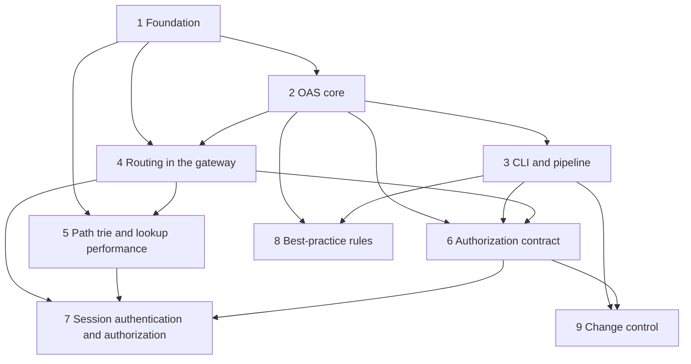

# Specifications

This folder contains the design specifications (specs) of oas-spring-boot-gateway. Each spec describes one small, testable piece of work, and one spec is normally one pull request (PR). Read the specs before you write code, and update a spec when its design changes.

## How to use the specs

1. Find the spec in the [index](#index) below.
2. Check that the specs in "Depends on" are implemented or that their design is stable.
3. Read the whole spec. The "Acceptance criteria" section defines when the work is complete.
4. Implement the spec in one PR, or in the PR slices that the "Delivery" section lists.
5. Change the status of the spec in the same PR.

To write a new spec, copy [`_template.md`](_template.md). Use the next free number and the file name `<NNN>-<slug>.md`.

## Status legend

| Status | Meaning |
|---|---|
| Draft | The design is written but not reviewed. This is the default status. |
| Proposed | The design depends on a decision that is not made yet. Do not implement it. |
| Conditional | Implement the spec only if a condition is true. The spec states the condition. |
| Optional | The feature is not required for the first release. The team can implement it later. |
| Accepted | The design is reviewed and approved. The spec is ready for implementation. (Not used yet.) |
| Implemented | The code is merged and all acceptance criteria pass. |
| Superseded by NNN | Another spec replaces this spec. Do not implement it. Read the spec NNN instead. |
| Superseded by decision | A product decision removes the feature of this spec. A note at the top of the spec explains the decision and links the new behavior. Do not implement it. If code of the spec exists, follow-up PRs remove it. |

## Pull request rules

- One spec is approximately one PR.
- The target size of a PR is fewer than 400 changed lines. Test fixtures and generated files do not count.
- If a spec is larger, its "Delivery" section lists the PR slices. Each slice is one PR.
- Each PR contains its tests.
- If the design changes during implementation, the PR updates the spec.

## Index

"Depends on" lists direct dependencies only.

### Phase 1 — Foundation

| Spec | Status | Depends on | Modules |
|---|---|---|---|
| [001 — Project skeleton](001-project-skeleton.md) | Implemented | None | parent `pom.xml`, `openapi-gateway-core`, `openapi-gateway-cli`, `gateway` |
| [002 — Gateway bootstrap](002-gateway-bootstrap.md) | Implemented | 001 | `gateway` |
| [003 — Upstream HTTP client](003-upstream-http-client.md) | Implemented | 002 | `gateway` |

### Phase 2 — OAS core

| Spec | Status | Depends on | Modules |
|---|---|---|---|
| [004 — OAS loading](004-oas-loading.md) | Implemented | 001 | `openapi-gateway-core` |
| [005 — Validation engine](005-validation-engine.md) | Implemented | 004 | `openapi-gateway-core` |
| [006 — x-gateway extension](006-x-gateway-extension.md) | Implemented | 005 | `openapi-gateway-core` |
| [007 — Route model](007-route-model.md) | Implemented | 005, 006 | `openapi-gateway-core` |

### Phase 3 — CLI and pipeline

| Spec | Status | Depends on | Modules |
|---|---|---|---|
| [008 — CLI basic](008-cli-basic.md) | Implemented | 004, 005 | `openapi-gateway-cli` |
| [009 — CLI GitHub and JSON output](009-cli-github-and-json-output.md) | Implemented | 008 | `openapi-gateway-cli` |
| [010 — CLI SARIF output](010-cli-sarif-output.md) | Implemented | 009 | `openapi-gateway-cli` |
| [011 — PR validation pipeline](011-pr-validation-pipeline.md) | Draft | 001, 009, 010 | `.github/workflows` |
| [012 — CLI distribution](012-cli-distribution.md) | Draft | 008 | `openapi-gateway-cli`, `.github/workflows` |

### Phase 4 — Routing in the gateway

| Spec | Status | Depends on | Modules |
|---|---|---|---|
| [013 — OAS route locator](013-oas-route-locator.md) | Implemented | 002, 003, 007 | `gateway` |
| [014 — Route reload](014-route-reload.md) | Optional | 013 | `gateway` |

### Phase 5 — Path trie and route lookup performance

| Spec | Status | Depends on | Modules |
|---|---|---|---|
| [015 — Path trie](015-path-trie.md) | Implemented | 001 | `openapi-gateway-core` |
| [016 — Routing benchmark](016-routing-benchmark.md) | Draft | 013, 015 | `gateway`, `benchmarks/` (new folder for the k6 script and results) |
| [017 — Indexed route lookup](017-indexed-route-lookup.md) | Implemented | 013, 015, 016 | `gateway` |

### Phase 6 — Authorization contract (core and CLI)

| Spec | Status | Depends on | Modules |
|---|---|---|---|
| [018 — Authorization extension](018-authorization-extension.md) | Implemented | 004, 005, 006, 007 | `openapi-gateway-core` |
| [019 — Permission catalog](019-permission-catalog.md) | Superseded by decision (2026-11-13) | 008, 013, 018 | `openapi-gateway-core`, `openapi-gateway-cli`, `gateway`, `catalog/` |
| [020 — Permission catalog sync](020-permission-catalog-sync.md) | Superseded by 035 | 019, 021 | `.github/workflows/`, `scripts/` (no Java module) |
| [035 — Entra permission validation](035-entra-permission-validation.md) | Superseded by decision (2026-11-13) | 011, 019, 021, 028 | `openapi-gateway-core`, `openapi-gateway-cli`, `.github/workflows`, `gateway`, `infra/` |

The product owner removed the permission catalog on 2026-11-13. See [Removal of the permission catalog (2026-11-13)](#removal-of-the-permission-catalog-2026-11-13). Code PRs 1 and 2 of that section removed the code of 019 and 035.

### Phase 7 — Session authentication and authorization in the gateway

| Spec | Status | Depends on | Modules |
|---|---|---|---|
| [021 — Entra app registrations](021-entra-app-registrations.md) | Draft | None | Documentation, `infra/azure-test/` (Terraform for the test app registrations) |
| [022 — Session login](022-session-login.md) | Implemented | 013, 018, 021 | `gateway` |
| [023 — Per-audience tokens](023-per-audience-tokens.md) | Draft | 021, 022 | `gateway` |
| [024 — Authorization manager](024-authorization-manager.md) | Implemented | 015, 018, 023 | `gateway` |
| [025 — Token relay and header hygiene](025-token-relay-and-header-hygiene.md) | Implemented | 013, 023 | `gateway` |
| [026 — Service-to-service bearer](026-service-to-service-bearer.md) | Proposed | 024 | `gateway` |

Spec 026 is deferred: it is out of scope for phase 7 (decision of 2026-11-13). Specs 022 to 025 record default decisions of 2026-11-13 for their open questions. Spec 023 stays Draft: one acceptance criterion needs a manual check in a test tenant (the user consent case of "Scope form"). Its code is merged, and all its automated criteria pass.

### Phase 8 — Best-practice rules

| Spec | Status | Depends on | Modules |
|---|---|---|---|
| [027 — Rule configuration](027-rule-configuration.md) | Implemented | 005, 008 | `openapi-gateway-core`, `openapi-gateway-cli` |
| [028 — Deviations and baseline](028-suppressions-and-baseline.md) | Implemented | 005, 008, 027 | `openapi-gateway-core`, `openapi-gateway-cli` |
| [029 — Naming rules](029-naming-rules.md) | Implemented | 005, 027 | `openapi-gateway-core` |
| [030 — Design rules](030-design-rules.md) | Implemented | 005, 027 | `openapi-gateway-core`, `openapi-gateway-cli` (rule options) |
| [031 — Documentation rules](031-documentation-rules.md) | Implemented | 005, 027 | `openapi-gateway-core` |
| [032 — CLI rules and explain](032-cli-rules-and-explain.md) | Implemented | 005, 008, 027 | `openapi-gateway-core`, `openapi-gateway-cli` |

### Phase 9 — Change control

| Spec | Status | Depends on | Modules |
|---|---|---|---|
| [033 — Breaking change detection](033-breaking-change-detection.md) | Draft | 011 | `.github/workflows` |
| [034 — Access change review](034-access-change-review.md) | Draft | 007, 008, 009, 011, 018, 033 | `openapi-gateway-core`, `openapi-gateway-cli`, `.github/workflows` |

Spec 033 stays Draft: its workflow is in the repository, but the acceptance criteria about job results need test PRs on GitHub. The check is advisory until a ruleset or a branch protection rule requires `breaking-changes` on `main` ([011](011-pr-validation-pipeline.md), "Advisory checks").

Spec 034 stays Draft for the same reason: the job `access-changes` is in the workflow, but the criteria about the label need a test PR on GitHub. The check is advisory until a ruleset or a branch protection rule requires `access-changes` on `main`.

## Phase dependencies

An arrow from phase A to phase B means that at least one spec in phase B depends on a spec in phase A.



## Removal of the permission catalog (2026-11-13)

The product owner removed the permission catalog on 2026-11-13. The CLI and the gateway no longer compare OAS files with a list of audiences and App Roles. The gateway derives everything from the OAS file: the audience in `x-gateway.audience` is the client id of the backend app. This section records the decision, the new behavior, the losses, the risks and their controls, and the code PRs. Specs [019](019-permission-catalog.md) and [035](035-entra-permission-validation.md) are superseded by this decision. Spec [020](020-permission-catalog-sync.md) stays superseded.

### What is removed

- The catalog file (`catalog/permissions.yaml`, `catalog/permissions.example.yaml`) and its JSON Schema.
- The CLI options `--catalog` and `--entra`, the subcommand `catalog export`, the Microsoft Graph client, and the dependency `com.azure:azure-identity`.
- The rules `audience-known`, `permission-exists`, and `permissions-unused`.
- The gateway property `gateway.security.catalog`.
- The app registration `gateway-oas-validator`, its Terraform, its OpenID Connect (OIDC) setup, and the workflows `entra-catalog.yml` and `entra-drift.yml`.

All other rules stay. This includes the format checks: `x-gateway-schema` checks that `x-gateway.audience` is a lowercase GUID ([006](006-x-gateway-extension.md)), and `permission-format` checks each permission name ([018](018-authorization-extension.md)). Two new CONTRACT rules check the audience: `audience-unique` and `audience-not-first-party` ([018](018-authorization-extension.md), "Rules for audiences").

Status on 2026-11-13:

- The app `gateway-oas-validator` is destroyed, and PR #45 was closed without merge.
- Done (finding QA-48-9): the repository variables `AZURE_CLIENT_ID` and `AZURE_TENANT_ID` and the label `entra-drift` are deleted. The OIDC subject claim template of the repository is reset.
- Code PR 2 of "Delivery of the removal" removed the property `gateway.security.catalog`, the folder `infra/gateway-oas-validator`, and the two workflows. It added the startup stop. It is the first code PR in the stack, because the gateway imported the catalog classes of core.
- Code PR 1 removed the catalog code of 019 and 035 from core and from the CLI, the dependency `com.azure:azure-identity`, and the file `catalog/permissions.example.yaml`. The size of the CLI jar went from 10.4 MB to 6.5 MB.
- Code PR 3 added the CONTRACT rules `audience-unique` and `audience-not-first-party` ([018](018-authorization-extension.md)). The CLI and the gateway startup run them.

### Behavior without the catalog

| Item | Value | Spec |
|---|---|---|
| Audience | `x-gateway.audience`: the client id of the backend app | [006](006-x-gateway-extension.md) |
| Registration id | `entra-{client-id}` | [023](023-per-audience-tokens.md) |
| Token scope | `{client-id}/.default offline_access`. Verified on 2026-11-13; a backend app may use any Application ID URI. | [023](023-per-audience-tokens.md) |
| Token validation | Issuer `https://login.microsoftonline.com/{tenant-id}/v2.0` (exact), `ver` `2.0`, and `tid`, before the gateway stores the token | [023](023-per-audience-tokens.md) |
| `aud` check | The token `aud` equals the client id. | [024](024-authorization-manager.md) |
| Permission check | The `roles` claim of the audience token satisfies the access rule. | [024](024-authorization-manager.md) |
| Limits of the audiences | The Entra admin consent of `gateway-bff` for each backend app, `audience-unique`, `audience-not-first-party`, and the startup check for the client id of `gateway-bff`. The admin consent alone is not a complete allowlist. | [021](021-entra-app-registrations.md), [018](018-authorization-extension.md), [023](023-per-audience-tokens.md) |

The team verified the scope form `{client-id}/.default` with [`infra/azure-test`](../infra/azure-test/README.md) on 2026-11-13 ([023](023-per-audience-tokens.md), "Scope form"). It works also for a backend app whose Application ID URI is not `api://{client-id}`. Plan B (`api://{client-id}/.default`) failed for such an app and is removed.

### What the team loses

- A typo in a permission is not found in the PR. The CLI checks only the format. Example: `all-of: [Orders.Raed]` passes the `validate` check. At runtime the check fails closed: no user has the role, so every request to that operation gets `403` ([024](024-authorization-manager.md)).
- A typo in an audience is not found in the PR. The CLI checks only the GUID format, the uniqueness, and the first-party list. At runtime the token request fails closed: a consent error gives `403`, and another token endpoint error gives `500` ([023](023-per-audience-tokens.md), "Admin consent limits the audiences").
- No warning reports an App Role that no OAS file uses.

### Risk: the audience of one backend with another upstream

An OAS file declares an audience and an `upstream`. Upstream hosts are not restricted (decision of 2026-11-12, [006](006-x-gateway-extension.md)). The gateway relays the token of the audience to the `upstream` of the same file ([025](025-token-relay-and-header-hygiene.md)). The catalog did not control this risk either: it checked that an audience exists, not where its tokens go.

Example: a second file declares the audience of `payments-api` and the upstream `http://reporting-service:8080`. The gateway gets a `payments-api` token for each user and sends it to `reporting-service`. That service can then call `payments-api` as the user.

Controls (decision of 2026-11-13, team default after the review of PR #48, finding SEC-48-1):

| Control | Effect | Spec |
|---|---|---|
| CONTRACT rule `audience-unique` | An audience appears in exactly one OAS file. The example above fails in the CLI, at gateway startup, and on reload. | [018](018-authorization-extension.md) |
| Audience bindings in `diff` | `diff` lists each new or changed pair of audience and `upstream` in the PR, and in the job summary. | [034](034-access-change-review.md) |
| PR review | The reviewer checks that each listed `upstream` is the backend of its audience. | [021](021-entra-app-registrations.md), onboarding step 12 |

A change of `upstream` in the existing file of an audience passes `audience-unique`. It is visible in the `diff` output and needs review. The repository has no `CODEOWNERS` file (decision of 2026-11-12), so one approval of any person with write access is enough ([034](034-access-change-review.md)). See open question 1.

### Risk: tokens for apps outside the backends

The admin consent of `gateway-bff` limits the audiences, but it is not a complete allowlist (finding SEC-48-2). The gateway can also get tokens for Microsoft first-party apps (for example Microsoft Graph), for `gateway-bff` itself, and for apps with user consent, a pre-authorization, or another publisher. [021](021-entra-app-registrations.md) ("Limits of the admin consent") lists each case and its control:

- The CONTRACT rule `audience-not-first-party` rejects the app ids of seven well-known Microsoft first-party apps, for example Microsoft Graph (`00000003-0000-0000-c000-000000000000`). [018](018-authorization-extension.md) lists them. The CLI and the gateway run it.
- The gateway does not start, and a reload does not apply, if an audience is the client id of `gateway-bff` ([023](023-per-audience-tokens.md)).
- Each `access_as_user` scope has the type `Admin`. The tenant SHOULD NOT allow user consent ([021](021-entra-app-registrations.md)).
- The gateway team audits the grants and the pre-authorizations of `gateway-bff` at a regular interval ([021](021-entra-app-registrations.md), "Grant audit").

### Startup stop for protected operations

Decision (2026-11-13, team default after the review of PR #48, findings QA-48-1, QA-48-2, QA-48-3, and SEC-48-4). Until PR 2 of [024](024-authorization-manager.md) is merged, the gateway has no `aud` check and no permission check. The gateway therefore does not start, and a reload does not apply, when an OAS file has a protected operation. [024](024-authorization-manager.md) ("Startup stop until the authorization manager is active") owns the design.

- The stop applies unless the application context has a bean of the marker interface `AudienceAuthorizationActive`.
- PR 2 of [024](024-authorization-manager.md) registers the production bean. No production code registers it before.
- Tests of [022](022-session-login.md) and [023](023-per-audience-tokens.md) register a test implementation from `gateway/src/test/java`.
- No configuration property registers the bean or turns off the stop.
- A reload ([014](014-route-reload.md)) applies the same check.

Exact message:

```text
<METHOD> <public path pattern> is a protected operation, but the authorization manager (spec 024) is not active.
```

Acceptance criteria (code PR 2 of the removal):

- [x] Without the bean, an OAS file with the protected operation `GET /orders` stops the startup with exactly `GET /orders is a protected operation, but the authorization manager (spec 024) is not active.`
- [x] With a test bean, the same OAS file starts the gateway.
- [x] `OpenApiRoutingStartupTest.protectedOperationsNeedTheCatalog` is renamed `protectedOperationsNeedTheAuthorizationManager` and checks the new message.
- [x] The gateway has no property that turns off the stop.

The criteria for the reload are in [014](014-route-reload.md).

### Delivery of the removal

Three code PRs. Each other code change of this section belongs to the spec PR named in the last list.

1. Remove the catalog from core and from the CLI:
   - The rules `audience-known`, `permission-exists`, and `permissions-unused`, and their fixtures.
   - The package `com.johnowl.gateway.core.catalog` (`PermissionCatalog`, `PermissionCatalogLoader`, and the other classes), the schema `permission-catalog.schema.json`, and the methods `BuiltInRules.all(PermissionCatalog)` and `BuiltInRules.contract(PermissionCatalog)`.
   - The options `--catalog` and `--entra` (validation and `baseline create`), the subcommand `catalog export` (`CatalogCommand`, `CatalogFileWriter`), the catalog sources (`CatalogSource`, `CatalogSourceFactory`, `DefaultCatalogSourceFactory`, `FileCatalogSource`, `EntraCatalogSource`, `CatalogSourceException`), the Graph client (`GraphClient`), `AudienceReport`, `AudienceLookup`, and `OasAudiences`.
   - The `ValidateCommand` constructor with a `CatalogSourceFactory` and an environment lookup. If `diff` of [034](034-access-change-review.md) needs an environment lookup for the job summary, `diff` adds its own.
   - The check `--catalog or --entra is required` in `ValidationRun` (finding QA-48-4) and `EffectiveSecurity.firstProtectedOperation`, which only this check uses. The class `EffectiveSecurity` stays, because the rules of [018](018-authorization-extension.md) use it. The gateway stop uses `ValidationReport.accessRules()`. Criterion in [008](008-cli-basic.md): a file with a protected operation and no other violation returns 0.
   - The dependency `com.azure:azure-identity` in `openapi-gateway-cli/pom.xml`, and the property `azure-identity.version` and its `dependencyManagement` entry in the parent `pom.xml`.
   - `CliJarIT`: the assertion that the jar contains `com/azure/identity/` classes becomes an assertion that the jar contains no `com/azure/` classes. The jar check of [008](008-cli-basic.md) bans `reactor/` classes again.
   - Test data (finding QA-48-7): the deviation fixtures that use `permissions-unused` (`openapi-gateway-core/src/test/resources/rules/deviation-unused/`, `rules/deviation-schema/`, and `openapi-gateway-cli/src/test/resources/cli-deviation-catalog-rule/`) use another configurable rule instead, for example `path-no-verbs`. Do not delete them. `ProfileTableTest`, `BuiltInRulesTest`, and `openapi-gateway-cli/src/test/resources/cli-config/unused-off.yaml` no longer use `permissions-unused`.
   - The file `catalog/permissions.example.yaml`, and the `--catalog` argument and the `catalog/**` path in `.github/workflows/openapi.yml` ([011](011-pr-validation-pipeline.md)).
2. Remove `gateway.security.catalog` from the gateway, and add the startup stop:
   - `GatewaySecurityProperties`, and the catalog loading (`loadCatalog`) in `OpenApiRoutingConfiguration`.
   - In `OpenApiRouteDefinitionLocator`, the check `gateway.security.catalog is required, ...` becomes the startup stop of "Startup stop for protected operations", with the marker interface `AudienceAuthorizationActive`.
   - `OpenApiRoutingStartupTest`: `protectedOperationsNeedTheCatalog` checks the new message (renamed `protectedOperationsNeedTheAuthorizationManager`). The catalog tests are removed. A new test starts with a test bean.
   - The folder `infra/gateway-oas-validator` and the workflows `entra-catalog.yml` and `entra-drift.yml`. All three are on `main` on 2026-11-13.
3. Add the CONTRACT rules `audience-unique` and `audience-not-first-party` ([018](018-authorization-extension.md)): the rules, the class `FirstPartyApps`, the registration in `BuiltInRules.contract()`, and fixtures. The CLI, the gateway startup, and the reload then run them without other changes.

Order and merge rules:

- The gateway on `main` imports `PermissionCatalog` and `PermissionCatalogLoader`. PR 1 therefore cannot remove these classes before PR 2 merges, unless PR 1 also changes the gateway. The implementer chooses the order, for example stacked PRs.
- PR 3 does not depend on PR 1 or PR 2. It can be based on `main` or stacked on PR 1.
- No deployment of `main` happens before PR 2 merges (SEC-48-4).
- PR 3 MUST merge before PR 2 of [024](024-authorization-manager.md), which ends the startup stop in production.

Other code changes of the review of PR #48, in the PRs of their specs:

| Change | PR |
|---|---|
| Startup check for the client id of `gateway-bff`; token validation before storage; new test backends in `infra/azure-test` | PR 1 of [023](023-per-audience-tokens.md) |
| Deny reason `INVALID_AUDIENCE_TOKEN`; production bean of `AudienceAuthorizationActive` | PR 2 of [024](024-authorization-manager.md) |
| Audience bindings in `diff` and in the job summary | PR 1 of [034](034-access-change-review.md) |
| Reload checks (startup stop, client id of `gateway-bff`) | The PR of [014](014-route-reload.md) |

### Decisions (2026-11-13)

Defaults chosen by the team after the review of PR #48 (QA-48, SEC-48). The team can change each of them later:

- Startup stop (QA-48-1, QA-48-2, QA-48-3, SEC-48-4): see "Startup stop for protected operations".
- `audience-unique` (SEC-48-1): a new CONTRACT rule. `diff` lists the audience bindings. A change of `upstream` in the existing file of an audience is visible in the `diff` output and needs review.
- First-party apps and `gateway-bff` (SEC-48-2): the CONTRACT rule `audience-not-first-party`, the startup check for the client id of `gateway-bff`, the scope type `Admin`, and the grant audit.
- Issuer pin (SEC-48-3): the decoder accepts only the version 2 issuer of the tenant and checks `ver` and `tid`. A failure gives `INVALID_AUDIENCE_TOKEN` (`500`).
- Roles only (SEC-48-5): see [021](021-entra-app-registrations.md). Plan B ownership (SEC-48-6) is superseded: plan B is removed (2026-11-13, [023](023-per-audience-tokens.md), "Scope form").
- CLI and test data (QA-48-4, QA-48-7): see "Delivery of the removal".
- Test backends and error statuses (QA-48-5, QA-48-6, QA-48-8): see [023](023-per-audience-tokens.md).

### Open questions about the removal

1. Does the team want a `CODEOWNERS` file, so that a new or changed audience binding needs a review by the gateway team? The decision of 2026-11-12 keeps `CODEOWNERS` off. Today one approval of any person with write access is enough.
2. ~~Should a `binding-changed` entry of `diff` fail the job without a label ([034](034-access-change-review.md))?~~ Answered on 2026-11-15: yes. `binding-new` and `binding-changed` return 1, so the job needs the label `access-change-approved`.
3. Which other Microsoft first-party apps does `audience-not-first-party` list ([018](018-authorization-extension.md))?
4. What is the interval of the grant audit, and who owns it ([021](021-entra-app-registrations.md))?

## Glossary

| Term | Definition |
|---|---|
| Access rule | The precompiled authorization requirement of one operation: public flag, audience, `all-of` set, and `any-of` set. In code: `AccessRule`. |
| App Role | A role that a Microsoft Entra ID app registration defines. Entra puts the assigned App Roles of a user in the `roles` claim of the access token. |
| Audience | The backend API that a token is for. Its value is the client id (GUID) of the backend Entra app registration, declared in `x-gateway.audience`. The gateway derives the client registration, the token scope, and the `aud` check from this value ([023](023-per-audience-tokens.md)). |
| Audience binding | The pair of `x-gateway.audience` and `x-gateway.upstream` of one OAS file. The gateway sends the token of the audience to that upstream. `diff` lists new and changed bindings ([034](034-access-change-review.md)). |
| Backend for Frontend (BFF) | A pattern in which the server keeps the tokens and the browser receives only a session cookie. |
| Best-practice rule | A validation rule about API quality, for example naming, design, or documentation. Only the CLI runs it. Teams can configure its severity, or accept a deviation with a reason (`x-deviation`). Example: `operation-id-camel-case`. |
| Contract rule | A validation rule that protects the gateway, for example a valid `x-gateway` object or a declared access rule. It is always an error. It cannot be disabled, and no deviation can cover it. Category `CONTRACT`. The gateway runs only these rules at startup; the CLI runs them too. |
| OAS file | One OpenAPI Specification (OAS) document (YAML or JSON) that describes one backend API and its `x-gateway` extensions. |
| Operation | One HTTP method on one path in an OAS file, for example `GET /orders/{id}`. |
| Path trie | A tree of path segments that finds the entry for a request path. Its cost depends on the number of segments, not on the number of routes. In code: `PathTrie<T>`. |
| Permission | The name of an App Role of an audience, for example `Orders.Read`. Access rules list permissions. |
| Permission catalog | Removed (decision of 2026-11-13). It was the list of each audience and its App Roles (`PermissionCatalog`, specs [019](019-permission-catalog.md) and [035](035-entra-permission-validation.md)). The CLI and the gateway do not use a catalog. |
| Route | The gateway entry that forwards matching requests to a backend. The gateway generates routes from OAS files. In core: `GatewayRoute`. |
| Violation | One problem that a rule finds: severity, rule id, file, JSON pointer, and message. In code: `Violation`. |
